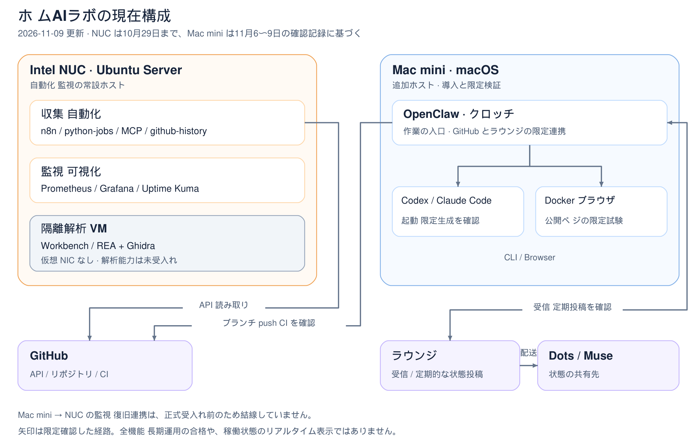

# Home AI Engineering Lab

[English](README.md) | **日本語**

GitHub の作業を自動化し、監視基盤やインフラ、セキュリティ解析を試すためのホームラボです。Intel NUC 上の Ubuntu Server で Docker Compose のサービスを動かし、別の QEMU/KVM ゲストにオフラインの解析環境を設けています。追加した Mac mini では OpenClaw（クロッチ）と開発用 CLI・ブラウザ連携の限定試験を進めています。従来記録の NUC 自動化基盤では LLM や有料 LLM API を使っていません。この記述は新しい Mac mini の連携全体を指すものではありません。

## 2026-11-09 の更新

[クロッチの改善記録](docs/kurotchi-improvements-2026-11-09.ja.md)に、確認済みの GitHub ブランチ push・CI、ラウンジ受信と定期配送の修復、進行中のマージ承認・自然文での状態共有を整理しました。正式な運用受入れは引き続き未完了です。

## 2026-11-06 の更新

Mac mini 上の OpenClaw／クロッチは導入・限定試験まで進みました。[導入の工夫・検証結果・未完了事項](docs/openclaw-status-2026-11-06.ja.md) に、Docker ブラウザ、開発用 CLI、ラウンジの確認範囲を記録しています。三者自動往復と正式な運用受入れは未完了です。この節は11月6日時点の記録です。以下の全体図は別途11月9日に更新し、NUC の観測結果は従来の基準日を維持しています。

## 構成図

2026-11-09 に、Intel NUC と Mac mini の2台を並べた全体図へ更新しました。NUC は10月29日までの構成記録、Mac mini は11月6〜9日の導入・限定試験に基づきます。

大きく見る：[PNG](assets/architecture.ja.png) · [拡大・編集できる SVG](assets/architecture.ja.svg)

- **NUC：** 収集・自動化、監視・可視化、仮想 NIC のない隔離解析 VM を担当。
- **Mac mini：** OpenClaw（クロッチ）、Codex／Claude Code CLI、専用 Docker ブラウザを配置。CLI の限定生成と公開ページのブラウザ試験を確認。
- **外部との連携：** GitHub のブランチ push・CI と、ラウンジ受信・定期投稿の限定経路を確認。自然文での状態共有とマージ承認は検証継続中。

Mac mini から NUC を監視・復旧する運用は正式受入れ前のため、図に接続線を引いていません。手元の PC からの SSH・管理画面へのトンネルは、読みやすさのため図から省略しています。接続手順は[運用手順書](docs/ops-runbook.md)と[Mac mini の初期構築記録](docs/mac-mini-kitting-record-2026-11.md)を参照してください。

NUC の Open WebUI は従来の停止・データ保持状態、AdGuard Home は試行枠として全体図から省略しています。Workbench と REA の相互連携は未実装です。コンテナの起動や限定試験は、全機能・長期運用の合格を意味しません。[VM の記録](docs/security-analysis-vm.md)と[過去の構成メモ](docs/architecture.md)は、それぞれの観測日の資料として残しています。

## 各コンポーネントの役割

| 場所 | コンポーネント | 役割と確認範囲 |
|---|---|---|
| Compose | n8n 2.44.7 | GitHub 日次レポートなどのワークフローを実行。手動実行は確認済み、定期実行は未確認。 |
| Compose | python-jobs | GitHub API から情報を収集し、レポートとスナップショットを保存。稼働中のイメージと現在のソースの対応は未確認。 |
| Compose | mcp-server | 保存済みレポートを認証付き・読み取り専用で提供。n8n からの読み取りは確認済み。イメージと現在のソースの対応は未確認。 |
| Compose | github-history | 保存済みの GitHub 履歴を提供。稼働中のコンテナはソースを読み取り専用でマウント。ダッシュボードとの連携は未確認。 |
| Compose | Prometheus 3.15.1、node_exporter 1.12.1 | メトリクスを公開・収集。Prometheus の準備完了と3つの収集先を確認済み。 |
| Compose | Grafana 12.4.14 | メトリクスを問い合わせ、可視化。API でデータベースの正常応答を確認済み。ブラウザでの表示は未確認。 |
| Compose | Uptime Kuma 2.5.6 | サービスの死活を監視。通知配送と収集ジョブの Push は未確認または未設定。 |
| Compose | Open WebUI | チャット画面。データを保持して意図的に停止中。 |
| KVM ゲスト | Workbench MCP、REA、Ghidra | オフラインでのセキュリティ解析実験。VM の基本操作は条件付き受入れ済み。REA → Ghidra の解析能力は未受入れ。現在のバージョンは再確認していません。 |
| Mac mini | OpenClaw（クロッチ） | 導入と限定的な作業連携を確認。ラボ運用全体の正式受入れは未完了。 |
| Mac mini | Codex CLI、Claude Code CLI | 起動と限定生成を確認。任意の開発タスクの完遂を保証するものではありません。 |
| Mac mini | 専用 Docker ブラウザ | 公開ページの限定試験を確認。任意サイトや認証状態の分離は未受入れ。 |
| 外部連携 | ラウンジ、Dots、Muse | 受信・定期的な状態投稿と両宛先への配送を確認。自然文の送信と継続運用は検証中。 |

自作の jobs と MCP は、一部のソースが公開版と異なります。稼働中イメージがどちらのソースに対応するかは未確認です。更新前に差分を確認し、ローカルの変更を保全します。監視集約やアラート・プローブの候補は未配置です。Ansible の資料には実機に適用済みの変更と未配置の候補が混在しています。

## 運用と資料

- 実機の確認状況と残課題は [構成状況](docs/configuration-status.md)、[監視案](docs/prometheus-alerts-candidate.md)、[自作 OSS 更新候補](docs/custom-oss-update-candidate.md) を参照。
- ホストへは SSH で接続し、ループバック限定の管理画面は SSH トンネルから開きます。[運用手順書](docs/ops-runbook.md)
- レポートの生成・参照は [GitHub 監視](docs/github-monitoring.md) と [MCP](docs/mcp-internal-api.md) を参照。手動実行の成功は定期実行の証明にはなりません。
- メトリクスと死活監視は [プレイグラウンド](docs/playground.md) と [監視・通知](docs/monitoring-notifications.md) を参照。
- [バックアップ・復元](docs/backup-restore.md) はローカルの暗号化バックアップと復元を試験済み。別の機器へのコピーは未整備で、observability のボリュームは既存バックアップの対象外です。
- 構築方法や過去の記録は [ドキュメント索引](docs/README.md) にあります。定義やスクリプトは [`stacks/`](stacks/)、[`scripts/`](scripts/)、試験は [`tests/`](tests/) にあります。

## リポジトリの歩き方

| パス | 内容 |
|---|---|
| `docs/` | ガイド・手順書・設計記録。[ドキュメント索引](docs/README.md) から辿れます。 |
| `stacks/` | Docker Compose の定義群：`observability/`、`n8n/`、`mcp/`、`uptime-kuma/`、`open-webui/`、`network-dns/`、`kubernetes/`、`openclaw-smoke/`。 |
| `scripts/` | ホストで動かす運用・バックアップ・収集スクリプト。 |
| `ansible/` | 読み取り専用のベースラインとサービス適用プレイブック（適用済みと未配置の候補が混在。README 参照）。 |
| `tests/` | スクリプトと収集処理の検証テスト。 |
| `schemas/` | セキュリティ解析イベントの JSON スキーマ。 |
| `experiments/` | 試行コード。稼働サービスとは分離しています。 |
| `assets/` | README からリンクするフルサイズの構成図画像。 |

## 今後の展望

2026-11-01の [Phase 4後のOpenClaw運用設計](docs/home-ai-lab-openclaw-operations.ja.md) では、Ubuntuと追加したMac miniの運用をOpenClaw、構築・改修をドッチーが担当します。本人のPhase 4と初期引継ぎを開始条件とした当時の設計です。その後の導入・改善は上記11月6日・9日の記録を参照してください。正式な運用受入れは未完了です。[購入前のMac mini計画](docs/mac-mini-local-ai-plan.ja.md) はM4・16 GB・256 GBという当時の想定を残した資料で、現在の実機台帳ではありません。設計の承認は導入・新規通信・停止中ジョブの再開許可ではなく、既存の隔離したセキュリティゲストも分離を維持します。

ライセンス：未指定。
