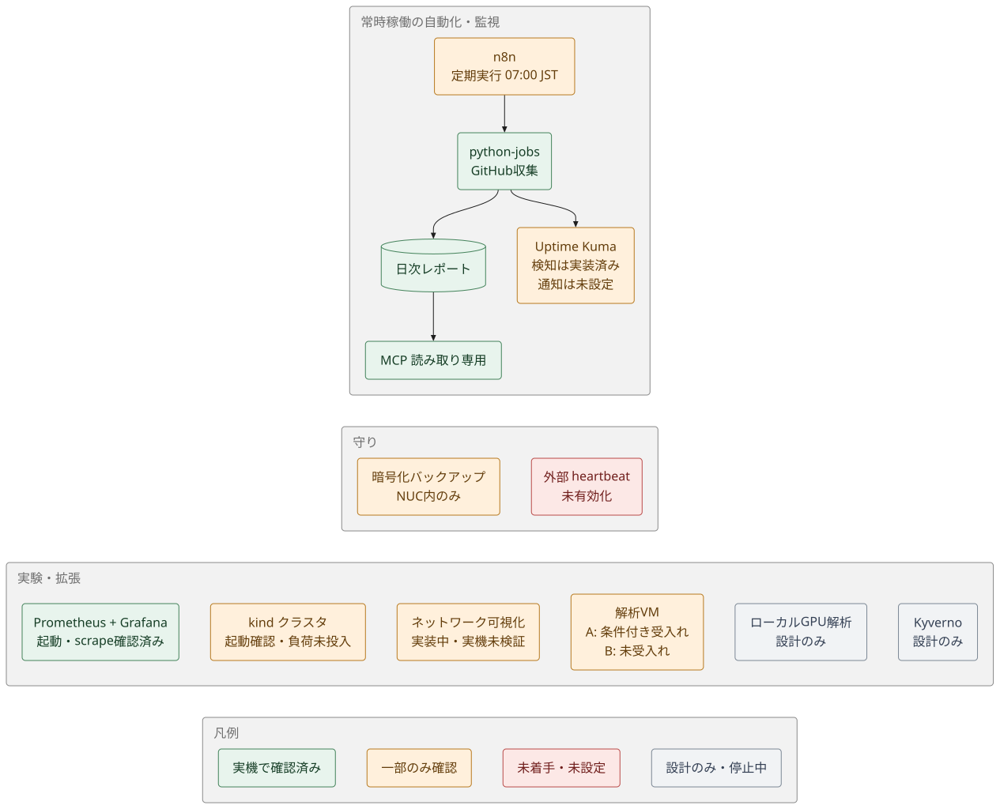
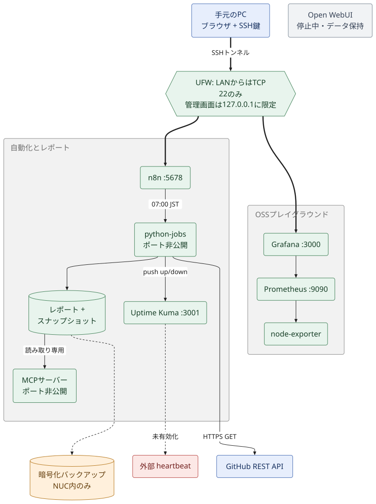

# Home AI Engineering Lab

[English](README.md) | **日本語**

自宅の Intel NUC で、GitHub の開発支援を自動化し、監視と OSS の実験を行うラボです。常設基盤は Ubuntu Server と Docker Compose で構成し、別の QEMU/KVM ゲストにオフラインのセキュリティ解析環境を用意しています。

常設の自動化基盤では LLM を動かさず、有料 LLM API も使いません。Open WebUI はデータを保持して意図的に停止中です。追加の有料サービスは導入していません（電気代・既存のサブスクリプション料金は除きます）。

**入口：** [全体の状態](#全体の状態) · [できていること](#できていること) · [ロードマップ](#ロードマップ) · [構成](#構成) · [使い方](#使い方) · [構築・開発](#構築開発) · [ドキュメント索引](docs/README.md)

## 全体の状態

リポジトリのコードと検証記録に基づく、**2026-10-23 JST 時点**の整理です。今回、NUC の稼働状況を再確認してはいません。「実装済み」は「NUC で確認済み」を意味しません（実装・実機への反映・受入れは別のマイルストーンです）。



## できていること

実機で確認し、ドキュメントに記録しているものです。

- **GitHub 日次レポート。** n8n → `python-jobs` → Markdown/JSON を保存。n8n 画面からの手動実行は成功（109 リポジトリ）。GitHub トークンなしでは API の予算が小さいため、結果は `PARTIAL`（部分的）と明記されます。[詳細](docs/github-monitoring.md)
- **読み取り専用 MCP。** 認証・監査つきの MCP サーバー経由で、n8n から保存済みレポートの一覧取得と読み取りができます。[詳細](docs/mcp-internal-api.md)
- **監視。** Uptime Kuma が SSH・n8n・MCP・収集ジョブを監視し、停止を検知できます。[詳細](docs/monitoring-notifications.md)
- **バックアップと復元。** 手動の暗号化バックアップと復元試験に合格。バックアップ後も Open WebUI は停止のままです。[詳細](docs/backup-restore.md)
- **ネットワークの公開範囲。** LAN から開いているのは TCP 22 のみ（1,051 ポートのスキャンで他は開放なし）。管理画面はすべて `127.0.0.1` 限定で、SSH トンネルから使います。[詳細](docs/security-operations.md)
- **OSS プレイグラウンド。** Prometheus・Grafana・node-exporter が稼働し、収集対象 3 件がすべて `up`。Grafana から Prometheus へのクエリも成功。2 ノードの kind クラスタも起動し、両ノードが `Ready` です。[詳細](docs/playground.md)
- **解析 VM のスコープ A。** 仮想 NIC なしのゲスト、読み取り専用 ISO での搬入、Workbench の基本操作は、条件付きでオーナーが受入れ済みです。[詳細](docs/security-analysis-vm.md)

## 実装はあるが、未検証または未有効のもの

コードや設計はありますが、実機での証拠がありません。

| 項目 | 足りないもの |
|---|---|
| 07:00 JST の定期実行 | 初回の定期実行は未観測で、実機での原因も未確定。ソース修正（公開失敗の検知・鮮度検査）は **NUC に未反映**。[GitHub monitoring §11](docs/github-monitoring.md#11-scheduled-run-investigation-task-122-2026-10-18) の調査手順を参照。 |
| 前日の活動集計 | PR の作成・マージ・close、Issue の件数は実装済みですが、確認は偽 API の自動テストのみ。push イベント数・コミット数は未実装。 |
| Actions 失敗の検知 | 偽 API のテストでのみ確認。実際の失敗はまだ観測していません。 |
| 通知の配送 | 検知はできますが、Kuma の通知チャネルと push トークンが未設定。外部 heartbeat も未有効化。 |
| 自動バックアップ | timer の初回自動実行は未観測。 |
| MCP の互換性 | 公式クライアント／Inspector との互換性、実機での異常系試験は未確認。 |
| プレイグラウンド | ブラウザでの Grafana ダッシュボード表示、kind 上のワークロードは未実施。 |
| [ネットワーク可視化](docs/network-visibility.md) | Phase 1・2 はリポジトリ内に実装済み（数値・手動台帳・ダッシュボード定義・DNS 試験の雛形）。実機への適用と表示は未検証。 |
| 解析 VM のスコープ B | REA → Ghidra の解析能力は**未受入れ**。元の `FAIL` / `REPORT=UNVERIFIED` を保持。 |
| [ローカル GPU 解析](docs/local-gpu-security-analysis-design.md) | Phase 1 の停止中の設計と、合成データでのオフライン試験のみ。デプロイも GPU ベンチマークも未実施。 |

## まだできていないこと

- **NUC 外バックアップ。** バックアップは NUC の中だけにあり、保存先は未決定です（[選択肢](docs/offsite-backup-options.md)）。observability のボリュームは暗号化バックアップの対象外です。
- **トークンを使う機能。** 非公開リポジトリ・Dependabot・大きな API 予算は、読み取り専用の GitHub トークンが必要です（未検証）。
- **Workbench ↔ REA の連携**（TASK-113）と、実スキャナーの実行。
- **Kyverno**（[設計のみ](docs/playground-kyverno-design.md)）、IDS・遮断（ネットワーク可視化の Phase 3・4）。
- **実際の LLM API への接続。** Open WebUI とあわせて保留中です。

## ロードマップ

ドキュメントに記録された残課題を順に並べたものです。優先順位と承認は、オーナーが決めます。

| 時期 | 項目 | 理由・依存関係 |
|---|---|---|
| **今すぐ** | 07:00 JST の実行を確認し、ソース修正を NUC に反映 | 日次レポートを信頼できる状態にするため。本番変更なので承認が必要。 |
| **今すぐ** | Kuma の通知チャネルを追加し、push URL を登録 | 検知を「実際に届く通知」にするため。認証情報が必要。 |
| **今すぐ** | NUC 外バックアップの保存先を決める | 今はディスクが壊れると全バックアップが失われる。 |
| 次 | 外部 heartbeat の有効化。必要なら読み取り専用 GitHub トークン | NUC 自体の停止を検知する。レポートの網羅性を広げる。 |
| 次 | ネットワーク可視化の Phase 1・2 を適用し、ブラウザ表示の証拠を取る | NIC や DNS の変更には承認が必要。 |
| 次 | プレイグラウンド：Grafana ダッシュボード作成、kind でワークロード実行、ボリュームのバックアップ追加 | 「起動する」を「使っている」に進める。 |
| 後 | kind 上の Kyverno | 設計済み。1 ステップ 1 PR で進める。 |
| 後 | ローカル GPU 解析：ベンチマーク → デプロイ判定ゲート | 先に実測が必要。 |
| 後 | VM スコープ B の受入れ、Workbench ↔ REA の連携 | 別スコープ。スコープ A の受入れからは自動で進まない。 |
| 後 | webhook による正確な push・コミット数 | 外部からの受信口が必要で、現状は対象外。 |

## 構成



| 層 | 構成と境界 |
|---|---|
| アクセス | 手元の PC → SSH 鍵認証 → NUC。管理画面はループバック限定で SSH トンネルから利用。インターネットへの画面公開・ルーターのポート開放なし。 |
| 自動化 | n8n が内部の `python-jobs` を呼び、GitHub API を読み取り、レポートとスナップショットを保存。 |
| レポート参照 | n8n または互換性のあるクライアントから、内部の読み取り専用 MCP サーバーを利用。 |
| 可観測性 | Uptime Kuma がサービスを監視。Prometheus／node_exporter の数値を Grafana で参照。ネットワーク可視化の追加部分は実機適用未検証。 |
| 復旧 | `age` で暗号化したローカルバックアップ。NUC 外の保存先は未決定。 |
| 解析 | 仮想 NIC なしの独立 QEMU/KVM ゲスト。Workbench と REA は別個の MCP サーバーで、相互連携は未実施。 |

ほかの図：[データの流れ・ネットワーク・バックアップ](docs/architecture.md) · [VM の構成図と受入れ範囲](docs/security-analysis-vm.md)。図はすべて [Pele](https://pele.run/) で生成した SVG です。[再生成の方法](docs/assets/diagrams/README.md)。

## 使い方

手元の PC から、ご自身のアカウントと NUC のアドレスで SSH トンネルを張ります。実際の LAN アドレスは公開リポジトリに記載しません。

```bash
ssh -N -L 3001:127.0.0.1:3001 -L 5678:127.0.0.1:5678 -L 9090:127.0.0.1:9090 -L 3000:127.0.0.1:3000 <user>@<nuc-address>
```

| 画面 | PC から開く URL | 操作ガイド |
|---|---|---|
| Uptime Kuma | <http://localhost:3001> | [通知・外部 heartbeat](docs/monitoring-notifications.md) |
| n8n | <http://localhost:5678> | [GitHub レポートの運用](docs/github-monitoring.md) |
| Prometheus | <http://localhost:9090> | [Prometheus の記録](docs/playground/prometheus.md) |
| Grafana | <http://localhost:3000> | [Grafana の記録](docs/playground/grafana.md) |

- **レポート生成：** n8n → `GitHub daily report (read-only)` → Execute。無認証 API の予算により部分的な結果になる場合があります。同日のより充実したレポートを、不完全な結果で上書きしない保護があります。
- **レポート参照：** n8n → `MCP read-only test`、または MCP の `read_report` で `github-daily-latest.md` を読む。[合成データのサンプル](docs/samples/github-daily-sample.md)。
- **定期実行されない場合：** [GitHub monitoring §11](docs/github-monitoring.md#11-scheduled-run-investigation-task-122-2026-10-18) の読み取り専用の調査手順を使う。状態確認のために deploy スクリプトを実行しない。
- **停止・再開・更新・復旧：** [運用手順書](docs/ops-runbook.md) を参照。

## 構築・開発

1. **ホストを再構築する：** [物理セットアップ](docs/physical-setup-guide.md) → [実装計画とフェーズ別の結果](docs/implementation-plan.md)。再構築用の記録であり、一括インストーラーではありません。
2. **機能を変更する：** `stacks/` の定義、`scripts/` の処理、対応する [テーマ別ガイド](docs/README.md) を確認。
3. **ローカルで検証する：** リポジトリのルートで関連するオフライン試験と秘密情報検査を実行。実機への反映・受入れ確認とは区別します。

```bash
python3 -m unittest discover -s tests -p '*_test.py'
python3 tests/mcp_selftest.py
bash scripts/scan-secrets.sh
```

構築・運用スクリプトはホストを変更するものがあります。NUC で実行する前に対応する手順書を確認してください。初期スタックと後から追加したプレイグラウンドでは配置先が異なります。[運用手順書](docs/ops-runbook.md)・[プレイグラウンド構築](docs/playground.md) を参照。

| パス | 内容 |
|---|---|
| [`stacks/`](stacks/) | Compose、ワークフロー、Python 収集、MCP、監視基盤、kind の定義 |
| [`scripts/`](scripts/) | 構築・運用・バックアップ・heartbeat・ネットワーク集計・秘密情報検査 |
| [`tests/`](tests/) | 収集・鮮度検査・MCP・ネットワーク可視化・ログパイプラインのオフライン試験 |
| [`docs/`](docs/README.md) | 設計・テーマ別手順書・サンプル・進捗・構成図・過去の記録 |

## 境界

- SSH 鍵認証、ループバック限定の管理画面、読み取り専用の収集を維持する。秘密情報・実際の LAN アドレス・MAC・シリアルをコミットしない。[セキュリティ運用](docs/security-operations.md) を参照。
- ネットワーク可視化と VM の未検証・未受入れを明示する。コードや限定的な出力だけで、実機の機能完成とは扱わない。
- 外部への書き込み・資格情報・有料サービス・ネットワーク変更は、各資料に記載した承認範囲に従う。

ライセンス：未指定。
