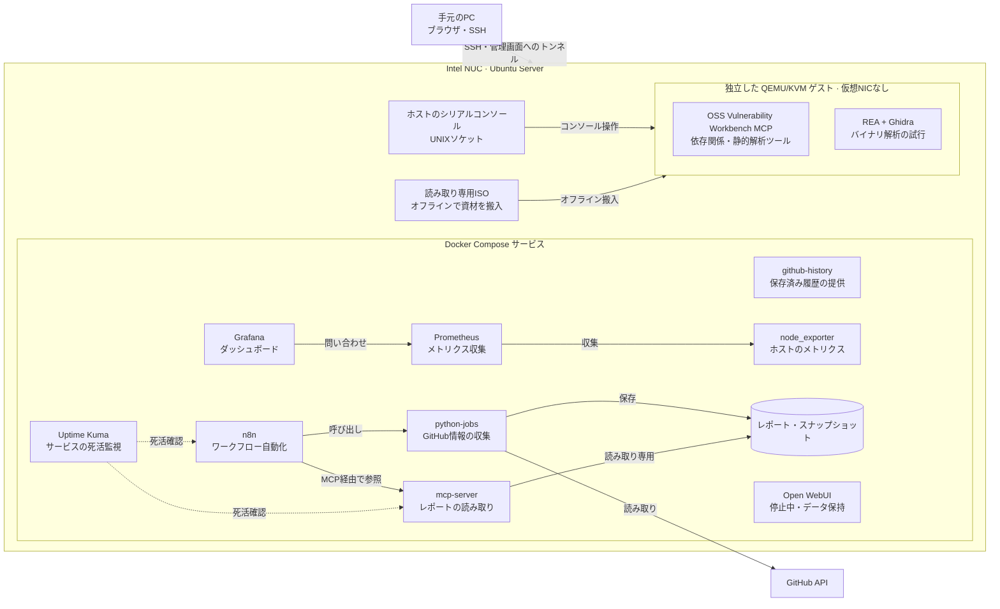

# Home AI Engineering Lab

[English](README.md) | **日本語**

GitHub の作業を自動化し、監視基盤やインフラ、セキュリティ解析を試すためのホームラボです。Intel NUC 上の Ubuntu Server で Docker Compose のサービスを動かし、別の QEMU/KVM ゲストにオフラインの解析環境を設けています。現在の自動化基盤では LLM や有料 LLM API を使っていません。

## 構成図

2026年10月29日までの構成記録と稼働確認をまとめています。コンテナが稼働していることは、すべてのワークフローや連携が動くことを意味しません。ゲストのコンソール用ソケットは確認済みですが、ゲストの現在の稼働状態とツールのバージョンは再確認していません。

Workbench と REA は独立したツールで、相互連携は未実装です。ゲストには仮想 NIC がないため、ゲストへの SSH 接続は図に含めていません。詳しくは [VM の記録](docs/security-analysis-vm.md) と [構成メモ](docs/architecture.md) を参照してください。古い図には以前の段階が残っています。

## 各コンポーネントの役割

| 場所 | コンポーネント | 役割と確認範囲 |
|---|---|---|
| Compose | n8n 2.44.7 | GitHub 日次レポートなどのワークフローを実行。手動実行は確認済み、定期実行は未確認。 |
| Compose | python-jobs | GitHub API から情報を収集し、レポートとスナップショットを保存。稼働中のイメージと現在のソースの対応は未確認。 |
| Compose | mcp-server | 保存済みレポートを認証付き・読み取り専用で提供。n8n からの読み取りは確認済み。イメージと現在のソースの対応は未確認。 |
| Compose | github-history | 保存済みの GitHub 履歴を提供。稼働中のコンテナはソースを読み取り専用でマウント。ダッシュボードとの連携は未確認。 |
| Compose | Prometheus 3.15.1、node_exporter 1.12.1 | メトリクスを公開・収集。Prometheus の準備完了と3つの収集先を確認済み。 |
| Compose | Grafana 12.4.14 | メトリクスを問い合わせ、可視化。API でデータベースの正常応答を確認済み。ブラウザでの表示は未確認。 |
| Compose | Uptime Kuma 2.5.6 | サービスの死活を監視。通知配送と収集ジョブの Push は未確認または未設定。 |
| Compose | Open WebUI | チャット画面。データを保持して意図的に停止中。 |
| KVM ゲスト | Workbench MCP、REA、Ghidra | オフラインでのセキュリティ解析実験。VM の基本操作は条件付き受入れ済み。REA → Ghidra の解析能力は未受入れ。現在のバージョンは再確認していません。 |

自作の jobs と MCP は、一部のソースが公開版と異なります。稼働中イメージがどちらのソースに対応するかは未確認です。更新前に差分を確認し、ローカルの変更を保全します。監視集約やアラート・プローブの候補は未配置です。Ansible の資料には実機に適用済みの変更と未配置の候補が混在しています。

## 運用と資料

- 実機の確認状況と残課題は [構成状況](docs/configuration-status.md)、[監視案](docs/prometheus-alerts-candidate.md)、[自作 OSS 更新候補](docs/custom-oss-update-candidate.md) を参照。
- ホストへは SSH で接続し、ループバック限定の管理画面は SSH トンネルから開きます。[運用手順書](docs/ops-runbook.md)
- レポートの生成・参照は [GitHub 監視](docs/github-monitoring.md) と [MCP](docs/mcp-internal-api.md) を参照。手動実行の成功は定期実行の証明にはなりません。
- メトリクスと死活監視は [プレイグラウンド](docs/playground.md) と [監視・通知](docs/monitoring-notifications.md) を参照。
- [バックアップ・復元](docs/backup-restore.md) はローカルの暗号化バックアップと復元を試験済み。別の機器へのコピーは未整備で、observability のボリュームは既存バックアップの対象外です。
- 構築方法や過去の記録は [ドキュメント索引](docs/README.md) にあります。定義やスクリプトは [`stacks/`](stacks/)、[`scripts/`](scripts/)、試験は [`tests/`](tests/) にあります。

## 今後の展望

Mac mini を追加し、オンプレミスで AI の研究を行える環境を検討しています。これは将来の構想であり、機器、モデル実行環境、接続方法、既存基盤との連携はまだ決まっていません。購入前の想定（M4、16 GB、256 GB）は [Mac mini ローカルAI計画](docs/mac-mini-local-ai-plan.ja.md) にまとめています。購入・導入・測定はしていません。

ライセンス：未指定。
