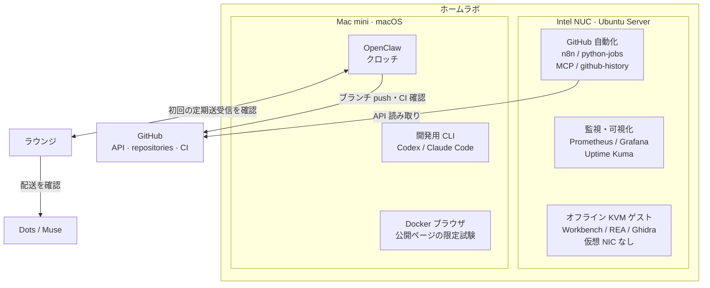

# Home AI Engineering Lab

[English](README.md) | **日本語**

GitHub の作業自動化、監視、インフラ・セキュリティの実験を行うホームラボです。**Intel NUC** が自動化・監視基盤を担い、**Mac mini** で OpenClaw（クロッチ）と開発ツールの連携を試しています。

[構成図](#構成図) · [確認状況](#確認状況) · [目的別ガイド](#目的別ガイド) · [全ドキュメント](docs/README.md)

## 全体像

| 場所 | 役割 |
| --- | --- |
| Intel NUC / Ubuntu Server | Docker Compose による自動化・監視と、独立したオフライン QEMU/KVM 解析ゲスト |
| Mac mini / macOS | OpenClaw、Codex / Claude Code CLI、専用 Docker ブラウザ |
| 外部連携 | GitHub API・リポジトリ・CI、Dots / Muse とのラウンジでの状態共有 |

**記録の基準日：** NUC は2026年10月29日まで、Mac mini は11月6〜10日の限定試験に基づきます。ラボ運用全体の正式受入れは未完了です。

## 構成図

矢印は記録された範囲で確認した連携経路です。任意のタスクの完遂、長期運用、三者の自動会話全体の確認を意味しません。**Mac mini → NUC の監視・復旧は受入れ前**のため、接続線を引いていません。

通常 DM は Sol 6.1 high・Codex サブスク経路で限定試験を確認し、Decision は Luna API を継続しています。従来の NUC 自動化基盤では LLM・有料 LLM API を使っていませんが、Mac mini を含む全体の説明ではありません。

全体図を更新するときは、このページと [README.md](README.md) の Mermaid ブロックを編集します。GitHub が直接描画するため、PNG/SVG の再生成は不要です。日英の図をそろえ、確認状態は日付のある記録に基づいて更新します。[過去のネットワーク・データフロー図](docs/architecture.md)は、それぞれの観測日の資料です。

## 確認状況

| 対象 | 確認したこと | 残っていること |
| --- | --- | --- |
| GitHub レポート | 手動収集、n8n からの読み取り専用 MCP 利用 | 定期実行、稼働イメージとソースの対応 |
| 監視・可視化 | Prometheus の準備完了と3つの収集先、Grafana API の DB 正常応答 | ブラウザでの表示、通知配送、収集ジョブの Push 設定 |
| OpenClaw 連携 | ブランチ push・CI、承認済み要約の配送、初回の定期送受信 | マージ承認、任意の自然文での共有、長期運用 |
| Codex サブスク経路 | 架空データ読取り、API fallback を拒否するオフライン4ケース | 実上限到達、通常業務の品質、費用削減の実測。Decision API は継続 |
| 解析 VM | 基本操作を条件付き受入れ。仮想 NIC なし | REA → Ghidra の解析能力。Workbench / REA の相互連携は未実装 |
| バックアップ | 以前のローカル暗号化バックアップ・復元試験 | 別機器へのコピー、observability ボリューム、後続の更新ごとの復元確認 |

各試験の範囲は[最新の切替記録](docs/kurotchi-lounge-codex-cutover-2026-11-10.ja.md)、[構成状況](docs/configuration-status.md)、[バックアップ・復元](docs/backup-restore.md)を参照してください。

コンポーネントのバージョン・詳細な確認範囲

| 場所 | コンポーネント | 役割と確認範囲 |
|---|---|---|
| Compose | n8n 2.44.7 | GitHub 日次レポートなどのワークフローを実行。手動実行は確認済み、定期実行は未確認。 |
| Compose | python-jobs | GitHub API から情報を収集し、レポートとスナップショットを保存。稼働中のイメージと現在のソースの対応は未確認。 |
| Compose | mcp-server | 保存済みレポートを認証付き・読み取り専用で提供。n8n からの読み取りは確認済み。イメージと現在のソースの対応は未確認。 |
| Compose | github-history | 保存済みの GitHub 履歴を提供。稼働中のコンテナはソースを読み取り専用でマウント。ダッシュボードとの連携は未確認。 |
| Compose | Prometheus 3.15.1、node_exporter 1.12.1 | メトリクスを公開・収集。Prometheus の準備完了と3つの収集先を確認済み。 |
| Compose | Grafana 12.4.14 | メトリクスを問い合わせ、可視化。API でデータベースの正常応答を確認済み。ブラウザでの表示は未確認。 |
| Compose | Uptime Kuma 2.5.6 | サービスの死活を監視。通知配送と収集ジョブの Push は未確認または未設定。 |
| Compose | Open WebUI | チャット画面。データを保持して意図的に停止中。 |
| KVM ゲスト | Workbench MCP、REA、Ghidra | オフラインでのセキュリティ解析実験。VM の基本操作は条件付き受入れ済み。REA → Ghidra の解析能力は未受入れ。現在のバージョンは再確認していません。 |
| Mac mini | OpenClaw（クロッチ） | 導入と限定的な作業連携を確認。ラボ運用全体の正式受入れは未完了。 |
| Mac mini | Codex CLI、Claude Code CLI | 起動と限定生成を確認。任意の開発タスクの完遂を保証するものではありません。 |
| Mac mini | 専用 Docker ブラウザ | 公開ページの限定試験を確認。任意サイトや認証状態の分離は未受入れ。 |
| 外部連携 | ラウンジ、Dots、Muse | 受信・定期的な状態投稿と両宛先への配送を確認。承認済み要約の手動共有と初回定期送受信まで確認。任意の自然文と継続運用は未受入れ。 |

自作の jobs と MCP は、一部のソースが公開版と異なります。稼働中イメージがどちらのソースに対応するかは未確認です。更新前に差分を確認し、ローカルの変更を保全します。監視集約やアラート・プローブの候補は未配置です。Ansible の資料には実機に適用済みの変更と未配置の候補が混在しています。

Open WebUI はデータを保持して意図的に停止中、AdGuard Home は試行枠として全体図から省略しています。コンテナ起動や限定試験は、全機能の受入れを意味しません。

## 目的別ガイド

| やりたいこと | 読む資料 |
| --- | --- |
| ホストへ接続・運用する | [運用手順書](docs/ops-runbook.md) · [Mac mini 初期構築記録](docs/mac-mini-kitting-record-2026-11.md) |
| GitHub レポートを生成・参照する | [GitHub 監視](docs/github-monitoring.md) · [読み取り専用 MCP](docs/mcp-internal-api.md) |
| 監視基盤を試す | [プレイグラウンド](docs/playground.md) · [監視・通知](docs/monitoring-notifications.md) |
| 復旧・変更計画を確認する | [バックアップ・復元](docs/backup-restore.md) · [監視案](docs/prometheus-alerts-candidate.md) · [自作 OSS 更新候補](docs/custom-oss-update-candidate.md) |
| オフライン解析を調べる | [セキュリティ解析 VM](docs/security-analysis-vm.md) |
| 構築・計画・過去の記録を探す | [ドキュメント索引](docs/README.md) |

管理画面はループバックに限定し、SSH トンネル経由で開きます。接続・操作は運用手順書に沿って行います。

## 最近の記録

各リンクは当日の結果を残した資料です。現在の実機状態を常時示すものではありません。

| 日付 | 記録 |
| --- | --- |
| 2026-11-10 | [ラウンジ復旧と Codex サブスク切替](docs/kurotchi-lounge-codex-cutover-2026-11-10.ja.md) — 手動配送、初回定期送受信、架空データ読取り |
| 2026-11-09 | [クロッチの改善](docs/kurotchi-improvements-2026-11-09.ja.md) — ブランチ push・CI とラウンジ修復 |
| 2026-11-06 | [OpenClaw 導入・限定試験](docs/openclaw-status-2026-11-06.ja.md) — ブラウザ・CLI・ラウンジの確認範囲 |

リポジトリの歩き方

| パス | 内容 |
|---|---|
| `docs/` | ガイド・手順書・設計記録。[ドキュメント索引](docs/README.md) から辿れます。 |
| `stacks/` | Docker Compose の定義群：`observability/`、`n8n/`、`mcp/`、`uptime-kuma/`、`open-webui/`、`network-dns/`、`kubernetes/`、`openclaw-smoke/`。 |
| `scripts/` | ホストで動かす運用・バックアップ・収集スクリプト。 |
| `ansible/` | 読み取り専用のベースラインとサービス適用プレイブック（適用済みと未配置の候補が混在。README 参照）。 |
| `tests/` | スクリプトと収集処理の検証テスト。 |
| `schemas/` | セキュリティ解析イベントの JSON スキーマ。 |
| `experiments/` | 試行コード。稼働サービスとは分離しています。 |
| `assets/` | 以前の PNG/SVG 構成図。現在の全体図は README 内の Mermaid を編集します。 |

今後の運用設計・過去の計画

2026-11-01の [Phase 4後のOpenClaw運用設計](docs/home-ai-lab-openclaw-operations.ja.md) では、Ubuntuと追加したMac miniの運用をOpenClaw、構築・改修をドッチーが担当します。本人のPhase 4と初期引継ぎを開始条件とした当時の設計です。その後の導入・改善は上記11月6日・9日の記録を参照してください。正式な運用受入れは未完了です。[購入前のMac mini計画](docs/mac-mini-local-ai-plan.ja.md) はM4・16 GB・256 GBという当時の想定を残した資料で、現在の実機台帳ではありません。設計の承認は導入・新規通信・停止中ジョブの再開許可ではなく、既存の隔離したセキュリティゲストも分離を維持します。

ライセンス：未指定。
