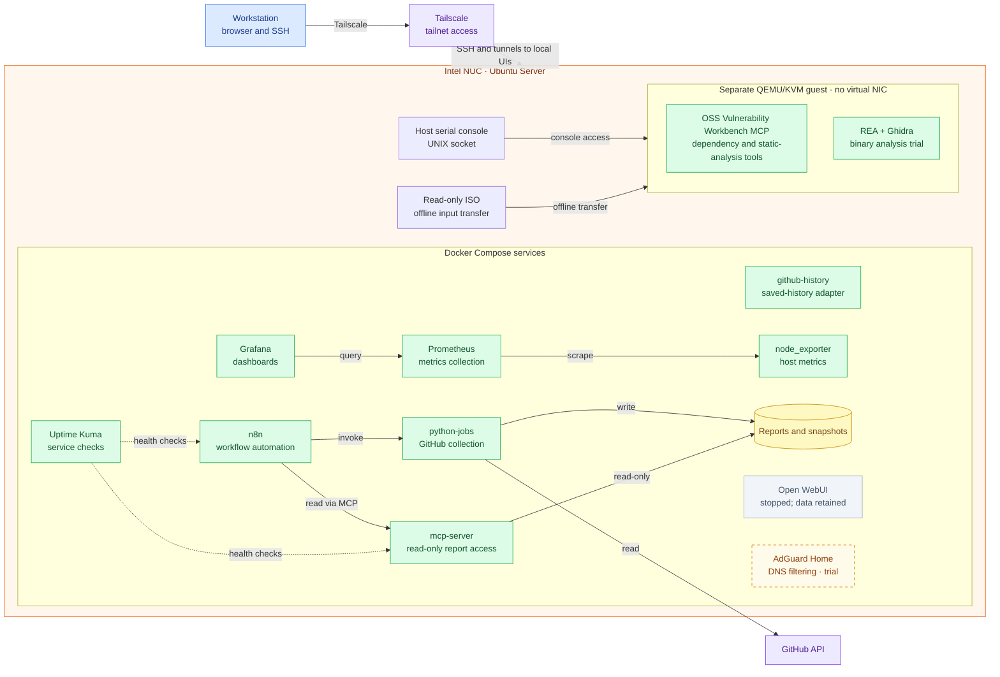

# Home AI Engineering Lab

**English** | [日本語](README.ja.md)

A home lab for GitHub automation, observability, and hands-on infrastructure and security experiments. An Intel NUC running Ubuntu Server hosts Docker Compose services and a separate QEMU/KVM security-analysis guest. The current automation platform does not run an LLM or use a paid LLM API.

## Architecture

The diagram shows the recorded configuration and observed running services as of 2026-10-29. A running container does not prove every workflow or integration works. The guest console socket exists; the guest's current running state and tool versions have not been rechecked.

Larger view: [full-size PNG](assets/architecture.png)

Prometheus pulls metrics from node_exporter. The history adapter runs, but its dashboard integration is not verified. Workbench and REA are separate tools; their integration is not implemented. The VM has no virtual NIC, so the diagram does not assume SSH to the guest. See [VM details](docs/security-analysis-vm.md) and [architecture notes](docs/architecture.md); older diagrams may reflect earlier stages.

## Components

| Location | Component | Purpose and current boundary |
|---|---|---|
| Compose | n8n 2.44.7 | Orchestrates workflows, including the GitHub daily report. Manual execution was verified; scheduled execution remains unverified. |
| Compose | python-jobs | Calls the GitHub API and saves reports and snapshots. Running image and current source correspondence is unverified. |
| Compose | mcp-server | Provides authenticated, read-only access to saved reports. n8n reading was verified; running image and current source correspondence is unverified. |
| Compose | github-history | Serves retained GitHub history. The running container uses read-only source mounts; dashboard integration is unverified. |
| Compose | Prometheus 3.15.1, node_exporter 1.12.1 | Collect and expose metrics; Prometheus readiness and three targets were checked. |
| Compose | Grafana 12.4.14 | Queries and visualizes metrics. Its API reported the database healthy; browser dashboard display remains unverified. |
| Compose | Uptime Kuma 2.5.6 | Checks service availability. Notification delivery and collector push setup remain unverified or unconfigured. |
| Compose | Open WebUI | Chat interface, intentionally stopped with data retained. |
| KVM guest | Workbench MCP; REA and Ghidra | Offline security-analysis experiments. Basic VM operation was conditionally accepted; REA-to-Ghidra analysis capability remains unaccepted. Current versions were not rechecked. |

The custom job and MCP source differs from the public snapshot in some files. Do not assume the running images match either source tree; verify and preserve local changes before updating. The monitoring aggregation and alert/probe candidates are not deployed. Ansible material includes both changes already applied and candidates not yet placed on the host.

## Operate and explore

- Read [configuration status](docs/configuration-status.md), the [monitoring proposal](docs/prometheus-alerts-candidate.md), and the [custom OSS update candidate](docs/custom-oss-update-candidate.md) for observations and remaining work.
- Access the host over SSH and use SSH tunnels for loopback-bound administration UIs. See the [operations runbook](docs/ops-runbook.md).
- Generate and read reports using the [GitHub monitoring guide](docs/github-monitoring.md) and [MCP guide](docs/mcp-internal-api.md). A manual run does not establish that the schedule works.
- Explore metrics and service checks in the [playground](docs/playground.md) and [monitoring guide](docs/monitoring-notifications.md).
- Review [backup and restore](docs/backup-restore.md): local encrypted backup and restore were tested, but an off-device copy is still missing, and observability volumes are outside the existing backup.
- Find setup, source and historical records in the [documentation index](docs/README.md), [`stacks/`](stacks/), [`scripts/`](scripts/) and [`tests/`](tests/).

## Repository map

| Path | What is there |
|---|---|
| `docs/` | Guides, runbooks and design records. Start from the [documentation index](docs/README.md). |
| `stacks/` | Docker Compose definitions: `observability/`, `n8n/`, `mcp/`, `uptime-kuma/`, `open-webui/`, `network-dns/`, `kubernetes/`, `openclaw-smoke/`. |
| `scripts/` | Operations, backup and collection scripts run on the host. |
| `ansible/` | Read-only baseline and service apply playbooks (applied changes and unplaced candidates are mixed; see its README). |
| `tests/` | Verification tests for the scripts and collectors. |
| `schemas/` | JSON schema for security-analysis events. |
| `experiments/` | Trial code, kept apart from the running services. |
| `assets/` | Full-size diagram images linked from the READMEs. |

## Future direction

Add a Mac mini as a possible on-premises AI research machine. This is a future idea: hardware, model runtime, connectivity and integration are not yet established. The existing NUC services and isolated security guest remain distinct from that proposed work. The pre-purchase [Mac mini local AI plan](docs/mac-mini-local-ai-plan.md) records the assumptions (M4, 16 GB, 256 GB); nothing is bought, installed or measured.

License: not yet specified.
