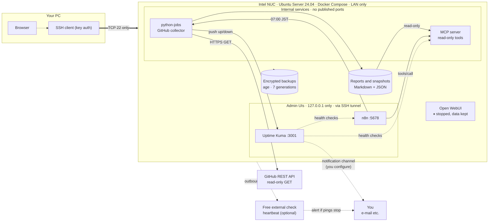

# Home AI Engineering Lab

**English** | [日本語](#日本語)

> **Status (2026-10-15):** An always-on, **zero-extra-cost** automation and monitoring box. Open WebUI is **stopped on purpose** (data kept). A daily GitHub report is generated; **notifications are not delivered yet** (no channel configured), the **first scheduled run is not yet observed**, and **off-device backup is still missing**. See [What is *not* verified](#what-is-not-verified-yet).

---

## English

### What is this?

A small, always-on **automation and monitoring box** on a home Intel NUC (Ubuntu Server + Docker Compose) that supports personal open-source work on GitHub.

It does **not** run AI models and **no paid LLM API is used**. Work that needs no AI is done with plain n8n, Python and the GitHub API. Everything is reachable **only through SSH** from your own PC; nothing is opened to the Internet. Extra monthly cost: **0 yen** (electricity and your existing subscriptions excluded).

### What can it do?

| # | You get… | Powered by | Status |
|---|---|---|---|
| 1 | **A daily GitHub report** every morning (07:00 JST): recently updated repos, new/stale issues and PRs, failed Actions, Dependabot alerts (with a token), changes since yesterday — saved on the NUC | n8n + Python (`github-dev-snapshot`) | ✅ Run from n8n OK (109 repos) · ⬜ first scheduled run not yet observed |
| 2 | **Read-only access to those reports for AI tools** through one authenticated, audited door | self-made MCP server | ✅ Read from n8n |
| 3 | **Down / failure alerts** for the NUC, n8n, MCP, the collector and critical GitHub problems | Uptime Kuma (+ push monitor) | ✅ Detection · ⬜ **delivery needs a channel you set up** |
| 4 | **"The whole NUC is dead" alert** from outside (free dead-man's switch) | heartbeat script + free external check | 🟡 Script ready, **not enabled** (needs your ping URL) |
| 5 | **Disaster recovery**: encrypted daily backup + tested restore | age + systemd timer | ✅ Local · ⬜ off-device copy not done |
| 6 | **Private by design**: only SSH is reachable; UIs are loopback-only | UFW + Docker network design | ✅ Verified by a LAN port scan |
| 7 | *(Parked)* Chat with cloud LLMs in a browser | Open WebUI | ⏸ Stopped on purpose; data kept; restart in 1 command |

More: [docs/use-cases.md](docs/use-cases.md).

### Architecture



Network, data-flow and backup diagrams: [docs/architecture.md](docs/architecture.md).

### Running services

| Service | Address on the NUC | Notes |
|---|---|---|
| Docker Engine 29.9 / Compose 5.6 | — | no TCP listener; `docker` group not used (`sudo docker`) |
| **Uptime Kuma** 2.x | `127.0.0.1:3001` | 6 monitors (1 paused on purpose) |
| **n8n** 2.43.5 | `127.0.0.1:5678` | 3 workflows; the daily one is active |
| **python-jobs** | internal only | GitHub collector, bearer token, read-only root FS |
| **MCP server** (minimal, self-made) | internal only | per-client token + tool allowlist, rate limit, audit log, no Internet |
| **Open WebUI** v0.12.0-slim | *(stopped)* | `docker compose stop`; volume, `.env`, secrets kept — [how to restart](docs/ops-runbook.md#1-open-webui-stop--start) |
| **Encrypted backup** | `/var/backups/home-ai-lab` | daily timer **03:30 UTC (= 12:30 JST)**, `age` public-key encryption |

The only port open on the LAN is **TCP 22** (checked by scanning 1,051 ports from another LAN machine).

### How to use

Open an SSH tunnel from your PC (your own user and the NUC's address; **the address is intentionally not stored in this repo**):

```bash
ssh -N -L 3001:127.0.0.1:3001 -L 5678:127.0.0.1:5678 <user>@<nuc-address>
```

- **Uptime Kuma** → `http://localhost:3001` · **n8n** → `http://localhost:5678`
- **Run the GitHub report now:** n8n → *GitHub daily report (read-only)* → *Execute*. Note the unauthenticated GitHub limit (60 calls/hour, shared by your whole home IP): a manual run can leave the report *partial*; the fuller report of the same day is kept.
- **Read the latest report:** n8n workflow *MCP read-only test* shows the first lines of `github-daily-latest.md` (any MCP client can call `read_report`). A synthetic sample: [docs/samples/github-daily-sample.md](docs/samples/github-daily-sample.md).

### Optional next steps for you (no cost)

1. **Notifications:** add one channel in Kuma (e-mail via SMTP recommended) → [docs/monitoring-notifications.md](docs/monitoring-notifications.md).
2. **Connect the collector to Kuma:** copy the push URL of the monitor *GitHub collector + alerts (push)* → `./jobs-admin.sh set-kuma-push` on the NUC → [docs/github-monitoring.md](docs/github-monitoring.md).
3. **Read-only GitHub token** (private repos, Dependabot, 5,000 calls/hour) → same doc.
4. **External "NUC is dead" check** → `heartbeat-admin.sh enable` → [docs/monitoring-notifications.md](docs/monitoring-notifications.md).
5. **Off-device backup:** choose a destination → [docs/offsite-backup-options.md](docs/offsite-backup-options.md).

### Security model in one minute

- **SSH keys only**; no root/password login; UFW denies everything else; **no router port-forwarding**.
- **Admin UIs bind to `127.0.0.1`**; internal services publish no ports; the MCP network has **no gateway**.
- **Read-only everywhere:** the collector only sends `GET`; MCP tools are read-only; the GitHub token (if you add one) must be read-only.
- **Secrets never go into Git.** They live in `chmod 600` files on the NUC and only in *encrypted* backups. Scanner: `bash scripts/scan-secrets.sh` ([docs/security-operations.md](docs/security-operations.md)).

### What is *not* verified yet

Nothing below is counted as "passed".

- ❌ **First scheduled 07:00 JST run** of the daily workflow (it shows *Published*, and a run from the n8n screen succeeded, but a scheduled firing has not been observed yet).
- ❌ **Notification delivery** (no Kuma channel), the **Kuma push** path (needs the push token), and the **external heartbeat** (not enabled).
- ❌ **Failed-Actions detection on real data** (no failing repo was found among the 32 checked; proven only against a fake API in 45 automated checks), and everything that needs a **GitHub token**: private repos, Dependabot, the raised API budget.
- ❌ **Off-device backup** (destination undecided); backup timer's **first automatic run** (next: 03:30 UTC).
- ❌ MCP **timeouts / rate limits / permission denial on the live NUC** (tested locally, 34 checks); compatibility with the **official MCP client/Inspector**.
- ❌ After a **reboot**, that Open WebUI stays stopped (Docker's `unless-stopped` semantics; not rebooted for this).
- ⬜ Open WebUI ↔ MCP, real LLM API connections: out of scope while Open WebUI is stopped.

Details, incidents and fixes: [docs/build-progress.md](docs/build-progress.md).

### Repository layout

```text
stacks/          Docker Compose stacks: uptime-kuma, n8n (+python-jobs), open-webui (stopped), mcp
scripts/         Re-runnable setup / ops / backup scripts (run on the NUC); scan-secrets.sh runs anywhere
tests/           Local tests: MCP server (34 checks), GitHub collector (45 checks, fake GitHub)
docs/            Design, operations and progress notes (index: docs/README.md)
```

### Documentation

| Doc | About |
|---|---|
| [docs/use-cases.md](docs/use-cases.md) | What the lab can do, with examples |
| [docs/architecture.md](docs/architecture.md) | Diagrams: system, networks, data flows, backup |
| [docs/github-monitoring.md](docs/github-monitoring.md) | The daily GitHub report: scope, API budget, token, alerts |
| [docs/monitoring-notifications.md](docs/monitoring-notifications.md) | Alert policy, notification channels, external heartbeat |
| [docs/ops-runbook.md](docs/ops-runbook.md) | Stop/start services, resource baseline, updates, manual recovery |
| [docs/backup-restore.md](docs/backup-restore.md) · [docs/offsite-backup-options.md](docs/offsite-backup-options.md) | Backup and restore · off-device options |
| [docs/security-operations.md](docs/security-operations.md) | Security controls and credential handling |
| [docs/mcp-internal-api.md](docs/mcp-internal-api.md) | MCP server design and verification |
| [docs/build-progress.md](docs/build-progress.md) | Checklist, final report, incidents |
| [docs/README.md](docs/README.md) | Index of all docs (current / historical) |

### Principles

1. LAN-only. No router port-forwarding. No unauthenticated Internet exposure.
2. Public repo: **no secrets, no local IPs/MACs/serial numbers.**
3. Read-only first; any write to an external service needs explicit approval.
4. No new paid services; no paid LLM API. A human decides about money and credentials.
5. Don't run what you don't use. Don't mark anything "done" that wasn't verified.

License: documentation-first prototype; license TBD.

---

## 日本語

### これは何？

自宅の Intel NUC（Ubuntu Server + Docker Compose）で動く、個人の OSS／GitHub 開発を支える**常設の自動化・監視ボックス**です。

AI モデルは動かさず、**有料の LLM API も使いません**。AI が不要な処理は、n8n・Python・GitHub API だけで行います。すべて手元の PC から **SSH 経由でのみ**使え、インターネットには何も公開しません。追加の月額費用は **0円**（電気代と既存サービス料金を除く）。

### 何ができる？

| # | できること | 使っているもの | 状態 |
|---|---|---|---|
| 1 | **毎朝（07:00 JST）の GitHub 日次レポート**：最近更新されたリポジトリ、新規・停滞中の Issue/PR、失敗した Actions、Dependabot アラート（トークン時）、前日との差分。NUC に保存 | n8n + Python（`github-dev-snapshot`） | ✅ n8n から実行成功（109リポジトリ）· ⬜ 定期実行の初回は未観測 |
| 2 | **AI ツールからレポートを読み取り専用で参照**（認証・監査つきの1つの入口） | 自作 MCP サーバー | ✅ n8n から読み取り確認 |
| 3 | **停止・障害の通知**：NUC、n8n、MCP、収集ジョブ、GitHub の重大な問題 | Uptime Kuma（＋Push監視） | ✅ 検知 · ⬜ **配送には通知チャネルの設定が必要** |
| 4 | **「NUC 全体が落ちた」を外部から検知**（無料の dead-man's switch） | heartbeat スクリプト＋無料の外部チェック | 🟡 スクリプトは準備済み・**未有効化**（ping URL が必要） |
| 5 | **災害復旧**：毎日の暗号化バックアップ＋復元試験済み | age + systemd timer | ✅ NUC内 · ⬜ NUC外コピーは未 |
| 6 | **非公開を保つ**：到達できるのは SSH だけ、画面はループバック限定 | UFW + Docker ネットワーク設計 | ✅ LAN ポートスキャンで確認 |
| 7 | *(保留)* クラウド LLM とのチャット | Open WebUI | ⏸ 意図的に停止中・データ保持・1コマンドで再開 |

詳細：[docs/use-cases.md](docs/use-cases.md)

### 構成図

上の「Architecture」の図（英語表記）が全体像です。ネットワーク・データの流れ・バックアップの図は [docs/architecture.md](docs/architecture.md)。

- PC → **SSH（TCP 22のみ）** → NUC。画面付きサービス（Kuma / n8n）は **`127.0.0.1` 限定**、SSH トンネルで開く
- n8n が毎朝 python-jobs を呼び、python-jobs が GitHub を**読み取り専用**で調べ、レポートを保存。MCP はそのレポートを**読み取り専用**で公開
- 異常は Uptime Kuma の Push 監視に集約。通知の配送は**あなたが設定する**チャネル（メール等）
- NUC 全体の停止は、NUC から外部の無料サービスへ送る heartbeat が途切れたことで検知（任意）

### 稼働サービス

| サービス | NUC上のアドレス | 備考 |
|---|---|---|
| Docker Engine 29.9 / Compose 5.6 | — | TCP待ち受けなし。`docker`グループ不使用（`sudo docker`運用） |
| **Uptime Kuma** 2.x | `127.0.0.1:3001` | 監視6件（1件は意図的に一時停止） |
| **n8n** 2.43.5 | `127.0.0.1:5678` | ワークフロー3件。日次レポートは有効 |
| **python-jobs** | 内部のみ | GitHub収集。Bearer認証、read-only rootfs |
| **MCPサーバー**（自作の最小実装） | 内部のみ | クライアント別トークン＋ツール許可リスト、レート制限、監査ログ、インターネット不可 |
| **Open WebUI** v0.12.0-slim | *(停止中)* | `docker compose stop`。ボリューム・`.env`・secrets は保持 — [再開手順](docs/ops-runbook.md#1-open-webui-stop--start) |
| **暗号化バックアップ** | `/var/backups/home-ai-lab` | 毎日 timer **03:30 UTC（＝日本時間 12:30）**、`age` 公開鍵暗号 |

LAN から到達できるのは **TCP 22 だけ**（別の LAN 内 PC から 1,051 ポートをスキャンして確認）。

### 使い方

PC から SSH トンネルを張ります（ユーザー名と NUC のアドレスはご自身のもの。**アドレスは意図的にリポジトリに載せていません**）。

```bash
ssh -N -L 3001:127.0.0.1:3001 -L 5678:127.0.0.1:5678 <user>@<nuc-address>
```

- **Uptime Kuma** → `http://localhost:3001` · **n8n** → `http://localhost:5678`
- **今すぐ GitHub レポートを作る：** n8n →「GitHub daily report (read-only)」→ *Execute*。無認証の GitHub 上限（60回/時、家庭の IP 全体で共有）のため、手動実行は*部分的*になることがあります。同じ日のより充実したレポートは残ります。
- **最新レポートを読む：** n8n の「MCP read-only test」で `github-daily-latest.md` の冒頭を確認（MCP クライアントなら `read_report`）。合成データのサンプル：[docs/samples/github-daily-sample.md](docs/samples/github-daily-sample.md)

### あなたが任意で行う次のステップ（無料）

1. **通知：** Kuma に通知チャネルを1つ追加（メール/SMTP 推奨）→ [docs/monitoring-notifications.md](docs/monitoring-notifications.md)
2. **収集ジョブと Kuma の接続：** 監視「GitHub collector + alerts (push)」の Push URL をコピー → NUC で `./jobs-admin.sh set-kuma-push` → [docs/github-monitoring.md](docs/github-monitoring.md)
3. **GitHub の読み取り専用トークン**（非公開リポジトリ・Dependabot・5,000回/時）→ 同上
4. **外部の「NUC が落ちた」検知** → `heartbeat-admin.sh enable` → [docs/monitoring-notifications.md](docs/monitoring-notifications.md)
5. **NUC 外バックアップ：** 保存先を決める → [docs/offsite-backup-options.md](docs/offsite-backup-options.md)

### セキュリティの考え方（1分で）

- **SSH は鍵認証のみ**。root／パスワードログイン禁止。UFW で他は遮断。**ルーターのポート開放なし**。
- **管理画面は `127.0.0.1` にバインド**。内部サービスはポート非公開。MCP のネットワークは**ゲートウェイなし**。
- **どこも読み取り専用：** 収集は `GET` のみ、MCP ツールは読み取り専用、GitHub トークン（追加する場合）も読み取り専用。
- **秘密情報は Git に入れない。** NUC 上の `chmod 600` ファイルと*暗号化された*バックアップにのみ。検査：`bash scripts/scan-secrets.sh`（[docs/security-operations.md](docs/security-operations.md)）。

### 未検証の項目

以下は「合格」として扱っていません。

- ❌ 日次ワークフローの **07:00 JST 定期実行の初回**（*Published* 表示で、n8n 画面からの実行は成功したが、定期実行の発火は未観測）。
- ❌ **通知の配送**（Kuma のチャネル未設定）、**Kuma Push** 経路（push トークンが必要）、**外部 heartbeat**（未有効化）。
- ❌ **実データでの失敗 Actions の検知**（確認した32リポジトリに失敗中のものはなく、偽 API での自動テスト45項目でのみ確認）、および **GitHub トークン**が必要なもの全般（非公開リポジトリ、Dependabot、API 予算の拡大）。
- ❌ **NUC 外バックアップ**（保存先未決定）、バックアップ timer の**初回の自動実行**（次回 03:30 UTC）。
- ❌ MCP の**タイムアウト／レート制限／権限外拒否の実機確認**（ローカルで34項目は確認済み）、**公式 MCP クライアントとの互換性**。
- ❌ **再起動後も** Open WebUI が停止のままであること（Docker の `unless-stopped` の仕様による。今回は再起動していない）。
- ⬜ Open WebUI と MCP の連携、実 LLM API 接続：Open WebUI 停止中のため対象外。

詳細・トラブル記録・対処：[docs/build-progress.md](docs/build-progress.md)

### リポジトリ構成

```text
stacks/          Docker Composeスタック：uptime-kuma, n8n(+python-jobs), open-webui(停止中), mcp
scripts/         再実行可能な構築・運用・バックアップ用スクリプト（NUC上で実行）。scan-secrets.sh はどこでも実行可
tests/           ローカルテスト：MCPサーバー(34項目)、GitHub収集(45項目・偽GitHub)
docs/            設計・運用・進捗（索引：docs/README.md）
```

### 原則

1. LAN限定。ルーターのポート開放なし。認証なしでインターネットに公開しない。
2. 公開リポジトリには**秘密情報・ローカルIP/MAC/シリアルを載せない**。
3. まず読み取り専用。外部サービスへの書き込みは明示承認が必要。
4. 新しい有料サービスを使わない。有料 LLM API も使わない。お金と認証情報は人が決める。
5. 使わないものは動かさない。検証していないものを「完了」と書かない。

ライセンス：ドキュメント中心のプロトタイプ。ライセンスは未定。
