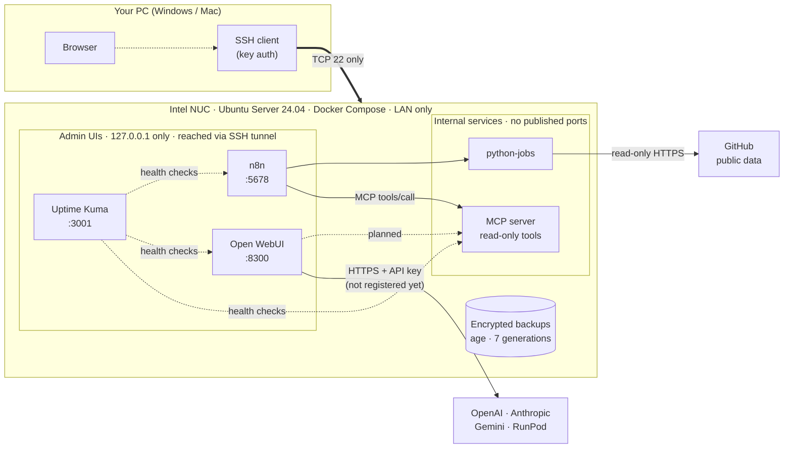

# Home AI Engineering Lab

**English** | [日本語](#日本語)

> **Status (2026-10-15):** Phases 0–5 are deployed and verified on the NUC. **Not done yet:** off-device backups, real LLM API keys, notifications. See [What is *not* verified](#what-is-not-verified-yet).

---

## English

### What is this?

A small, always-on **control plane for AI work**, running on a home Intel NUC (Ubuntu Server + Docker Compose).

It does **not** run big AI models. It runs the *glue around them*: scheduled automations, a chat UI for cloud LLMs, a safe tool server for AI (MCP), health monitoring, and encrypted backups. The heavy "thinking" is done by external AI APIs / GPUs (OpenAI, Anthropic, Gemini, RunPod) — only after *you* register an API key.

Everything is reachable **only through SSH** from your own PC. Nothing is opened to the Internet.

### What can it do?

| # | You can… | Powered by | Status |
|---|---|---|---|
| 1 | **Run automations** on demand or on a schedule (e.g. fetch a public GitHub repo's metadata, save a Markdown report) | n8n + a Python job runner | ✅ Works (read-only GitHub sample) |
| 2 | **Chat with several cloud LLMs** in one browser UI | Open WebUI | 🟡 UI works. **No API key registered yet**, so no model is available |
| 3 | **Give AI tools a safe, read-only toolbox** (list/read reports, echo, time) with per-client tokens and an audit log | Self-made MCP server | ✅ Works from n8n · 🟡 Open WebUI use not verified |
| 4 | **See if something is down** (NUC SSH, n8n, Open WebUI, MCP, Kuma itself) | Uptime Kuma (5 monitors) | ✅ Works · ⬜ no alert notifications yet |
| 5 | **Recover from a disaster** (encrypted daily backup + a tested restore) | age + systemd timer | ✅ Local only · ⬜ off-device copy not done |
| 6 | **Stay private** — only SSH is reachable; admin UIs are loopback-only | UFW + Docker network design | ✅ Verified by a LAN port scan |

More detail and examples: [docs/use-cases.md](docs/use-cases.md).

### Architecture



Network and data-flow diagrams: [docs/architecture.md](docs/architecture.md).

### Running services

| Service | Address on the NUC | Notes |
|---|---|---|
| Docker Engine 29.9 / Compose 5.6 | — | no TCP listener; `docker` group not used (`sudo docker`) |
| **Uptime Kuma** 2.x | `127.0.0.1:3001` | admin login, SQLite |
| **n8n** 2.43.5 | `127.0.0.1:5678` | owner login, public API & command-exec nodes disabled |
| **python-jobs** | internal only | bearer token, repo allowlist, read-only root FS |
| **Open WebUI** v0.12.0-slim | `127.0.0.1:8300` | admin login, sign-up disabled, telemetry off |
| **MCP server** (minimal, self-made) | internal only | per-client token + tool allowlist, rate limit, audit log, no Internet access |
| **Encrypted backup** | `/var/backups/home-ai-lab` | daily 03:30 timer, `age` public-key encryption |

The only port open on the LAN is **TCP 22** (checked by scanning 1,051 ports from another LAN machine).

### How to access

Admin UIs listen on loopback only. Open an SSH tunnel from your PC (use your own user and the NUC's address; **the address is intentionally not stored in this repo**):

```bash
ssh -N -L 3001:127.0.0.1:3001 -L 5678:127.0.0.1:5678 -L 8300:127.0.0.1:8300 <user>@<nuc-address>
```

Then open `http://localhost:3001` (Kuma), `http://localhost:5678` (n8n), `http://localhost:8300` (Open WebUI). MCP and python-jobs have no UI; n8n calls them internally.

### Security model in one minute

- **SSH keys only**, no root login, no password login; UFW denies everything else; **no router port-forwarding**.
- **Admin UIs bind to `127.0.0.1`** (this also avoids Docker's habit of bypassing UFW).
- Internal services live on **Docker networks without published ports**; the MCP network has **no gateway** (no Internet, no host access).
- **Least privilege:** MCP tools are read-only; each client gets only the tools it needs; every call is audited (no tokens, no argument values logged).
- **Secrets never go into Git.** They live in `chmod 600` files on the NUC (`.env`, `secrets/`) and are included only in *encrypted* backups. See [docs/ai-api-key-management.md](docs/ai-api-key-management.md) and [docs/security-operations.md](docs/security-operations.md). A scanner is provided: `scripts/scan-secrets.sh`.

### What is *not* verified yet

Nothing below is counted as "passed".

- ❌ **Real LLM connections** (OpenAI / Anthropic / Gemini / RunPod): no API key is registered. Only network reachability (without credentials) was checked.
- ❌ **Open WebUI → MCP tools**: only reachability and the "401 without token" response were checked.
- ❌ **Off-device backup**: destination undecided, so backups exist only on the NUC itself.
- ❌ Backup timer's **first automatic run**; restore of a backup taken *after* the Open WebUI admin was created.
- ❌ MCP **timeouts / rate limits / permission denial on the live NUC** (tested locally, 36 checks); compatibility with the **official MCP client/Inspector** (this is a minimal self-made server).
- ❌ **Notifications** (Kuma alerts, n8n error alerts), and detection if Kuma itself dies.
- ⬜ GitHub *write* integrations — intentionally not built.

Details, incidents and fixes: [docs/build-progress.md](docs/build-progress.md).

### Repository layout

```text
stacks/          Docker Compose stacks: uptime-kuma, n8n (+python-jobs), open-webui, mcp
scripts/         Re-runnable setup / verification / backup scripts (run on the NUC)
tests/           Local self-test for the MCP server (python tests/mcp_selftest.py)
docs/            Design, operations and progress notes (index: docs/README.md)
```

### Documentation

| Doc | About |
|---|---|
| [docs/use-cases.md](docs/use-cases.md) | What the lab can do, with examples |
| [docs/architecture.md](docs/architecture.md) | Diagrams: system, networks, data flows, backup |
| [docs/security-operations.md](docs/security-operations.md) | Security controls and credential handling |
| [docs/ai-api-key-management.md](docs/ai-api-key-management.md) | How LLM API keys are stored and rotated |
| [docs/mcp-internal-api.md](docs/mcp-internal-api.md) | MCP server design and verification |
| [docs/backup-restore.md](docs/backup-restore.md) | Backup, restore test, recovery steps |
| [docs/build-progress.md](docs/build-progress.md) | Checklist, final report, incidents |
| [docs/README.md](docs/README.md) | Index of all docs (which are current / historical) |

### Principles

1. LAN-only. No router port-forwarding. No unauthenticated Internet exposure.
2. Public repo: **no secrets, no local IPs/MACs/serial numbers.**
3. Read-only first; any write to an external service needs explicit approval.
4. API spend needs provider-side hard limits and a human in the loop.
5. Don't run what you don't use. Don't mark anything "done" that wasn't verified.

License: documentation-first prototype; license TBD.

---

## 日本語

### これは何？

自宅の Intel NUC（Ubuntu Server + Docker Compose）上で動かす、**AI作業のための常設「コントロールプレーン」**です。

大きなAIモデルは**動かしません**。モデルの周りの「つなぎ」を担当します：定期自動化、クラウドLLM用のチャットUI、AI向けの安全なツールサーバー（MCP）、死活監視、暗号化バックアップ。重い「考える」処理は、外部のAI API／GPU（OpenAI・Anthropic・Gemini・RunPod）に任せます。ただし**あなたがAPIキーを登録するまでは接続されません**。

すべて、手元のPCから**SSH経由でのみ**使えます。インターネットには何も公開していません。

### 何ができる？

| # | できること | 使っているもの | 状態 |
|---|---|---|---|
| 1 | **自動化の実行**（例：公開GitHubリポジトリの情報を取得してMarkdownレポート化）。手動でも定期でも可 | n8n + Pythonジョブ | ✅ 動作（読み取り専用のGitHubサンプル） |
| 2 | **複数のクラウドLLMと1つのブラウザUIでチャット** | Open WebUI | 🟡 UIは動作。**APIキー未登録**のため、まだモデルは使えません |
| 3 | **AIに安全な「読み取り専用ツール箱」を渡す**（レポート一覧/読取、echo、時刻）。クライアント別トークン＋監査ログ | 自作MCPサーバー | ✅ n8nから動作 · 🟡 Open WebUIからの利用は未検証 |
| 4 | **止まったことに気づく**（NUCのSSH、n8n、Open WebUI、MCP、Kuma自身） | Uptime Kuma（監視5件） | ✅ 動作 · ⬜ 通知は未設定 |
| 5 | **障害から復旧**（毎日の暗号化バックアップ＋復元試験済み） | age + systemd timer | ✅ NUC内のみ · ⬜ NUC外への保存は未実施 |
| 6 | **非公開を保つ**：到達できるのはSSHだけ。管理画面はループバック限定 | UFW + Dockerネットワーク設計 | ✅ LANからのポートスキャンで確認 |

詳細と具体例：[docs/use-cases.md](docs/use-cases.md)

### 構成図

上の「Architecture」の図（英語表記）が全体像です。ネットワーク図・データの流れ・バックアップの流れは [docs/architecture.md](docs/architecture.md) にあります。

- あなたのPC → **SSH（TCP 22のみ）** → NUC
- NUCの中で、画面付きのサービス（Kuma / n8n / Open WebUI）は **`127.0.0.1` だけ**で待ち受け、**SSHトンネル**経由で開きます
- 内部サービス（python-jobs / MCP）は**ポートを公開しません**。MCPのネットワークは出口なし（インターネットにもホストにも出られない）
- 外部と話すのは、n8n/python-jobs → GitHub（公開データの読み取り）と、Open WebUI → 各社LLM（APIキー登録後）だけ

### 稼働サービス

| サービス | NUC上のアドレス | 備考 |
|---|---|---|
| Docker Engine 29.9 / Compose 5.6 | — | TCP待ち受けなし。`docker`グループ不使用（`sudo docker`運用） |
| **Uptime Kuma** 2.x | `127.0.0.1:3001` | 管理者ログイン、SQLite |
| **n8n** 2.43.5 | `127.0.0.1:5678` | オーナーログイン、公開API・コマンド実行ノードは無効 |
| **python-jobs** | 内部のみ | Bearerトークン、リポジトリ許可リスト、read-only rootfs |
| **Open WebUI** v0.12.0-slim | `127.0.0.1:8300` | 管理者ログイン、サインアップ無効、テレメトリ無効 |
| **MCPサーバー**（自作の最小実装） | 内部のみ | クライアント別トークン＋ツール許可リスト、レート制限、監査ログ、インターネット不可 |
| **暗号化バックアップ** | `/var/backups/home-ai-lab` | 毎日03:30のtimer、`age`公開鍵暗号 |

LANから到達できるのは **TCP 22 だけ**です（別のLAN内PCから1,051ポートをスキャンして確認）。

### アクセス方法

管理画面はループバック限定です。PCからSSHトンネルを張ります（ユーザー名とNUCのアドレスはご自身のもの。**アドレスは意図的にこのリポジトリに載せていません**）。

```bash
ssh -N -L 3001:127.0.0.1:3001 -L 5678:127.0.0.1:5678 -L 8300:127.0.0.1:8300 <user>@<nuc-address>
```

その後、ブラウザで `http://localhost:3001`（Kuma）、`http://localhost:5678`（n8n）、`http://localhost:8300`（Open WebUI）を開きます。MCP と python-jobs には画面がなく、n8n が内部から呼び出します。

### セキュリティの考え方（1分で）

- **SSHは鍵認証のみ**。rootログイン・パスワードログイン禁止。UFWで他は遮断。**ルーターのポート開放なし**。
- **管理画面は `127.0.0.1` にバインド**（DockerがUFWを迂回する問題の回避にもなります）。
- 内部サービスは**ポート非公開のDockerネットワーク**上。MCPのネットワークは**ゲートウェイなし**。
- **最小権限**：MCPツールは読み取り専用。クライアントごとに必要なツールだけ許可。全呼び出しを監査（トークン・引数の値は記録しない）。
- **秘密情報はGitに入れない**。NUC上の `chmod 600` ファイル（`.env`、`secrets/`）にのみ置き、バックアップには*暗号化して*含めます。詳細は [docs/ai-api-key-management.md](docs/ai-api-key-management.md) と [docs/security-operations.md](docs/security-operations.md)。検査用に `scripts/scan-secrets.sh` を用意しています。

### 未検証の項目

以下は「合格」として扱っていません。

- ❌ **実際のLLM接続**（OpenAI / Anthropic / Gemini / RunPod）：APIキー未登録。認証なしでのネットワーク到達性のみ確認。
- ❌ **Open WebUI → MCPツール**：到達性と「トークンなしは401」のみ確認。
- ❌ **NUC外へのバックアップ**：保存先未決定。バックアップはNUC内にしかありません。
- ❌ バックアップtimerの**初回の自動実行**、およびOpen WebUI管理者作成*後*のバックアップの復元。
- ❌ MCPの**タイムアウト／レート制限／権限外拒否の実機での確認**（ローカルで36項目は確認済み）、**公式MCPクライアントとの互換性**（自作の最小実装のため）。
- ❌ **通知**（Kumaアラート、n8nエラー通知）、Kuma自身が止まった時の検知。
- ⬜ GitHubへの*書き込み*連携：意図的に未実装。

詳細・トラブル記録・対処：[docs/build-progress.md](docs/build-progress.md)

### リポジトリ構成

```text
stacks/          Docker Composeスタック：uptime-kuma, n8n(+python-jobs), open-webui, mcp
scripts/         再実行可能な構築・検証・バックアップ用スクリプト（NUC上で実行）
tests/           MCPサーバーのローカル自己テスト（python tests/mcp_selftest.py）
docs/            設計・運用・進捗（索引：docs/README.md）
```

### 原則

1. LAN限定。ルーターのポート開放なし。認証なしでインターネットに公開しない。
2. 公開リポジトリには**秘密情報・ローカルIP/MAC/シリアルを載せない**。
3. まず読み取り専用。外部サービスへの書き込みは明示承認が必要。
4. API費用はプロバイダー側のハード上限と、人の承認を前提にする。
5. 使わないものは動かさない。検証していないものを「完了」と書かない。

ライセンス：ドキュメント中心のプロトタイプ。ライセンスは未定。
