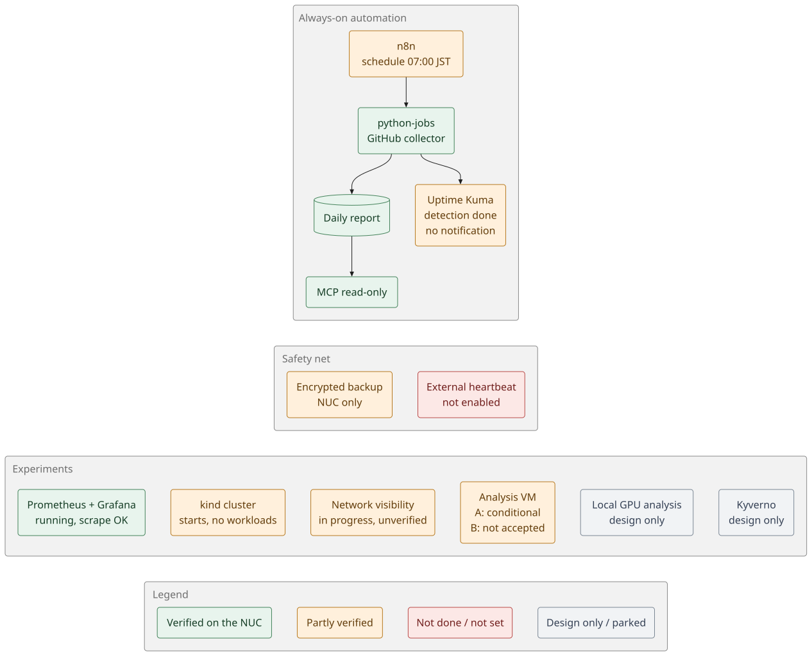

# Home AI Engineering Lab

**English** | [日本語](README.ja.md)

A home Intel NUC lab for GitHub automation, monitoring and hands-on OSS experiments. The always-on platform runs on Ubuntu Server and Docker Compose; a separate QEMU/KVM guest provides an offline security-analysis workspace.

No LLM runs on the automation platform and no paid LLM API is used. Open WebUI is stopped on purpose with its data kept. No additional paid service has been introduced (electricity and existing subscriptions excluded).

**Start here:** [Status at a glance](#status-at-a-glance) · [What works / what does not](#what-works-today) · [Roadmap](#roadmap) · [Architecture](#architecture) · [Use the lab](#use-the-lab) · [Build or develop](#build-or-develop) · [Documentation index](docs/README.md)

## Status at a glance

Written from the repository code and recorded verification, **as of 2026-10-23 JST**. The live NUC was not re-checked for this update. Implementation, deployment and acceptance are separate milestones; "implemented" never means "verified on the NUC".



## What works today

Verified on the NUC and recorded in the docs.

- **Daily GitHub report.** n8n → `python-jobs` → Markdown/JSON report. A manual run from the n8n screen succeeded (109 repositories). Without a GitHub token the API budget is small, so the report is marked `PARTIAL`. [Details](docs/github-monitoring.md)
- **Read-only MCP.** n8n lists and reads saved reports through an authenticated, audited MCP server. [Details](docs/mcp-internal-api.md)
- **Monitoring.** Uptime Kuma watches SSH, n8n, MCP and the collector; a failure is detected. [Details](docs/monitoring-notifications.md)
- **Backup and restore.** Manual encrypted backup and a restore test passed. Open WebUI stays stopped after a backup. [Details](docs/backup-restore.md)
- **Network exposure.** Only TCP 22 is open on the LAN (a scan of 1,051 ports found nothing else); every UI binds to `127.0.0.1` and is reached through SSH tunnels. [Details](docs/security-operations.md)
- **OSS playground.** Prometheus, Grafana and node-exporter run with all scrape targets `up`; a Grafana query through the Prometheus data source works; a 2-node kind cluster starts and both nodes are `Ready`. [Details](docs/playground.md)
- **Security-analysis VM, scope A.** NIC-less guest, read-only ISO transfer and basic Workbench operation are conditionally accepted by the owner. [Details](docs/security-analysis-vm.md)

## Built, but not verified or not switched on

Code or a design exists; the live evidence does not.

| Item | What is missing |
|---|---|
| 07:00 JST scheduled report | The first scheduled run has not been observed and the live cause is unconfirmed. The source fix (publication failure surfaced, freshness detector) is **not deployed**. See [GitHub monitoring §11](docs/github-monitoring.md#11-scheduled-run-investigation-task-122-2026-10-18). |
| Previous-day activity counts | PR opened/merged/closed and Issue counts are implemented and tested against a fake API only. Push-event and commit counts are not implemented. |
| Failed-Actions alert | Proven only by fake-API tests; no real failure has been seen. |
| Alert delivery | Detection works, but no Kuma notification channel or push token is set, and the external heartbeat is not enabled. |
| Automatic backup | The first timer run has not been observed. |
| MCP compatibility | Official-client / Inspector compatibility and live negative tests are unverified. |
| Playground | Grafana dashboards in a browser and workloads on kind were never tried. |
| [Network visibility](docs/network-visibility.md) | Phase 1–2 are implemented in the repository (metrics, manual inventory, dashboard definition, DNS-trial template); deployment and display are unverified. |
| Security-analysis VM, scope B | REA → Ghidra analysis is **not accepted**; the original `FAIL` / `REPORT=UNVERIFIED` is retained. |
| [Local GPU analysis](docs/local-gpu-security-analysis-design.md) | Inactive Phase 1 design with synthetic offline tests; no deployment and no GPU benchmark. |

## Not done yet

- **Off-device backup.** Backups live only on the NUC; the destination is undecided ([options](docs/offsite-backup-options.md)). The observability volumes are not in the encrypted backup.
- **Token features.** Private repositories, Dependabot alerts and a larger API budget need a read-only GitHub token (untested).
- **Workbench ↔ REA integration** (TASK-113) and any real scanner run.
- **Kyverno** ([design only](docs/playground-kyverno-design.md)), IDS and blocking (network phases 3–4).
- **Real LLM API connections.** Parked together with Open WebUI.

## Roadmap

The order follows the open items recorded in the docs; the owner decides priorities and approvals.

| When | Item | Why / dependency |
|---|---|---|
| **Now** | Confirm the 07:00 JST run, then deploy the source fixes | Without it the daily report cannot be trusted. Production change: needs approval. |
| **Now** | Add a Kuma notification channel and register the push URL | Turns detection into alerts you actually receive. Needs your credentials. |
| **Now** | Decide an off-device backup destination | Today a dead disk loses every backup. |
| Next | Enable the external heartbeat; optionally add a read-only GitHub token | Detects a dead NUC; widens report coverage. |
| Next | Network visibility: deploy Phase 1–2 and capture browser evidence | Needs approval for any NIC or DNS change. |
| Next | Playground: build a Grafana dashboard, run a workload on kind, add the volumes to backup | Turns "starts" into "used". |
| Later | Kyverno on kind | Design is written; one PR per step. |
| Later | Local GPU analysis: benchmark, then the deployment gates | Needs measurements first. |
| Later | VM scope B acceptance and Workbench ↔ REA integration | Separate scope; not implied by scope A. |
| Later | Exact push/commit counts via a webhook | Needs an inbound path; currently out of scope. |

## Architecture


| Layer | Components and boundary |
|---|---|
| Access | PC → SSH key authentication → NUC. Admin UIs bind to loopback and use SSH tunnels; no Internet-facing UI or router port forwarding. |
| Automation | n8n calls internal `python-jobs`; the collector reads GitHub and saves reports/snapshots. |
| Report access | n8n or a compatible client reads saved reports through the internal, read-only MCP server. |
| Observability | Kuma checks services; Prometheus/node_exporter feed Grafana. The network-visibility extension is not deployment-verified. |
| Recovery | Local `age`-encrypted backups; off-device destination undecided. |
| Analysis | Separate QEMU/KVM guest with no virtual NIC. Workbench and REA are independent MCP servers; integration not implemented. |

More diagrams: [data flows, networks and backup](docs/architecture.md) · [VM architecture and acceptance boundaries](docs/security-analysis-vm.md). All diagrams are SVG files rendered with [Pele](https://pele.run/); see [how to regenerate them](docs/assets/diagrams/README.md).

## Use the lab

Open a tunnel from your PC using your own account and NUC address. Real LAN addresses are intentionally omitted.

```bash
ssh -N -L 3001:127.0.0.1:3001 -L 5678:127.0.0.1:5678 -L 9090:127.0.0.1:9090 -L 3000:127.0.0.1:3000 <user>@<nuc-address>
```

| UI | Local URL | Guide |
|---|---|---|
| Uptime Kuma | <http://localhost:3001> | [Notifications and heartbeat](docs/monitoring-notifications.md) |
| n8n | <http://localhost:5678> | [GitHub report operations](docs/github-monitoring.md) |
| Prometheus | <http://localhost:9090> | [Prometheus notes](docs/playground/prometheus.md) |
| Grafana | <http://localhost:3000> | [Grafana notes](docs/playground/grafana.md) |

- **Generate a report:** n8n → `GitHub daily report (read-only)` → Execute. Unauthenticated API budgets can produce partial data; a fuller same-day report is protected from a poorer replacement.
- **Read a report:** n8n → `MCP read-only test`, or MCP `read_report` for `github-daily-latest.md`. [Synthetic report sample](docs/samples/github-daily-sample.md).
- **Investigate missing scheduled runs:** follow the read-only checks in [GitHub monitoring §11](docs/github-monitoring.md#11-scheduled-run-investigation-task-122-2026-10-18). Do not use the deployment script as a status check.
- **Stop/start, update or recover:** [operations runbook](docs/ops-runbook.md).

## Build or develop

1. **Rebuild the host:** [physical setup](docs/physical-setup-guide.md) → [implementation plan and phase results](docs/implementation-plan.md). These are rebuild records, not a one-command installer.
2. **Change a component:** inspect `stacks/`, `scripts/` and the relevant [topic guide](docs/README.md).
3. **Verify locally:** run relevant offline tests and the secret scan from the repository root. These do not prove deployment or live acceptance.

```bash
python3 -m unittest discover -s tests -p '*_test.py'
python3 tests/mcp_selftest.py
bash scripts/scan-secrets.sh
```

Setup and operations scripts can modify the host; read their runbooks before executing them on the NUC. Original stacks and the later playground use different deployment paths: see [operations](docs/ops-runbook.md) and [playground setup](docs/playground.md).

| Path | Contents |
|---|---|
| [`stacks/`](stacks/) | Compose stacks, workflows, collector, MCP, observability and kind definitions |
| [`scripts/`](scripts/) | Setup, operations, backup, heartbeat, network reports and secret scanning |
| [`tests/`](tests/) | Offline collector, freshness, MCP, network-visibility and log-pipeline checks |
| [`docs/`](docs/README.md) | Design, topic runbooks, samples, progress, diagrams and historical records |

## Boundaries

- Maintain SSH key-only access, loopback UIs and read-only collection. Never commit secrets, real LAN addresses, MACs or serial numbers. [Security operations](docs/security-operations.md).
- Keep network-visibility and VM acceptance gaps explicit; code or limited tool output is not proof of deployed functionality.
- External writes, credentials, paid services and network changes follow their documented approval boundaries.

License: not yet specified.
