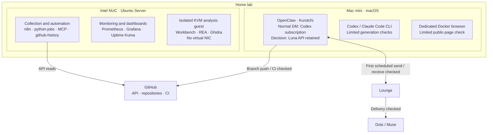

# Home AI Engineering Lab

**English** | [日本語](README.ja.md)

A home lab for GitHub automation, observability, and infrastructure/security experiments. An **Intel NUC** runs the automation and monitoring stack; a **Mac mini** hosts OpenClaw (Kurotchi) and development-tool integration experiments.

[Architecture](#architecture) · [Status](#status) · [Guides](#guides) · [All documentation](docs/README.md)

## At a glance

| Area | Role |
| --- | --- |
| Intel NUC / Ubuntu Server | Docker Compose automation and monitoring, plus a separate offline QEMU/KVM analysis guest |
| Mac mini / macOS | OpenClaw, Codex / Claude Code CLI, and a dedicated Docker browser |
| External integrations | GitHub API / repositories / CI, and lounge status sharing with Dots and Muse |

**Recorded state:** NUC observations through October 29; Mac mini checks from November 6–10, 2026. These are dated, limited results. Formal acceptance of full lab operations remains incomplete.

## Architecture

Arrows show integration paths checked within the recorded scope. They do not establish arbitrary-task completion, long-running operation, or automatic three-party conversation. **Mac mini → NUC monitoring/recovery is still awaiting acceptance** and has no connection in this diagram.

The normal DM route was checked with Sol 6.1 high via the Codex subscription. Decision still uses the Luna API. The older NUC automation stack uses no LLM or paid LLM API; this does not describe the whole Mac mini environment.

To update the overview, edit the Mermaid blocks here and in [README.ja.md](README.ja.md). GitHub renders them directly; no PNG/SVG regeneration is needed. Keep both diagrams aligned and change verification claims only when supported by a dated record. [Historical network/data-flow diagrams](docs/architecture.md) retain their own dates.

## Status

| Area | What was checked | Still open |
| --- | --- | --- |
| GitHub reporting | Manual collection and read-only MCP access from n8n | Scheduled execution; running image/source correspondence |
| Observability | Prometheus readiness and three targets; Grafana database health via API | Browser dashboard display, notifications, collector push setup |
| OpenClaw integration | Branch push/CI, approved-summary delivery, first scheduled lounge send/receive | Merge approval, arbitrary natural-language sharing, long-running operation |
| Codex subscription route | Synthetic read task; four offline cases rejected API fallback | Real quota exhaustion, everyday-task quality, measured savings; Decision API remains |
| Analysis VM | Basic VM operation conditionally accepted; no virtual NIC | REA → Ghidra analysis acceptance; Workbench/REA integration is not implemented |
| Backup | Earlier local encrypted backup/restore tests | Off-device copy; observability-volume coverage; later update-specific restore checks |

See the [latest cutover record (JA)](docs/kurotchi-lounge-codex-cutover-2026-11-10.ja.md), [configuration observations](docs/configuration-status.md), and [backup/restore guide](docs/backup-restore.md) for the scope of each check.

Component versions and detailed boundaries

| Location | Component | Purpose and current boundary |
|---|---|---|
| Compose | n8n 2.44.7 | Orchestrates workflows, including the GitHub daily report. Manual execution was verified; scheduled execution remains unverified. |
| Compose | python-jobs | Calls the GitHub API and saves reports and snapshots. Running image and current source correspondence is unverified. |
| Compose | mcp-server | Provides authenticated, read-only access to saved reports. n8n reading was verified; running image and current source correspondence is unverified. |
| Compose | github-history | Serves retained GitHub history. The running container uses read-only source mounts; dashboard integration is unverified. |
| Compose | Prometheus 3.15.1, node_exporter 1.12.1 | Collect and expose metrics; Prometheus readiness and three targets were checked. |
| Compose | Grafana 12.4.14 | Queries and visualizes metrics. Its API reported the database healthy; browser dashboard display remains unverified. |
| Compose | Uptime Kuma 2.5.6 | Checks service availability. Notification delivery and collector push setup remain unverified or unconfigured. |
| Compose | Open WebUI | Chat interface, intentionally stopped with data retained. |
| KVM guest | Workbench MCP; REA and Ghidra | Offline security-analysis experiments. Basic VM operation was conditionally accepted; REA-to-Ghidra analysis capability remains unaccepted. Current versions were not rechecked. |
| Mac mini | OpenClaw (Kurotchi) | Installed with limited work integration verified. Full lab operations acceptance remains incomplete. |
| Mac mini | Codex CLI, Claude Code CLI | Launch and limited generation verified; arbitrary development-task completion is not established. |
| Mac mini | Dedicated Docker browser | Limited public-page check verified. Arbitrary sites and authentication-state separation remain unaccepted. |
| External integration | Lounge, Dots, Muse | Reception, scheduled status posts and delivery to both peers verified. Manual sharing of approved summaries and the first scheduled send/receive cycle were checked; arbitrary natural-language sending and ongoing operation remain unaccepted. |

The custom job and MCP source differs from the public snapshot in some files. Do not assume the running images match either source tree; verify and preserve local changes before updating. The monitoring aggregation and alert/probe candidates are not deployed. Ansible material includes both changes already applied and candidates not yet placed on the host.

Open WebUI remains intentionally stopped with data retained; the AdGuard Home trial is omitted from the overview. Container startup and bounded checks do not establish all-feature acceptance.

## Guides

| I want to… | Start here |
| --- | --- |
| Access or operate the hosts | [Operations runbook](docs/ops-runbook.md) · [Mac mini setup record](docs/mac-mini-kitting-record-2026-11.md) |
| Generate or read GitHub reports | [GitHub monitoring](docs/github-monitoring.md) · [Read-only MCP](docs/mcp-internal-api.md) |
| Explore monitoring | [Playground](docs/playground.md) · [Monitoring and notifications](docs/monitoring-notifications.md) |
| Review recovery and changes | [Backup/restore](docs/backup-restore.md) · [Monitoring proposal](docs/prometheus-alerts-candidate.md) · [Custom OSS update candidate](docs/custom-oss-update-candidate.md) |
| Explore offline analysis | [Security-analysis VM (JA)](docs/security-analysis-vm.md) |
| Find setup, plans, and past results | [Documentation index](docs/README.md) |

Administration UIs are loopback-bound and accessed through SSH tunnels. Follow the runbook for connection and operation details.

## Recent records

These links describe results on their respective dates; they are not a live inventory.

| Date | Record |
| --- | --- |
| 2026-11-10 | [Lounge recovery and Codex subscription cutover (JA)](docs/kurotchi-lounge-codex-cutover-2026-11-10.ja.md) — manual delivery, first scheduled send/receive, synthetic read task |
| 2026-11-09 | [Kurotchi improvements (JA)](docs/kurotchi-improvements-2026-11-09.ja.md) — branch push/CI and lounge repairs |
| 2026-11-06 | [OpenClaw installation and limited checks (JA)](docs/openclaw-status-2026-11-06.ja.md) — browser, CLI, and lounge observations |

Repository map

| Path | What is there |
|---|---|
| `docs/` | Guides, runbooks and design records. Start from the [documentation index](docs/README.md). |
| `stacks/` | Docker Compose definitions: `observability/`, `n8n/`, `mcp/`, `uptime-kuma/`, `open-webui/`, `network-dns/`, `kubernetes/`, `openclaw-smoke/`. |
| `scripts/` | Operations, backup and collection scripts run on the host. |
| `ansible/` | Read-only baseline and service apply playbooks (applied changes and unplaced candidates are mixed; see its README). |
| `tests/` | Verification tests for the scripts and collectors. |
| `schemas/` | JSON schema for security-analysis events. |
| `experiments/` | Trial code, kept apart from the running services. |
| `assets/` | Earlier PNG/SVG diagram exports; edit the Mermaid blocks in the READMEs for the overview. |

Future operations and historical plans

The 2026-11-01 [post-Phase-4 OpenClaw operations design](docs/home-ai-lab-openclaw-operations.md) assigns operations of Ubuntu and the now-added Mac mini to OpenClaw, with Dots responsible for construction and changes. It starts after the owner's Phase 4 and initial handover; that historical design did not verify hardware, connectivity, installation or acceptance. For subsequent installation and limited test results, use the dated record above; formal operations acceptance is still incomplete. The [pre-purchase Mac mini plan](docs/mac-mini-local-ai-plan.md) preserves the earlier M4, 16 GB and 256 GB assumptions, not a current inventory. Design approval does not authorize deployment, new communication or restarting paused jobs; the existing isolated security guest remains separate.

License: not yet specified.
