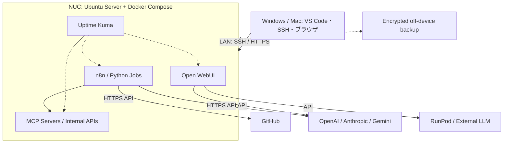

# Home AI Engineering Lab / 自宅AIエンジニアリングラボ

> Status: **Phase 2 (Docker / Uptime Kuma / local encrypted backup) deployed and verified; off-device backup pending** — 2026-10-15 JST

Intel NUC 11 Performance を、クラウドAI・GPU・GitHubと連携する常設AI開発・運用基盤として再利用するプロジェクト。**GPU搭載のLLM計算機ではなく、AIワークフローを実行・連携・観測するコントロールプレーン**とする。

## なぜ作る？

| 機能 | 導入メリット | 実例 |
|---|---|---|
| AIジョブ自動化 (n8n + Python) | 手動API呼び出しやジョブ連携を常時実行 | OSS依存関係の定期収集・分析 |
| Open WebUI | LAN内のAI共通UI | 外部LLM接続のブラウザ検証 |
| MCP / API | 自作ツールを標準APIで統合 | 権限を限定したMCPツール検証 |
| Monitoring (Uptime Kuma) | 停止やリソース逼迫の可視化 | n8n・NUCの死活監視 |
| GitHub連携 (後期) | CI/CD検証 | 信頼済みコードでのみRunner実行 |

**非目標:** 大型LLMのローカル学習・GPU推論、無認証のインターネット公開、既存ESXiの強制初期化、Dots本体の直接インストール。

## 確認済みハードウェア・OS
- Intel NUC 11 Performance / NUC11PAH (Core i5)、第11世代 4C8Tクラス、2.5GbE
- RAM **32 GB（16GB × 2）確認済み**、Crucial P5 NVMe SSD 1TB
- ESXi 7.0.2から **Ubuntu Server 24.04 LTSに移行済み**
- Windows→UbuntuのSSH接続成功、UFW稼働、OpenSSHの鍵認証有効・パスワード認証無効（実効値確認）
- Dockerは導入手順案内済みだが **インストール未確認**

## 全体構成

※論理設計。Open WebUI等のAPI接続は導入時に互換性・到達性を検証。

## 設計資料
- **[最新の実装進捗・チェックリスト](docs/build-progress.md)**
- **[次スレッド用マスタープロンプト](docs/next-thread-master-prompt.md)**
- [アーキテクチャ詳細](docs/architecture.md)
- [導入・移行ランブック](docs/implementation-plan.md)
- [物理セットアップ＆Ubuntu Server導入ランブック](docs/physical-setup-guide.md)
- [セキュリティ・運用](docs/security-operations.md)
- [バックアップ・リストア手順](docs/backup-restore.md)
- [外部AI APIの鍵管理と接続方式](docs/ai-api-key-management.md)
- Composeスタック: [`stacks/`](stacks/)、運用スクリプト: [`scripts/`](scripts/)
- [利用シナリオと検証基準](docs/use-cases.md)

## フェーズ・進捗（2026-10-15）

| Phase | 内容 | 状態 |
|---|---|---|
| 0 | ハードウェア確認、ESXiからの移行 | ✅ 完了 |
| 1 | Ubuntu Server、WindowsからSSH、UFW、SSH認証強化 | ✅ ほぼ完了（鍵限定の再接続テスト未確認） |
| 2 | Docker Compose、Uptime Kuma、バックアップ | 🟨 ほぼ完了（Docker・Kuma・再起動試験・ローカル暗号化バックアップ/リストア試験は合格。**NUC外バックアップ保存は保留**） |
| 3 | n8n、読み取り専用自動化 | 🟨 ほぼ完了（n8n + Pythonジョブ導入・読み取り専用GitHubワークフロー成功・Kuma監視・バックアップ対象化。外部AI API接続基盤は未着手） |
| 4 | Open WebUI、外部AI API | 🟨 構成導入済み（鍵なし起動・到達性確認・鍵管理方式確立。**APIキー未登録、実接続は未検証**） |
| 5 | MCP/API、GitHub連携 | ⬜ 未着手 |

詳細なログ・次の手順は [構築進捗](docs/build-progress.md) を参照。以前の「USB作成待ち」「実機導入待ち」は完了済みです。

## 原則
1. 既存ESXiの消去を伴うUbuntu移行は実施済み。今後の破壊的操作では対象とバックアップを必ず確認する。
2. LAN限定から開始しルーターのポート開放はしない。
3. 公開GitHubに秘密情報・ローカルIP・MAC・シリアルを掲載しない。
4. API費用の上限・レート制限・人間の承認を設ける。
5. 使わないサービスは増やさない。

## License
Documentation-first prototype. License selection TBD.
