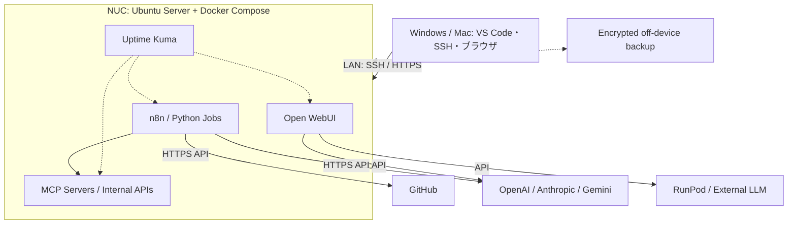

# Home AI Engineering Lab / 自宅AIエンジニアリングラボ

> Status: **Design only / 未構築** — 2026-10-14

Intel NUC 11 Performance を、クラウドAI・GPU・GitHubと連携する常設AI開発・運用基盤として再利用するプロジェクト。**GPU搭載のLLM計算機ではなく、AIワークフローを実行・連携・観測するコントロールプレーン**とする。

## なぜ作る？

| 機能 | 導入メリット | 実例 |
|---|---|---|
| AIジョブ自動化 (n8n + Python) | 手動API呼び出しやジョブ連携を常時実行 | OSS依存関係の定期収集・分析 |
| Open WebUI | LAN内のAI共通UI | 外部LLM接続のブラウザ検証 |
| MCP / API | 自作ツールを標準APIで統合 | 権限を限定したMCPツール検証 |
| Monitoring (Uptime Kuma) | 停止やリソース逼迫の可視化 | n8n・NUCの死活監視 |
| GitHub連携 (後期) | CI/CD検証 | 信頼済みコードでのみRunner実行 |

**非目標:** 大型LLMのローカル学習・GPU推論、無認証のインターネット公開、既存ESXiの強制初期化、Dots本体の直接インストール。

## 想定ハードウェア（要実機確認）
- Intel NUC 11 Performance / NUC11PAH (Core i5)、第11世代 4C8Tクラス、2.5GbE
- RAM **32 GBと推定・未検証**。SSD容量・BIOS状態も未確認
- 現状ESXi管理UIにアクセス可能、パスワード不明
- 予定OS: Ubuntu Server LTS（導入時点でサポート状況を確認）

## 全体構成

※論理設計。Open WebUI等のAPI接続は導入時に互換性・到達性を検証。

## 設計資料
- [アーキテクチャ詳細](docs/architecture.md)
- [導入・移行ランブック](docs/implementation-plan.md)
- [物理セットアップ＆Ubuntu Server導入ランブック](docs/physical-setup-guide.md)
- [セキュリティ・運用](docs/security-operations.md)
- [利用シナリオと検証基準](docs/use-cases.md)

## フェーズ・進捗

| Phase | 内容 | 状態 |
|---|---|---|
| 0 | ESXi保全判断、RAM/SSD実機確認 | 未着手 |
| 1 | Ubuntu Server、SSH鍵、ネットワーク、更新 | 未着手 |
| 2 | Docker Compose、Uptime Kuma、バックアップ | 未着手 |
| 3 | n8n、読み取り専用の自動化、監査ログ | 未着手 |
| 4 | Open WebUI、外部推論APIへの疎通 | 未着手 |
| 5 | MCP/API隔離実験、GitHub連携、必要ならGrafana | 未着手 |

## 原則
1. 既存ESXiのデータ確認前に破壊的操作をしない。
2. LAN限定から開始しルーターのポート開放はしない。
3. 公開GitHubに秘密情報・ローカルIP・MAC・シリアルを掲載しない。
4. API費用の上限・レート制限・人間の承認を設ける。
5. 使わないサービスは増やさない。

## License
Documentation-first prototype. License selection TBD.
