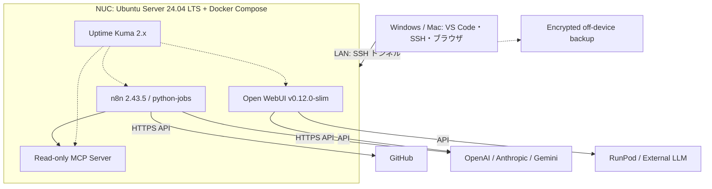

# Home AI Engineering Lab / 自宅AIエンジニアリングラボ

> Status: **Phases 0–5 deployed and verified on NUC (Docker / Uptime Kuma / n8n + python-jobs / Open WebUI / internal MCP server / local encrypted backup); off-device backup & external LLM API keys pending** — 2026-10-15 JST

Intel NUC 11 Performance を、クラウドAI・GPU・GitHubと連携する常設AI開発・運用基盤として再利用するプロジェクト。**GPU搭載のLLM計算機ではなく、AIワークフローを実行・連携・観測するコントロールプレーンとする。**

## なぜ作る？

| 機能 | 導入メリット | 実例 |
| :--- | :--- | :--- |
| AIジョブ自動化 (n8n + Python) | 手動API呼び出しやジョブ連携を常時実行 | OSS依存関係の定期収集・分析 |
| Open WebUI | LAN内のAI共通UI | 外部LLM接続のブラウザ検証 |
| MCP / API | 自作ツールを標準APIで統合 | 権限を限定したMCPツール検証 |
| Monitoring (Uptime Kuma) | 停止やリソース逼迫の可視化 | n8n・Open WebUI・MCP・NUC SSHの死活監視 |
| GitHub連携 (後期) | CI/CD検証 | 信頼済みコードでのみRunner実行 |

**非目標:** 大型LLMのローカル学習・GPU推論、無認証のインターネット公開、既存ESXiの強制初期化、Dots本体の直接インストール。

## 確認済みハードウェア・OS

- Intel NUC 11 Performance / NUC11PAHi5 (Core i5-1135G7)、第11世代 4C8T、2.5GbE
- RAM **32 GB (16GB × 2) 確認済み**（実効30GiB、swap 8GiB）、Crucial P5 NVMe SSD 1TB（LVM `/` = 100GiB、PV 928.5GiB）
- ESXi 7.0.2から **Ubuntu Server 24.04 LTSに移行済み**
- Windows -> UbuntuのSSH鍵限定接続・OS再起動後の自動復帰（約20秒）確認済み、UFW稼働、OpenSSHの鍵認証有効・パスワード認証無効（`sshd -T` 実効値確認済み）
- **Docker Engine 29.9.0 / Compose Plugin 5.6.0 稼働確認済み**（`docker` グループ未使用・`sudo docker` 運用）

## 稼働サービス一覧 (2026-10-15 時点)

ホスト側の待ち受けは **TCP 22（LANのみ）** と、下記3つの **`127.0.0.1` ループバックポート** のみです（LAN上の別マシンから1051ポートをスキャンし、開放が22番のみであることを確認済み）。Uptime Kumaの監視対象は **5件（Kuma自身、NUC SSH、n8n、Open WebUI、MCP）** です。

| サービス | 状態 | 待ち受け | 主な保護 |
| :--- | :--- | :--- | :--- |
| **Docker Engine 29.9.0 / Compose 5.6.0** | 稼働 | TCP 待ち受けなし | `docker` グループ未使用（`sudo docker` 運用） |
| **Uptime Kuma 2.x** | healthy | `127.0.0.1:3001` | 管理者認証、SQLite、固定サブネット (`172.30.0.0/24`) |
| **n8n 2.43.5** | 稼働 | `127.0.0.1:5678` | オーナー認証、公開 API・コマンド実行ノード無効 |
| **python-jobs（内部サービス）** | healthy | 公開ポートなし | Bearer 認証、許可リスト、`read-only` rootfs、`cap_drop: ALL`、非root |
| **Open WebUI v0.12.0-slim** | healthy | `127.0.0.1:8300` | 管理者認証、サインアップ無効、テレメトリ無効 |
| **MCP サーバー（自前の最小実装）** | healthy | 公開ポートなし（内部専用ネットワーク `172.31.0.0/24`） | クライアント別トークン、ツール許可リスト、監査ログ、外向き通信ブロック |
| **暗号化バックアップ** | timer 有効 | 毎日 03:30 頃 | age 公開鍵暗号、7世代保持 |

## アクセス方法

管理画面はすべてループバック（`127.0.0.1`）限定です。Windows から SSH トンネルで接続します（鍵は `ssh-agent` に登録済みであることが前提です。NUC の IP は公開リポジトリに載せていません）。

```bash
ssh -N -L 3001:127.0.0.1:3001 -L 5678:127.0.0.1:5678 -L 8300:127.0.0.1:8300 moruku@<NUC の IP>
```

- **Uptime Kuma**: `http://127.0.0.1:3001`
- **n8n**: `http://localhost:5678`
- **Open WebUI**: `http://localhost:8300`
- **MCP / python-jobs**: 内部専用のためWeb画面はありません（n8n の中から呼び出します）。

## 全体構成



※論理設計。外部AI APIの実接続は用途専用キーと月額ハードリミット設定後に有効化。

## 設計資料

- **[最新の実装進捗・最終報告 (2026-10-15)](docs/build-progress.md)**
- **[次スレッド用マスタープロンプト](docs/next-thread-master-prompt.md)**
- **[アーキテクチャ詳細](docs/architecture.md)**
- [導入・移行ランブック](docs/implementation-plan.md)
- [物理セットアップ&Ubuntu Server導入ランブック](docs/physical-setup-guide.md)
- [セキュリティ・運用](docs/security-operations.md)
- [バックアップ・リストア手順](docs/backup-restore.md)
- [外部AI APIの鍵管理と接続方式](docs/ai-api-key-management.md)
- [MCP / 内部API](docs/mcp-internal-api.md)
- Composeスタック: [`stacks/`](stacks/)、運用スクリプト: [`scripts/`](scripts/)
- [利用シナリオと検証基準](docs/use-cases.md)

## フェーズ・進捗 (2026-10-15)

| Phase | 内容 | 状態 |
| :--- | :--- | :--- |
| **0** | ハードウェア確認、ESXiからの移行 | ✅ 完了 |
| **1** | Ubuntu Server、WindowsからSSH、UFW、SSH認証強化 | ✅ 完了（Ed25519鍵限定接続テスト・OS再起動後のSSH/UFW永続性確認済み） |
| **2** | Docker Compose、Uptime Kuma、バックアップ | 🟨 ほぼ完了（Docker・Kuma 5件監視・再起動試験・暗号化バックアップ/復元試験合格。**NUC外保存とtimer初回自動実行確認は保留**） |
| **3** | n8n、読み取り専用自動化 | 🟨 ほぼ完了（n8n + python-jobs導入・否定テスト合格・読み取り専用GitHubワークフロー成功・復元データ起動確認済み。**エラー通知・外部AI API連携は未着手**） |
| **4** | Open WebUI、外部AI API | 🟨 構成導入済み（管理者作成＆サインアップ閉鎖・認証なし到達性確認・バックアップ復元確認済み。**APIキー未登録、外部LLM実接続は未検証**） |
| **5** | MCP/API、GitHub連携 | 🟨 構成導入済み（読み取り専用MCPサーバー導入・ローカル自己テスト36項目合格・n8n経由呼び出し成功・外部非公開確認済み。**Open WebUI連携・実機での制限系テスト・公式MCPクライアント互換性は未検証**） |

詳細な検証結果・トラブル対処記録・残課題は [構築進捗・最終報告 (`docs/build-progress.md`)](docs/build-progress.md) を参照。

## 原則

1. 既存ESXiの消去を伴うUbuntu移行は実施済み。今後の破壊的操作では対象とバックアップを必ず確認する。
2. LAN限定から開始しルーターのポート開放はしない。
3. 公開GitHubに秘密情報・ローカルIP・MAC・シリアルを掲載しない。
4. API費用の上限・レート制限・人間の承認を設ける。
5. 使わないサービスは増やさない。

## License

Documentation-first prototype. License selection TBD.
