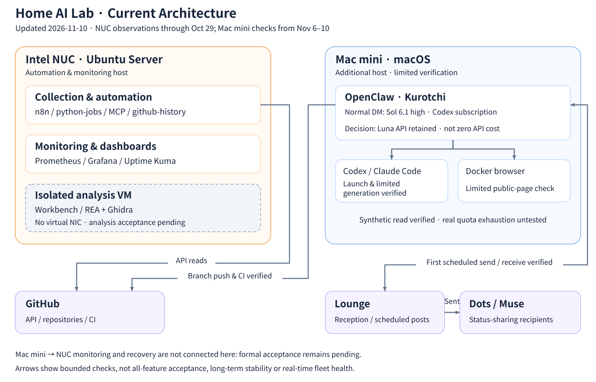

# Home AI Engineering Lab

**English** | [日本語](README.ja.md)

A home lab for GitHub automation, observability, and hands-on infrastructure and security experiments. An Intel NUC running Ubuntu Server hosts Docker Compose services and a separate QEMU/KVM security-analysis guest. The additional Mac mini hosts OpenClaw (Kurotchi) and limited development-CLI/browser integration checks. The previously documented NUC automation platform does not run an LLM or use a paid LLM API; this statement does not describe the newer Mac mini integration.

## Update: 2026-11-10

The [lounge recovery and Codex subscription cutover record (Japanese)](docs/kurotchi-lounge-codex-cutover-2026-11-10.ja.md) records restored manual delivery and the first scheduled send/receive cycle, plus a successful synthetic read task after switching Kurotchi's normal DM main to Sol 6.1 high on the Codex subscription route. Four offline failure cases rejected API fallback. Actual subscription-limit exhaustion and long-running operation remain untested; Decision processing still uses the Luna API, so this is not a zero-API-cost claim.

## Update: 2026-11-09

Kurotchi's [latest improvement record (Japanese)](docs/kurotchi-improvements-2026-11-09.ja.md) covers verified GitHub branch push/CI, repaired lounge reception and scheduled delivery, and the remaining merge-approval and natural-language sharing checks. Formal operations acceptance remains incomplete.

## Update: 2026-11-06

OpenClaw (Kurotchi) on the Mac mini has reached installation and limited verification. The [dated integration record (Japanese)](docs/openclaw-status-2026-11-06.ja.md) distinguishes Docker browser checks, CLI login, and lounge execution/receipt from unproven agent isolation, CLI agent use, and incomplete automatic three-party exchange. This paragraph records the November 6 state. The overview below was separately updated on November 9, while NUC observations retain their earlier dates.

## Architecture

Updated on 2026-11-09 to show Intel NUC and Mac mini as two separate hosts. The NUC view uses configuration observations through October 29; the Mac mini view uses installation and limited checks from November 6–9.

Larger view: [PNG](assets/architecture.png) · [scalable, editable SVG](assets/architecture.svg)

- **NUC:** Collection and automation, monitoring and dashboards, and an isolated analysis VM with no virtual NIC.
- **Mac mini:** OpenClaw (Kurotchi), Codex/Claude Code CLIs, and a dedicated Docker browser. Limited CLI generation and a public-page browser check were verified.
- **External integration:** Bounded GitHub branch push/CI and lounge reception/scheduled-post paths were verified. Natural-language status sharing and merge approval remain under verification.

Mac mini → NUC monitoring and recovery are not drawn as working connections: formal operations acceptance remains pending. Workstation SSH access and tunnels to administration UIs are omitted for readability; see the [operations runbook](docs/ops-runbook.md) and [Mac mini initial setup record](docs/mac-mini-kitting-record-2026-11.md).

The overview also omits NUC Open WebUI, previously stopped with data retained, and the AdGuard Home trial. Workbench and REA integration is not implemented. Container startup and bounded checks do not establish all-feature acceptance or long-term operation. [VM details](docs/security-analysis-vm.md) and [historical architecture notes](docs/architecture.md) retain their own observation dates.

## Components

| Location | Component | Purpose and current boundary |
|---|---|---|
| Compose | n8n 2.44.7 | Orchestrates workflows, including the GitHub daily report. Manual execution was verified; scheduled execution remains unverified. |
| Compose | python-jobs | Calls the GitHub API and saves reports and snapshots. Running image and current source correspondence is unverified. |
| Compose | mcp-server | Provides authenticated, read-only access to saved reports. n8n reading was verified; running image and current source correspondence is unverified. |
| Compose | github-history | Serves retained GitHub history. The running container uses read-only source mounts; dashboard integration is unverified. |
| Compose | Prometheus 3.15.1, node_exporter 1.12.1 | Collect and expose metrics; Prometheus readiness and three targets were checked. |
| Compose | Grafana 12.4.14 | Queries and visualizes metrics. Its API reported the database healthy; browser dashboard display remains unverified. |
| Compose | Uptime Kuma 2.5.6 | Checks service availability. Notification delivery and collector push setup remain unverified or unconfigured. |
| Compose | Open WebUI | Chat interface, intentionally stopped with data retained. |
| KVM guest | Workbench MCP; REA and Ghidra | Offline security-analysis experiments. Basic VM operation was conditionally accepted; REA-to-Ghidra analysis capability remains unaccepted. Current versions were not rechecked. |
| Mac mini | OpenClaw (Kurotchi) | Installed with limited work integration verified. Full lab operations acceptance remains incomplete. |
| Mac mini | Codex CLI, Claude Code CLI | Launch and limited generation verified; arbitrary development-task completion is not established. |
| Mac mini | Dedicated Docker browser | Limited public-page check verified. Arbitrary sites and authentication-state separation remain unaccepted. |
| External integration | Lounge, Dots, Muse | Reception, scheduled status posts and delivery to both peers verified. Natural-language sending and ongoing operation remain under verification. |

The custom job and MCP source differs from the public snapshot in some files. Do not assume the running images match either source tree; verify and preserve local changes before updating. The monitoring aggregation and alert/probe candidates are not deployed. Ansible material includes both changes already applied and candidates not yet placed on the host.

## Operate and explore

- Read [configuration status](docs/configuration-status.md), the [monitoring proposal](docs/prometheus-alerts-candidate.md), and the [custom OSS update candidate](docs/custom-oss-update-candidate.md) for observations and remaining work.
- Access the host over SSH and use SSH tunnels for loopback-bound administration UIs. See the [operations runbook](docs/ops-runbook.md).
- Generate and read reports using the [GitHub monitoring guide](docs/github-monitoring.md) and [MCP guide](docs/mcp-internal-api.md). A manual run does not establish that the schedule works.
- Explore metrics and service checks in the [playground](docs/playground.md) and [monitoring guide](docs/monitoring-notifications.md).
- Review [backup and restore](docs/backup-restore.md): local encrypted backup and restore were tested, but an off-device copy is still missing, and observability volumes are outside the existing backup.
- Find setup, source and historical records in the [documentation index](docs/README.md), [`stacks/`](stacks/), [`scripts/`](scripts/) and [`tests/`](tests/).

## Repository map

| Path | What is there |
|---|---|
| `docs/` | Guides, runbooks and design records. Start from the [documentation index](docs/README.md). |
| `stacks/` | Docker Compose definitions: `observability/`, `n8n/`, `mcp/`, `uptime-kuma/`, `open-webui/`, `network-dns/`, `kubernetes/`, `openclaw-smoke/`. |
| `scripts/` | Operations, backup and collection scripts run on the host. |
| `ansible/` | Read-only baseline and service apply playbooks (applied changes and unplaced candidates are mixed; see its README). |
| `tests/` | Verification tests for the scripts and collectors. |
| `schemas/` | JSON schema for security-analysis events. |
| `experiments/` | Trial code, kept apart from the running services. |
| `assets/` | Full-size diagram images linked from the READMEs. |

## Future direction

The 2026-11-01 [post-Phase-4 OpenClaw operations design](docs/home-ai-lab-openclaw-operations.md) assigns operations of Ubuntu and the now-added Mac mini to OpenClaw, with Dots responsible for construction and changes. It starts after the owner's Phase 4 and initial handover; that historical design did not verify hardware, connectivity, installation or acceptance. For subsequent installation and limited test results, use the dated record above; formal operations acceptance is still incomplete. The [pre-purchase Mac mini plan](docs/mac-mini-local-ai-plan.md) preserves the earlier M4, 16 GB and 256 GB assumptions, not a current inventory. Design approval does not authorize deployment, new communication or restarting paused jobs; the existing isolated security guest remains separate.

License: not yet specified.
