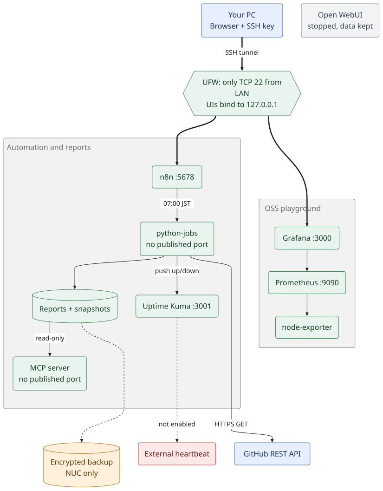
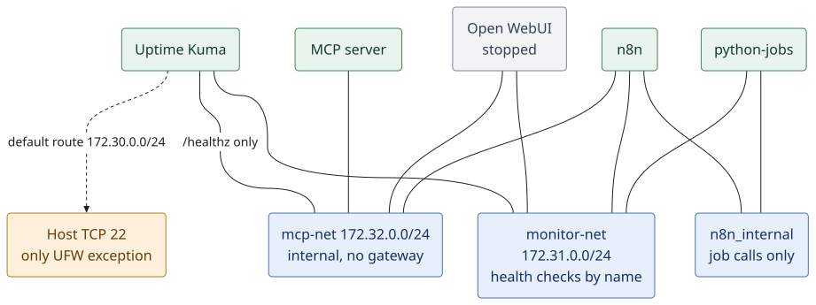
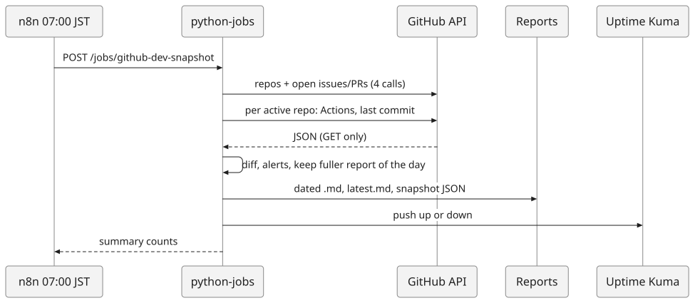
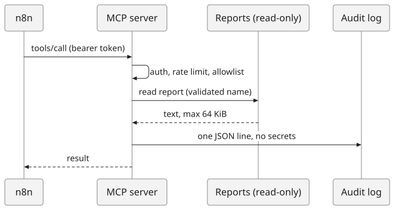
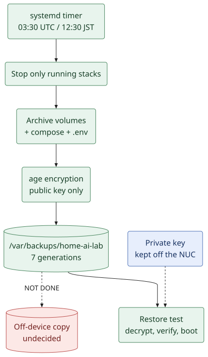

# Architecture / アーキテクチャ

English first, Japanese below each section. Reflects the deployed state recorded up to 2026-10-23. All diagrams are SVG files drawn with [Pele](https://pele.run/) from the sources in [assets/diagrams](assets/diagrams/README.md).
各節は英語が先、日本語が後です。2026-10-23 までに記録された実機の状態を反映しています。図はすべて [Pele](https://pele.run/) で描いた SVG です（ソースは [assets/diagrams](assets/diagrams/README.md)）。

## 1. Roles / 役割分担

| EN | JA |
|---|---|
| **NUC = control & execution plane.** Starts workflows, runs light jobs, serves tools to AI, monitors, logs. It never does GPU/LLM inference. | **NUC = 制御・実行基盤。** ワークフロー起動、軽量ジョブ、AI向けツール提供、監視、ログ。GPU／LLM推論は行わない。 |
| **Your PC = workstation.** Browser + SSH. No GUI on the NUC. | **手元のPC = 作業端末。** ブラウザとSSH。NUCにGUIは載せない。 |
| **GitHub = source of truth** for designs, scripts, compose files (no secrets). | **GitHub = 正本。** 設計・スクリプト・Compose定義（秘密情報なし）。 |
| **External AI = intelligence layer** (OpenAI, Anthropic, Gemini, RunPod), used only after you register a key. | **外部AI = 知能層。** キー登録後にのみ利用。 |

## 2. System overview / システム全体図

**EN:** You reach the UIs only through an SSH tunnel. Services nobody opens in a browser (python-jobs, MCP) publish no port at all. The only outbound traffic is the GitHub API, the optional heartbeat, and image pulls.
**JA:** 画面付きサービスには SSH トンネル経由でのみ入ります。ブラウザで開かないもの（python-jobs、MCP）はポート自体を公開しません。外向き通信は GitHub API、任意の heartbeat、イメージ取得のみです。

## 2b. OSS playground status / OSSプレイグラウンドの現状

The playground is the right-hand group in the diagram above. / 上の図の右側のグループがプレイグラウンドです。

| Product | Role | Status (see [build-progress.md](build-progress.md)) |
|---|---|---|
| Uptime Kuma | alerts, health checks | running (ops stack) |
| Prometheus | metrics | running; UI on loopback only; all three scrape targets `up` (verified) |
| Grafana OSS | dashboards | running; login and a query through the Prometheus data source verified by API; browser dashboards not tried |
| Kubernetes (kind) | throw-away cluster | 2 nodes `Ready`, API on `127.0.0.1:6443` only; no workloads yet |
| Kyverno | admission policies | **design only**: [playground-kyverno-design.md](playground-kyverno-design.md) |

**EN:** The playground stack has its own network `172.33.0.0/24` and also joins `monitor-net`, so Kuma can probe it by name. Its volumes are **not** in the encrypted backup yet. Playground work (usage notes, vulnerability checks, fixes) is documented in [playground.md](playground.md) and `docs/playground/<product>.md`.
**JA:** プレイグラウンドのスタックは専用ネットワーク `172.33.0.0/24` を持ち、`monitor-net` にも参加するため、Kuma から名前で監視できます。ボリュームは暗号化バックアップの**対象外**です。プレイグラウンドでの作業（感想・脆弱性診断・修正）は [playground.md](playground.md) と `docs/playground/<製品>.md` に記録します。

## 3. Networks and exposure / ネットワークと公開範囲

| Network | Members | Purpose / 目的 |
|---|---|---|
| Kuma default `172.30.0.0/24` | Uptime Kuma | Kuma's route to the host SSH check (the only UFW exception: this subnet → TCP 22) / Kumaがホストのssh死活を見る経路（UFWの唯一の例外） |
| `monitor-net` `172.31.0.0/24` | Kuma, n8n, python-jobs, Open WebUI (stopped) | Health checks by container name; python-jobs reaches Kuma's push endpoint here (every call to python-jobs still needs its bearer token) / コンテナ名での死活監視。python-jobs は Kuma の push 先に到達（呼び出しには引き続きトークンが必要） |
| `mcp-net` `172.32.0.0/24` **internal** | MCP server, n8n, Open WebUI, Kuma | MCP only. **No gateway: no Internet, no host.** Kuma may only call `/healthz` / MCP専用。出口なし。Kumaは`/healthz`のみ |
| `n8n_internal` | n8n, python-jobs | Job calls; MCP and others cannot see python-jobs / ジョブ呼び出し専用 |

Checked on the live NUC / 実機で確認済み:
- **EN:** no published port for MCP or python-jobs; the MCP container cannot reach `1.1.1.1`, `api.github.com` or the host; a port scan of 1,051 TCP ports from another LAN machine found only **22** open; container subnets are not routable from the LAN.
- **JA:** MCP・python-jobsに公開ポートなし。MCPコンテナは `1.1.1.1`・`api.github.com`・ホストのいずれにも到達できない。別のLAN内PCから1,051ポートをスキャンして開いていたのは **22のみ**。コンテナのサブネットはLANから到達不可。

**Lesson / 教訓:** a container attached to several networks may send host-bound traffic from an unexpected source IP and miss a UFW rule. Kuma's default route is pinned with `gw_priority` (see `scripts/fix-kuma-gw.sh`).
複数ネットワークに参加したコンテナは、ホスト宛通信の送信元IPが変わりUFW許可に合わなくなることがある。Kumaは `gw_priority` で既定経路を固定している。

## 4. Data flows / データの流れ

### 4.1 Daily GitHub report / GitHub日次レポート

If nothing is pushed for 26 h, Kuma marks the push monitor `down` itself. / 26時間 heartbeat がなければ Kuma が自分で `down` にします。

### 4.2 MCP tool call (works from n8n) / MCPツール呼び出し（n8nから動作）

The n8n workflow *MCP read-only test* lists the reports and reads the latest one (verified). Open WebUI → MCP is **parked**. / n8n の「MCP read-only test」で一覧取得と最新レポートの読み取りを確認済み。Open WebUI→MCP は**保留**。

### 4.3 Chat with a cloud LLM — parked / クラウドLLMとのチャット（保留中）

**EN:** Open WebUI is stopped on purpose (no paid LLM API is used). When started again it would send chat content to a provider using an API key kept in a `chmod 600` file — see [ai-api-key-management.md](ai-api-key-management.md). **Never exercised; no key is registered.**
**JA:** Open WebUI は意図的に停止中です（有料 LLM API は使いません）。再開した場合は、`chmod 600` ファイルの API キーでチャット内容をプロバイダーに送ります（[ai-api-key-management.md](ai-api-key-management.md)）。**一度も実行しておらず、キーも未登録です。**

## 5. Backup and recovery / バックアップと復旧

- **EN:** The NUC can create backups but cannot decrypt them without the private key you hold elsewhere. A restore test (Kuma, n8n, Open WebUI, MCP audit) passed on the live NUC. **Backups still live only on the NUC**, so a dead disk loses them.
- **JA:** NUCは暗号化バックアップを作れますが、別に保管した秘密鍵がなければ復号できません。実機で復元試験（Kuma・n8n・Open WebUI・MCP監査ログ）に合格しています。**バックアップはまだNUC内にしかなく**、ディスク故障で失われます。

## 6. Security layers / セキュリティの層

| Layer | EN | JA |
|---|---|---|
| Access | SSH keys only; no root/password login; no router port-forwarding | SSH鍵のみ。root/パスワード禁止。ポート開放なし |
| Host firewall | UFW: LAN → 22 and Kuma subnet → 22 | UFW：LAN→22、Kuma→22のみ |
| Docker ports | UIs bound to `127.0.0.1`; internal services publish nothing | 管理画面は127.0.0.1のみ。内部サービスは非公開 |
| Containers | non-root where possible, `cap_drop: ALL`, `no-new-privileges`, memory/PID limits, read-only root FS for python-jobs/MCP | 可能な範囲で非root、全ケーパビリティ削除、リソース制限 |
| Identity | per-client tokens; tool allowlist; admin accounts; sign-up disabled | クライアント別トークン、ツール許可リスト、サインアップ無効 |
| Audit | MCP: one JSON line per call, no tokens or argument values | MCP：1呼び出し1行。トークン・引数値は記録しない |
| Secrets | `chmod 600` files on the NUC, never in Git, encrypted in backups | NUC上の600ファイル。Git禁止。バックアップは暗号化 |

## 7. Decisions (ADR summary) / 設計判断の要約

| ADR | EN | JA |
|---|---|---|
| 001 | Ubuntu directly on the NUC (not ESXi). Revisit Proxmox only if VMs are needed. | NUCにUbuntuを直接導入（ESXiは使わない）。VMが必要ならProxmoxを再検討。 |
| 002 | NUC orchestrates; inference is external. | NUCはオーケストレーション担当。推論は外部。 |
| 003 | Docker Compose; no Kubernetes. | Docker Compose。Kubernetesは採用しない。 |
| 004 | LAN-only, reached through SSH tunnels. If remote access is needed later, use a VPN. | LAN限定、SSHトンネルで接続。外部からは将来VPN。 |
| 005 | No GitHub self-hosted runner (untrusted-PR risk). | GitHub self-hosted Runnerは対象外（未信頼PRのリスク）。 |
| 006 | MCP server is a **minimal self-made** one: small enough to audit, read-only. Interoperability with official clients is unverified. | MCPは**自作の最小実装**（監査しやすさ重視・読み取り専用）。公式クライアントとの互換性は未検証。 |
| 007 | Loopback bind + SSH tunnel instead of LAN-exposed UIs, because Docker's published ports can bypass UFW. | DockerのポートはUFWを迂回し得るため、LAN公開せずループバック＋SSHトンネルにする。 |
| 008 | Zero extra cost: no paid LLM API; work that needs no AI is done with n8n + Python + GitHub API. Open WebUI is parked (stopped, data kept). | 追加費用ゼロ：有料LLM APIは使わず、AI不要の処理は n8n＋Python＋GitHub API で行う。Open WebUI は保留（停止・データ保持）。 |
| 009 | The collector only issues `GET`, uses the Search API instead of per-repo calls, and degrades to a *partial* report instead of failing when the unauthenticated limit (60/h) is hit. | 収集は `GET` のみ。リポジトリ毎の呼び出しではなく Search API を使い、無認証の上限(60回/時)に達しても失敗せず*部分的*レポートに縮退する。 |
| 010 | Alerts are delivered through Uptime Kuma (push monitor) so there is one notification channel to configure and one place that de-duplicates. | 通知は Uptime Kuma（Push監視）に集約。設定する通知チャネルは1つで、重複抑制も1か所。 |
