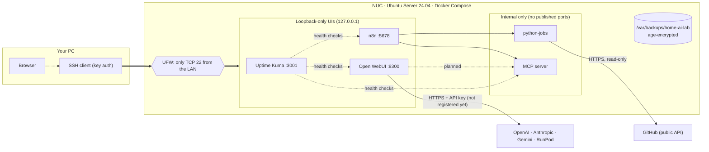
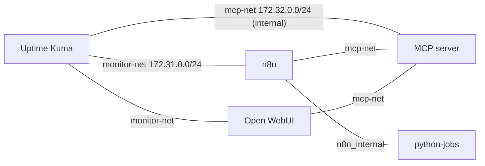
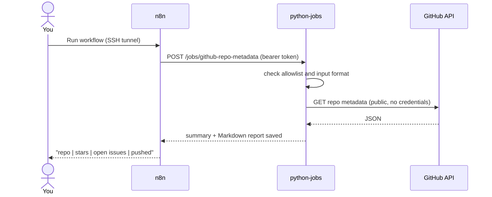
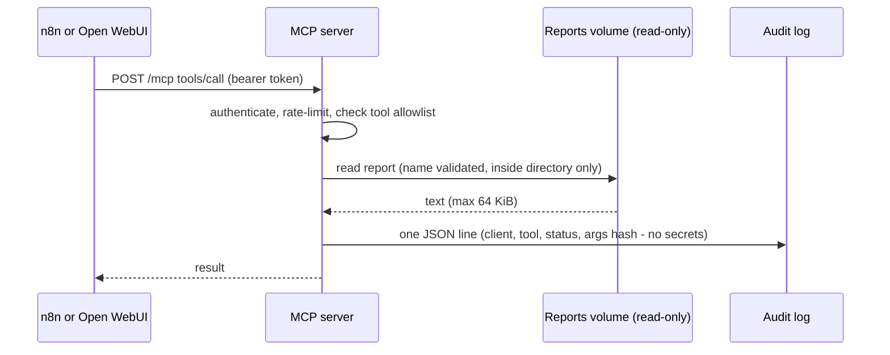
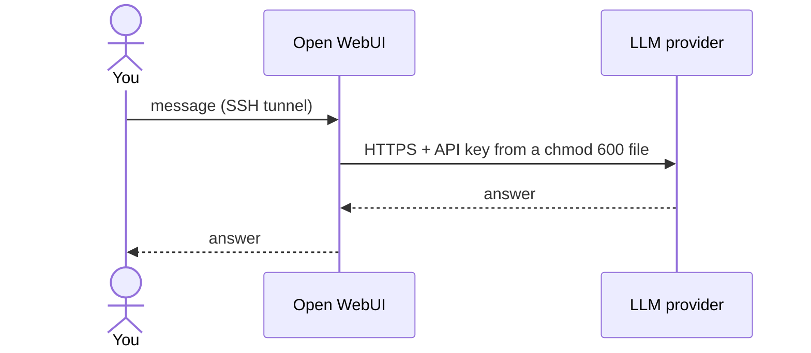
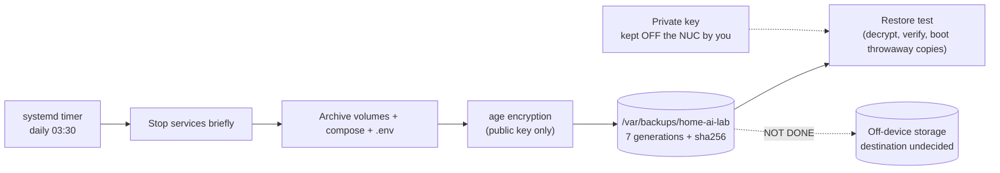

# Architecture / アーキテクチャ

English first, Japanese below each section. Reflects the deployed state on 2026-10-15.
各節は英語が先、日本語が後です。2026-10-15 時点の実機の状態を反映しています。

## 1. Roles / 役割分担

| EN | JA |
|---|---|
| **NUC = control & execution plane.** Starts workflows, runs light jobs, serves tools to AI, monitors, logs. It never does GPU/LLM inference. | **NUC = 制御・実行基盤。** ワークフロー起動、軽量ジョブ、AI向けツール提供、監視、ログ。GPU／LLM推論は行わない。 |
| **Your PC = workstation.** Browser + SSH. No GUI on the NUC. | **手元のPC = 作業端末。** ブラウザとSSH。NUCにGUIは載せない。 |
| **GitHub = source of truth** for designs, scripts, compose files (no secrets). | **GitHub = 正本。** 設計・スクリプト・Compose定義（秘密情報なし）。 |
| **External AI = intelligence layer** (OpenAI, Anthropic, Gemini, RunPod), used only after you register a key. | **外部AI = 知能層。** キー登録後にのみ利用。 |

## 2. System overview / システム全体図

**EN:** You reach the UIs only through an SSH tunnel. The services that nobody needs to open in a browser (python-jobs, MCP) publish no port at all.
**JA:** 画面付きサービスにはSSHトンネル経由でのみ入ります。ブラウザで開く必要のないもの（python-jobs、MCP）は、ポート自体を公開しません。

## 3. Networks and exposure / ネットワークと公開範囲

| Network | Members | Purpose / 目的 |
|---|---|---|
| Kuma default `172.30.0.0/24` | Uptime Kuma | Kuma's route to the host SSH check (the only UFW exception: this subnet → TCP 22) / Kumaがホストのssh死活を見る経路（UFWの唯一の例外） |
| `monitor-net` `172.31.0.0/24` | Kuma, n8n, Open WebUI | Health checks by container name / コンテナ名での死活監視 |
| `mcp-net` `172.32.0.0/24` **internal** | MCP server, n8n, Open WebUI, Kuma | MCP only. **No gateway: no Internet, no host.** Kuma may only call `/healthz` / MCP専用。出口なし。Kumaは`/healthz`のみ |
| `n8n_internal` | n8n, python-jobs | Job calls; MCP and others cannot see python-jobs / ジョブ呼び出し専用 |

Checked on the live NUC / 実機で確認済み:
- **EN:** no published port for MCP or python-jobs; the MCP container cannot reach `1.1.1.1`, `api.github.com` or the host; a port scan of 1,051 TCP ports from another LAN machine found only **22** open; container subnets are not routable from the LAN.
- **JA:** MCP・python-jobsに公開ポートなし。MCPコンテナは `1.1.1.1`・`api.github.com`・ホストのいずれにも到達できない。別のLAN内PCから1,051ポートをスキャンして開いていたのは **22のみ**。コンテナのサブネットはLANから到達不可。

**Lesson / 教訓:** a container attached to several networks may send host-bound traffic from an unexpected source IP and miss a UFW rule. Kuma's default route is pinned with `gw_priority` (see `scripts/fix-kuma-gw.sh`).
複数ネットワークに参加したコンテナは、ホスト宛通信の送信元IPが変わりUFW許可に合わなくなることがある。Kumaは `gw_priority` で既定経路を固定している。

## 4. Data flows / データの流れ

### 4.1 Read-only GitHub job (works today) / 読み取り専用GitHubジョブ（動作済み）

### 4.2 MCP tool call (works from n8n) / MCPツール呼び出し（n8nから動作）

Open WebUI → MCP is **planned, not verified**. / Open WebUI→MCPは**計画のみ・未検証**。

### 4.3 Chat with a cloud LLM (needs your API key) / クラウドLLMとのチャット（APIキーが必要）

**EN:** Not exercised yet — no key is registered. Your messages go to the provider, so do not type confidential data.
**JA:** まだ動作させていません（キー未登録）。入力内容はプロバイダーに送られるので、機密情報は入れないでください。

## 5. Backup and recovery / バックアップと復旧

- **EN:** The NUC can create backups but cannot decrypt them without the private key you hold elsewhere. A restore test (Kuma, n8n, Open WebUI, MCP audit) passed on the live NUC. **Backups still live only on the NUC**, so a dead disk loses them.
- **JA:** NUCは暗号化バックアップを作れますが、別に保管した秘密鍵がなければ復号できません。実機で復元試験（Kuma・n8n・Open WebUI・MCP監査ログ）に合格しています。**バックアップはまだNUC内にしかなく**、ディスク故障で失われます。

## 6. Security layers / セキュリティの層

| Layer | EN | JA |
|---|---|---|
| Access | SSH keys only; no root/password login; no router port-forwarding | SSH鍵のみ。root/パスワード禁止。ポート開放なし |
| Host firewall | UFW: LAN → 22 and Kuma subnet → 22 | UFW：LAN→22、Kuma→22のみ |
| Docker ports | UIs bound to `127.0.0.1`; internal services publish nothing | 管理画面は127.0.0.1のみ。内部サービスは非公開 |
| Containers | non-root where possible, `cap_drop: ALL`, `no-new-privileges`, memory/PID limits, read-only root FS for python-jobs/MCP | 可能な範囲で非root、全ケーパビリティ削除、リソース制限 |
| Identity | per-client tokens; tool allowlist; admin accounts; sign-up disabled | クライアント別トークン、ツール許可リスト、サインアップ無効 |
| Audit | MCP: one JSON line per call, no tokens or argument values | MCP：1呼び出し1行。トークン・引数値は記録しない |
| Secrets | `chmod 600` files on the NUC, never in Git, encrypted in backups | NUC上の600ファイル。Git禁止。バックアップは暗号化 |

## 7. Decisions (ADR summary) / 設計判断の要約

| ADR | EN | JA |
|---|---|---|
| 001 | Ubuntu directly on the NUC (not ESXi). Revisit Proxmox only if VMs are needed. | NUCにUbuntuを直接導入（ESXiは使わない）。VMが必要ならProxmoxを再検討。 |
| 002 | NUC orchestrates; inference is external. | NUCはオーケストレーション担当。推論は外部。 |
| 003 | Docker Compose; no Kubernetes. | Docker Compose。Kubernetesは採用しない。 |
| 004 | LAN-only, reached through SSH tunnels. If remote access is needed later, use a VPN. | LAN限定、SSHトンネルで接続。外部からは将来VPN。 |
| 005 | No GitHub self-hosted runner (untrusted-PR risk). | GitHub self-hosted Runnerは対象外（未信頼PRのリスク）。 |
| 006 | MCP server is a **minimal self-made** one: small enough to audit, read-only. Interoperability with official clients is unverified. | MCPは**自作の最小実装**（監査しやすさ重視・読み取り専用）。公式クライアントとの互換性は未検証。 |
| 007 | Loopback bind + SSH tunnel instead of LAN-exposed UIs, because Docker's published ports can bypass UFW. | DockerのポートはUFWを迂回し得るため、LAN公開せずループバック＋SSHトンネルにする。 |
