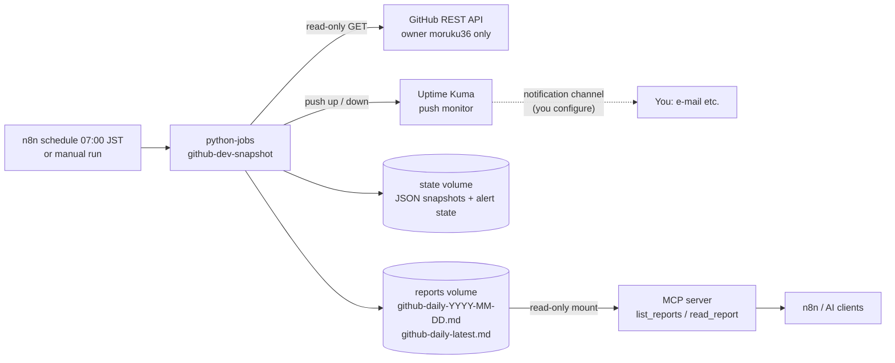

# GitHub development monitoring / GitHub開発状況の監視

English first, Japanese below each section. Status as of 2026-10-15. / 各節は英語が先、日本語が後。2026-10-15時点。

## 1. What it does / 何をするか

**EN:** Every morning at **07:00 JST** the n8n workflow *GitHub daily report (read-only)* asks the `python-jobs` service to read the public state of every repository owned by `moruku36`, compares it with the previous snapshot, and writes a Markdown report on the NUC. Nothing is ever written to GitHub (only `GET` requests). No LLM and no paid API is involved.

**JA:** 毎朝 **07:00 JST** に、n8n の「GitHub daily report (read-only)」が `python-jobs` に依頼し、`moruku36` の全リポジトリの状況を読み取り、前回との差分を取り、NUC 上に Markdown レポートを保存します。GitHub への書き込みは一切ありません（`GET` のみ）。LLM も有料 API も使いません。



## 2. What the report contains / レポートの内容

Sample (synthetic data): [samples/github-daily-sample.md](samples/github-daily-sample.md)

| # | Section | Source | Needs token? |
|---|---|---|---|
| – | Summary + critical alerts / 概要・重要な警告 | all | – |
| 1 | Recently updated repositories (last push, last commit) / 最近更新 | repo list (+ commits API) | no |
| 2 | New / updated issues (last 2 days) / 新規・更新Issue | Search API | no |
| 3 | Open pull requests with age / 未対応PR | Search API | no |
| 4 | Failed GitHub Actions (default branch) / 失敗したActions | Actions runs API | no (public repos) |
| 5 | Security notes: Dependabot alerts / セキュリティ | Dependabot alerts API | **yes** |
| 6 | Stale repositories (≥90 d) and stale issues/PRs (≥30 d) / 長期停滞 | repo list + Search API | no |
| 7 | Changes since the previous snapshot / 前回差分 | previous JSON snapshot | no |

- **EN:** Forks are counted but not analysed. Private repositories need a token. The report starts with a "Data completeness" box whenever anything could not be collected.
- **JA:** フォークは件数のみ。非公開リポジトリはトークンが必要。取得できなかったものがあると、レポート冒頭の「データの完全性」に明記します。

## 3. API budget and degradation / API 呼び出し予算と縮退

| | Without token | With read-only token |
|---|---|---|
| GitHub rate limit | **60 requests/hour per IP** (the NUC and your PC share the home IP) | 5,000/hour |
| Per-run budget (`MAX_API_CALLS`) | 45 | 1,500 |
| Repos / issues / PRs | 2 + 2 calls (Search API returns all repos at once) | same |
| Per active repo (pushed ≤14 d, non-fork, ≤40 repos) | Actions run (1 call) first; last commit with what is left | + last commit + Dependabot |
| Result today (live run) | 108 repos read; Actions checked for 32 active repos; last commit for 9 of 32 → **marked PARTIAL** | not yet tried |

Rules / ルール:
- **EN:** Retries (3 tries, exponential back-off) only for 5xx/network errors. A rate-limit answer or exhausted budget ends the data collection politely and the report says what is missing. A failure on one repository never stops the run.
- **EN:** If you re-run on the same day and the new run collected *less* than the existing report (typically because the rate limit is used up), **the fuller report is kept**; the earlier verdict is re-sent to Kuma (a critical state is never cleared by a poorer re-run).
- **JA:** リトライは 5xx／通信エラーのみ（3回・指数バックオフ）。レート制限や予算切れは、取得できた範囲でレポートを作り、不足を明記します。1リポジトリの失敗では止まりません。
- **JA:** 同じ日に再実行して、結果が既存より少ない場合（主にレート制限）は**既存の充実したレポートを残し**、重大状態は Kuma に再送します（劣る再実行で重大状態が解除されることはありません）。

## 4. Alerts / アラート

| Severity | Condition | Goes to |
|---|---|---|
| **critical** | Latest completed Actions run on the default branch failed within 48 h | Kuma push → `down` |
| **critical** | Open Dependabot alert with severity critical/high (token only) | Kuma push → `down` |
| **critical** | Collector failed completely (repo list unreadable, 401 …) | Kuma push → `down` |
| warn | Issue/PR not updated for ≥30 days; partial data | report only |
| – | No heartbeat for 26 h (n8n/python-jobs/NUC down) | Kuma marks the push monitor `down` by itself |

- **EN:** Normal updates go only into the daily report. One notification per state change (Kuma). Limitation: while the monitor is already `down`, a *second, different* critical alert does not notify again — it appears in the report; watch the "Critical alerts" box.
- **JA:** 通常の更新は日次レポートだけに載せます。通知は状態変化ごとに1回（Kuma）。制限：すでに `down` の間に起きた*別の*重大アラートは再通知されません（レポートの「重要な警告」で確認）。

## 5. Read-only token (optional) / 読み取り専用トークン（任意）

**EN:** Without a token everything above works for **public** data within the limits. A token adds private repositories, a higher budget and Dependabot.

Create a **fine-grained personal access token** (GitHub → Settings → Developer settings):

| Setting | Value |
|---|---|
| Resource owner | `moruku36` |
| Repository access | All repositories (or only the ones you want monitored) |
| Repository permissions | **Read-only** for: Metadata (mandatory), Contents, Issues, Pull requests, Actions, Dependabot alerts |
| Everything else | **No access** — never grant any write/admin permission |
| Expiration | 90 days (calendar a rotation) |

> The exact permission name for Dependabot alerts could not be confirmed on GitHub's official page during this work; a 403 response carries an `X-Accepted-GitHub-Permissions` header naming the required permission. **Unverified until a token is used.**

Store it **on the NUC only**, at a hidden prompt (never in chat, Git or the n8n UI):

```bash
cd ~/home-ai-lab/n8n
./jobs-admin.sh set-github-token      # hidden prompt; stored in .env (chmod 600)
./jobs-admin.sh check-github-token    # prints the GitHub login + rate limit only
./jobs-admin.sh remove-github-token   # and revoke it on GitHub
```

**JA:** トークンがなくても、**公開**データは上記の制限内ですべて動きます。トークンを使うと、非公開リポジトリ、より大きな予算、Dependabot が加わります。作成は上表のとおり（**書き込み・管理権限は付けない**。期限は90日）。保管は NUC 上の非表示入力のみで、チャット・Git・n8n 画面には入れません。Dependabot の権限名は公式ページで確認できませんでした（403 の `X-Accepted-GitHub-Permissions` で確認）。**トークンを使うまでは未検証です。**

| Where / 保管先 | What / 内容 |
|---|---|
| `~/home-ai-lab/n8n/.env` (600) | `GITHUB_TOKEN` (optional), `KUMA_PUSH_TOKEN`; included only in *encrypted* backups |
| GitHub | Never committed. Scanner: `scripts/scan-secrets.sh` |

## 6. Kuma push monitor (notifications) / Kuma の Push 監視

**EN:** The monitor **"GitHub collector + alerts (push)"** already exists in Uptime Kuma (expects a heartbeat every 26 h). To connect it, open the monitor in Kuma, copy its *Push URL*, and on the NUC run `./jobs-admin.sh set-kuma-push` (paste at the hidden prompt). Until then the job runs but sends no heartbeat, so the monitor stays "pending". Delivery of the alert (e-mail etc.) needs a notification channel in Kuma: see [monitoring-notifications.md](monitoring-notifications.md).

**JA:** Kuma に監視「GitHub collector + alerts (push)」を作成済み（26時間ごとの heartbeat を期待）。接続するには、Kuma でこの監視を開いて *Push URL* をコピーし、NUC で `./jobs-admin.sh set-kuma-push` に非表示入力で貼り付けます。それまでは heartbeat が送られず「pending」のままです。通知の配送（メール等）には Kuma の通知チャネルの設定が必要です（[monitoring-notifications.md](monitoring-notifications.md)）。

## 7. Reading the report through MCP / MCP からの読み取り

**EN:** The reports volume is mounted **read-only** in the MCP server. Tools: `list_reports` and `read_report` with `name = "github-daily-latest.md"` (or a dated file). Verified from n8n (workflow *MCP read-only test*: it lists the reports and reads the latest one). Open WebUI is stopped, so no AI chat client reads them yet.
**JA:** レポートのボリュームは MCP サーバーに**読み取り専用**でマウントされています。`list_reports` と `read_report`（`name` に `github-daily-latest.md` 等）で取得。n8n の「MCP read-only test」で、一覧取得と最新レポートの読み取りを確認済み。Open WebUI は停止中のため、AI チャットクライアントからはまだ読んでいません。

## 8. Storage and retention / 保存と保持

| Data | Location | Retention |
|---|---|---|
| Reports | volume `n8n_jobs-reports` (`/data/reports`) | newest 60 `github-daily-*.md` (other files untouched) |
| Snapshots, alert state | volume `n8n_jobs-state` (`/data/state`) | newest 30 snapshots |
| Both | included in the nightly encrypted backup | 7 backups |

## 9. Verification status / 検証状況

| Item | State |
|---|---|
| Live run against real public data (108 repos, 45 API calls), report written | ✅ verified on the NUC |
| Report readable via MCP from n8n | ✅ verified |
| Open WebUI stopped; data kept; stays stopped after backup | ✅ verified |
| Collector logic (pagination, diff, alerts, retries, budget, same-day rule, retention, secrets not written, Kuma push) | ✅ 45 automated checks against a **fake** GitHub/Kuma (`tests/github_snapshot_test.py`) |
| n8n workflow executed from the n8n screen | ✅ verified (2026-10-15): collect → *Job ok?* → *Summary* all green; `repos 109 \| open issues 3 \| open PRs 29 \| critical 0 \| API calls 45 \| PARTIAL DATA` (last commit 8/33 repos: unauthenticated budget) |
| **Scheduled 07:00 JST run** | ⬜ workflow shows **Published**; **first scheduled run not yet observed** |
| Failed-Actions detection on real data | ⬜ Actions were checked for all ~33 active repos in the n8n run and none was failing, so only the fake-API test proves detection |
| Token path, private repos, Dependabot | ⬜ not tested (no token) |
| Kuma push (heartbeat / down) end-to-end | ⬜ needs `set-kuma-push` |
| Notification delivery (e-mail etc.) | ⬜ no channel configured |

## 10. Rollback / ロールバック

```bash
# stop the schedule: n8n UI → workflow "GitHub daily report (read-only)" → switch Active off
# remove the secrets:  cd ~/home-ai-lab/n8n && ./jobs-admin.sh remove-github-token && ./jobs-admin.sh remove-kuma-push
# the job itself is harmless when not called; reports/state are plain files in two volumes (nothing is deleted by this rollback)
```

## 11. Scheduled run investigation (TASK-122, 2026-10-18)

**Finding from source only:** `github-daily-report.json` specifies `0 7 * * *` and `Asia/Tokyo`. The committed JSON has `active: false`; that field does **not** establish the current state of the live n8n database. The deployment script imported the workflow, then suppressed errors from both its publish attempt and its active-state check. n8n's CLI documentation says imports deactivate workflows by default. Therefore a failed publication could have gone unnoticed while a manual run still worked. The live cause remains **unconfirmed** until the checks below are run on the NUC.

The updated `scripts/ops-deploy.sh` fails if publication fails or the workflow is not active after restart. The job server now logs a safe `request started` marker before collection, so a hung job can be distinguished from a trigger that never called it. Neither change has been run on the NUC; applying them is a production change requiring approval. Do not rerun the whole deployment script just to inspect this issue: it also changes other services and invokes the report job.

### Read-only evidence collection on the NUC

1. In the n8n UI, open **GitHub daily report (read-only)** and record whether it is **Published**. Under **Executions**, filter for scheduled executions since 2026-10-15 and record start times, trigger, status, and failing node. A manual execution does not prove that the Schedule Trigger fired.
2. Confirm container state without showing environment variables: `sudo docker ps --filter name=n8n --filter name=python-jobs --format '{{.Names}} {{.Status}}'`.
3. Check only safe structured job-log fields. The following command omits request bodies, tokens, reports, and exception details:

   ```bash
   sudo docker logs --since 72h python-jobs 2>&1 | python3 -c 'import sys,json
for line in sys.stdin:
    try: d=json.loads(line)
    except ValueError: continue
    if d.get("msg") in ("request started","request","snapshot done","snapshot failed"):
        print({k:d[k] for k in ("ts","msg","job","status","repos","calls","partial") if k in d})'
   ```

4. Locate the reports volume without opening report content: `sudo docker volume inspect n8n_jobs-reports --format '{{.Mountpoint}}'`. Run `sudo python3 scripts/github_daily_health.py --reports-dir "$(sudo docker volume inspect n8n_jobs-reports --format '{{.Mountpoint}}')"` from a checkout containing this script. Exit 0 means a dated report was written after 07:00 JST; exit 2 means missing/stale; exit 3 means a filesystem error. It checks the previous day until 09:00 JST, then the current day. **A fresh report may have come from a manual run.**
5. If the UI shows a scheduled execution but no job request, inspect that execution's HTTP node and credential reference. If there is a job request with HTTP failure, inspect the selected execution status and safe job-log fields; do not export or paste credentials. If the workflow is unpublished or has no scheduled execution, check the publication history and n8n start/restart logs before changing it.

**Detection deployment:** the health script can be run after 09:00 JST by an existing monitoring scheduler and its exit status routed to the existing alerting channel. This wiring and end-to-end notification have not been performed or verified. It is separate from the n8n scheduler, so it can detect a missing report when n8n itself never fires.

**Approval boundary:** publishing or importing the live workflow, changing its schedule or credentials, manually executing it, and sending the report are production actions. Record the evidence above and obtain explicit approval for the smallest needed change. Never run `ops-deploy.sh` for diagnosis.

**JA:** ソースでは07:00 JSTのcronを確認。保存JSONの`active: false`は実機の状態の証拠にはならない。旧配備スクリプトは公開失敗を無視し得たため修正した。実機の根本原因は未確定。上の読み取り調査の後、本番の公開・実行・監視設定には明示承認が必要。
