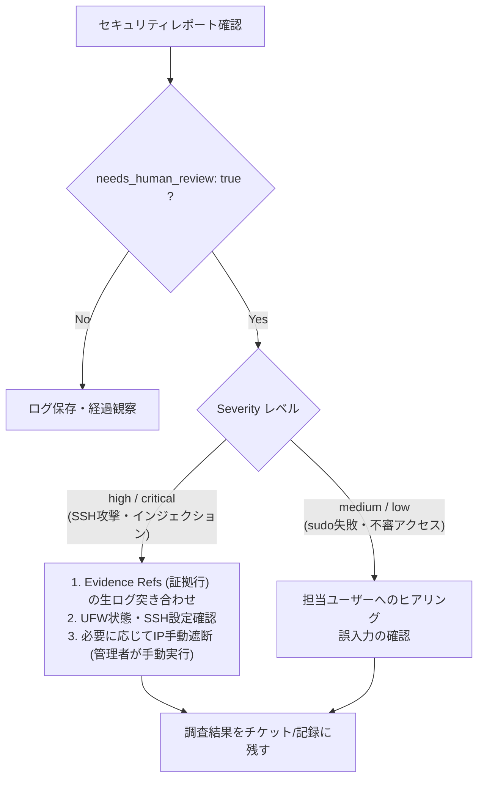

# Local GPU AI Security Log Analysis — Operations Runbook
# ローカルGPU AI セキュリティログ解析 運用手順書（Runbook）

**Status: Phase 1 Specification / 運用仕様書**  
**Role: Human Administrator & On-call / 運用管理者向け手順**

---

## 1. 定常確認事項 (Routine Operations)

セキュリティログ解析パイプラインは自動実行されますが、**自動対処（ファイアウォール遮断やプロセス強制停止）は一切行いません**。管理者が以下の手順で定期確認を行います。

### 確認項目とコマンド
1. **生成レポートの確認**:
   - レポート保存先: `/data/security-reports/`
   - 最新レポート: `security-report-latest.md`
   - 確認内容:
     - `LLM Stage Status`: `SUCCESS` または `DEFERRED_LLM` であること。
     - `Findings Count`: 新規異常件数の推移。
2. **バリデーション拒否率の監視**:
   - `python-jobs` のログにおいて `[WARN] Rejected invalid LLM finding` の頻度を確認。
   - 拒否が多発する場合、モデルのコンテキスト長超過またはプロンプト追従精度の劣化（ハルシネーション増大）を疑う。

---

## 2. Windows 停止・スリープ時の挙動と対処 (Handling Windows Offline)

Windows ホスト（GPU推論端末）は、夜間スリープや再起動、他作業により停止・切断されることが前提です。

### 期待されるシステムの挙動
- パイプラインはエラー終了せず、ステータス `DEFERRED_LLM (ConnectionRefusedError)` で正常完了します。
- **決定論的ルール検知（SSH攻撃・sudo失敗・プロンプトインジェクション等）は通常通り実行され、フォールバックレポートが出力されます**。
- Uptime Kuma 等の死活監視において、NUC 側の異常アラート（Down）は発報されません。

### 管理者の対応
- 対処不要。Windows 端末が次回起動した際に、次のスケジュールまたは手動実行にて自動的に LLM 分析が復帰します。
- 緊急のセキュリティ確認が必要な場合は、フォールバックレポート内の決定論的検知結果を参照してください。

---

## 3. 人間介入トリアージフロー (Human Triage Workflow)

パイプラインが出力したイベントのうち、`needs_human_review: true` の項目は以下の手順でトリアージします。



> [!CAUTION]
> **本パイプラインには OS 操作権限やファイアウォール変更権限はありません。**  
> いかなる遮断措置やシステム変更も、管理者が SSH 経由で手動検証した上で実行してください。

---

## 4. ログ容量管理とローテーション (Retention & Ingestion Bounds)

- **入力制限**: 1回のバッチ解析あたりの読み取り行数は最大 2,000 行（約 1MB）。これを超えるログは最新分を優先して bounded 分割。
- **レポート保持ポリシー**:
  - レポートは日次で生成。保持期間は 14 日間（`find /data/security-reports -name "security-*.json" -mtime +14 -delete`）。
  - GitHub 日次レポート（`jobs-reports/`）とは別ボリュームのため、日次レポートの保存枠を圧迫しません。

---

## 5. ロールバックおよび緊急停止手順 (Rollback & Emergency Stop)

セキュリティ解析パイプラインに予期せぬ負荷や不具合が発生した場合、既存の NUC 日次運用に影響を与えることなく即座に停止できます。

1. **n8n ワークフローの無効化**:
   - n8n 管理画面にて `Security Log Analysis` のトグルを OFF（`active: false`）にする。
2. **Compose 拡張スタックの停止**:
   ```bash
   # NUCホスト上での操作 (必要時のみ)
   docker compose -f stacks/n8n/compose.yaml -f stacks/n8n/compose.proposed-llm-extension.yaml stop security-pipeline
   ```
3. **影響確認**:
   - 既存の GitHub 日次レポート（`python-jobs` / `github-dev-snapshot`）および Uptime Kuma は別プロセスとして独立しているため、完全稼働を維持します。
