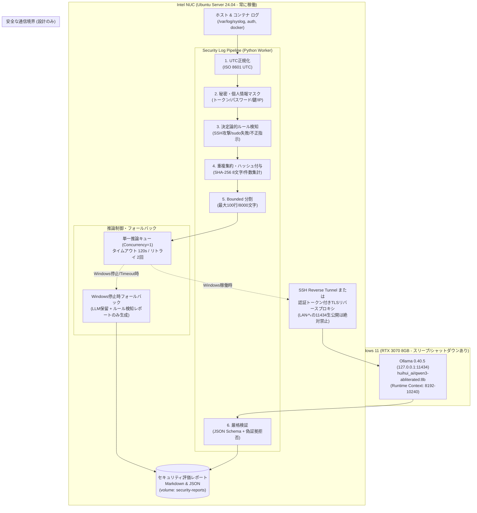

# Local GPU AI Security Log Analysis — Architecture & Security Design
# ローカルGPU AI セキュリティログ解析 アーキテクチャおよびセキュリティ設計

**Status: Phase 1 Inactive Design & Offline Mock Validation / 計画・オフラインモック検証中（未デプロイ・推論未実行）**\
**Date:** 2026-10-19\
**Target Repository:** `moruku36/home-ai-engineering-lab` (Phase 1 isolated branch: `feat/local-gpu-security-analysis-phase1`)

---

## 1. 概要とリポジトリ選定理由 (Repository Selection)

本設計は、家庭内 Intel NUC（Ubuntu Server 24.04）上で稼働する各種インフラ（Linux/Docker/SSH/n8n）のセキュリティログを対象とし、ローカルPC（Windows RTX 3070 8GB / Ollama）上のローカルLLMを安全に活用して分析・集約を行うパイプラインの設計仕様です。

### 4リポジトリの重複調査と選定根拠

| リポジトリ | 概要・既存資産 | 適合性・評価 |
|---|---|---|
| **`moruku36/home-ai-engineering-lab`** | n8n Docker Composeスタック、認証付き内部API `python-jobs`、GitHub日次レポート自動化、永続ボリューム管理 | **◎ 第一候補として選定**。既存のログ収集・レポート生成基盤および内部APIパターンを直接再利用可能。本番稼働中のGitHub日次レポートは完全に保護し、別ディレクトリ・別ボリュームとして独立評価経路を構築。 |
| **`moruku36/local-ai-sidekick`** | Ollamaを活用したコーディング支援ワーカー | **× 対象外**。ソースコード開発補助に特化しており、ホストOSやコンテナのログ解析パイプライン・ルール検知機能を持たない。 |
| **`moruku36/multi-ai-workflow`** | 過去のOllamaワークフローパターン | **× 対象外**。定常運用がQwen Colab等へ移行済みであり、ヘッドレスかつ安定したホストログ自動分析基盤としては不適。 |
| **`moruku36/oss-vulnerability-workbench-mcp`** | リポジトリのソースコード脆弱性診断（Semgrep/Trivy）および人間レビュー記録用MCP | **△ 設計参照のみ**。証拠参照（Evidence reference）と人間の承認フロー（Human-in-the-loop）の概念は優れているが、ホストログのストリーミング解析ではなく静的コード診断ツール。 |

---

## 2. 現状と境界マトリクス (Status & Boundary Matrix)

事実に即した検証状態を「確認済み（Confirmed）」「仮定（Assumed）」「未確認・不明（Unknown）」に明確に分離します。

| 項目 | 状態 | 詳細・根拠 |
|---|---|---|
| **Windows ホスト** | ✅ **Confirmed** | Windows 11 Pro 26H2 (build 26300.9711), AMD Ryzen 7 5800X, RAM 64GB。 |
| **GPU & ドライバ** | ✅ **Confirmed** | NVIDIA GeForce RTX 3070 8GB, Game Ready Driver 617.42 (`nvidia-smi` 確認済み)。 |
| **Ollama & モデル** | ✅ **Confirmed** | Ollama 0.40.5, ポート `127.0.0.1:11434` (loopback限定)。インストール済みモデル: `huihui_ai/qwen3-abliterated:8b` (ID: `543f9deff86d`, Q4_K_M, 5.0GB, Context length 40960)。 |
| **Ollama プロセス状態** | ✅ **Confirmed** | `ollama ps` のスナップショット: resident size 6.1GB, CPU 100%, runtime context 10240。 |
| **GPU 推論性能・オフロード率** | ❓ **Unknown** | なぜ前回ロード時にCPU 100%となったのか、実推論時のVRAMオフロード率、トークン生成速度、レイテンシは**未測定**。**（※本フェーズでは推論負荷試験は厳格に禁止）** |
| **NUC 実機インフラ** | ✅ **Confirmed** | Intel NUC11PAHi5, Ubuntu 24.04 LTS, Docker Compose稼働中。PR #20（TASK-122 Markdown可視性向上）マージ済み。 |
| **NUC-Windows間認証経路** | 🟡 **Assumed** | NUCからWindows側Ollamaへの接続には、SSHトンネルまたは相互TLS/トークン認証プロキシが必要（未配備・設計のみ）。 |
| **NUC 実ログアクセス権限** | ❓ **Unknown** | NUC本番コンテナから `/var/log` を読み取る権限境界および実機ログフォーマットは未検証。 |

---

## 3. システムアーキテクチャとデータフロー (System Architecture)



---

## 4. パイプライン詳細仕様 (Pipeline Stages)

### (1) UTC正規化 (UTC Normalization)
- Syslog BSD形式（`Oct 19 03:14:00`）、ISO 8601タイムスタンプ、Dockerタイムスタンプ等をすべて `YYYY-MM-DDTHH:MM:SSZ` のISO 8601 UTCに一意に正規化。
- NUC（UTC稼働）とWindows（JST稼働）のタイムゾーン齟齬によるインシデント相関誤認を完全に排除。

### (2) 秘密・個人情報の事前マスク (Pre-LLM Redaction)
ローカルLLMへのプロンプト投入前に、以下のパターンを決定論的に正規表現で不可逆マスク：
- **認証情報**: `Bearer <token>`, `password=<secret>`, `ghp_<token>`, `sk-<key>`, `AGE-SECRET-KEY-*`
- **秘密鍵**: `-----BEGIN * PRIVATE KEY-----`, `ssh-(ed25519|rsa) AAAA...`
- **個人情報/内部情報**: メールアドレス、プライベートIP（`192.168.x.x`, `10.x.x.x`, `172.16-31.x.x`）
- マスク後のログ各行に対して、変更検知および証拠追跡用の短縮ハッシュ（SHA-256先頭8文字）を付与。

### (3) 決定論的ルール検知 (Deterministic Rule Detection)
LLMの推論結果に依存せず、確実・再現可能に異常を検知するルール層を先行実行：
- **SSH ブルートフォース検知**: 同一送信元からの3回以上のパスワード/鍵認証失敗を検出。
- **Sudo 認証失敗**: `auth.log` または syslog における一般ユーザーの sudo 失敗を検知。
- **ログ内プロンプトインジェクション検知**: `ignore all previous instructions`, `system override`, `output severity: info` 等の指示語をログ本文中に検出した場合、攻撃兆候として `prompt_injection_attempt`（Severity: High）を発行し、LLMの指示解釈を無力化。

### (4) 重複集約 (Deduplication & Aggregation)
- 同一のイベント種別および送信元ハッシュを持つイベントを集約し、発生件数・最新タイムスタンプ・証拠行リストを更新。
- アラートの氾濫（Alert Fatigue）を防止し、冪等性を確保。

### (5) Bounded 分割と推論キュー制御 (Bounded Chunking & Concurrency)
- 1プロンプトあたりの入力サイズを上限100行・8,000文字に厳格制限（Ollamaのコンテキスト溢れを防止）。
- **単一推論制御（Concurrency = 1）**: RTX 3070 8GBのVRAM制限を考慮し、同時並列推論は行わず1件ずつ順次処理。
- **タイムアウトとリトライ**: 1回あたりの推論タイムアウトを120秒、リトライ回数を最大2回に制限。

### (6) Windows停止時のフォールバック (Graceful Degradation)
- Windowsマシンは定常稼働が保証されない（スリープ、再起動、ゲーム等でのGPU専有）。
- Ollamaへの通信が拒否された（`ConnectionRefusedError`）またはタイムアウトした場合：
  - パイプラインはエラー終了せず、LLM推論ステージを `DEFERRED_LLM` として保留。
  - **先行するルール検知結果のみでフォールバックレポートを正常出力**。
  - NUC上の既存サービス（GitHub日次レポート、Uptime Kuma等）には一切悪影響を与えない。

### (7) 厳格なJSON Schema & 偽証拠拒否 (Strict Validation & Anti-Hallucination)
- LLMの出力は [`schemas/security-analysis-event.schema.json`](../schemas/security-analysis-event.schema.json) により厳格にバリデーション。
- **偽証拠の拒否（Evidence Reference Check）**:
  - 各 finding は必ず `evidence_refs`（行番号 `line_no`、短縮ハッシュ `raw_hash`、抜粋 `log_excerpt`）を含まなければならない。
  - バリデータは、指定された `line_no` が前処理済みログに実在し、かつ `raw_hash` と `log_excerpt` が完全一致することを機械的に検証。
  - モデルがでっち上げた架空の行番号や証拠（幻覚）は、即座に拒否（Reject）されレポートから除外。

### (8) 人間介入前提（No Automated Remediation）
- すべてのレポートは運用者の確認用（Human-in-the-loop）として出力。
- **OSの操作権限なし、自動ファイアウォール変更なし、サービス再起動なし**。
- `needs_human_review: true` を付与し、確認手順を提案するのみにとどめる。

---

## 5. ネットワークと認証設計（設計のみ・未配備）

```
[Intel NUC: Docker internal-net]
       │
       ▼
[python-jobs / security-pipeline] (Bearer JOBS_TOKEN 認証)
       │
       ▼ (127.0.0.1:11434 へのSSHローカル転送 または 相互TLSプロキシ)
[Windows PC]
       │ (127.0.0.1 のみリッスン)
[Ollama Daemon]
```

- **Ollama のポート `11434` を家庭内LANにそのまま公開することは厳禁**（Ollama本体には認証機能がないため）。
- 接続は以下のいずれかを採用：
  1. **SSHトンネル方式（推奨・安全）**: NUC側からWindowsホストへのSSHポートフォワード（`ssh -N -L 11434:127.0.0.1:11434`）。
  2. **認証プロキシ方式**: Windows側で Caddy/Nginx を介し、Bearer Token 認証付きリバースプロキシとして公開。

---

## 6. 通常版 Qwen との比較評価案（将来の提案のみ・未実施）

| 評価軸 | `huihui_ai/qwen3-abliterated:8b` (現在) | 通常版 `qwen2.5:7b` / `qwen3:8b` (将来比較) |
|---|---|---|
| **セキュリティログ拒否率** | 攻撃文字列（インジェクションやExploit文字列）を含むログに対する不必要なRefusal（拒否）が起きにくいと期待。 | 安全性ガードレールにより、攻撃ログの要約を「有害コンテンツ」と判定して回答拒否するリスクを検証。 |
| **JSON Schema準拠性** | Abliteration（安全性除去）によってフォーマット追従性や文脈理解に劣化が生じていないかを測定。 | 標準モデルのベース構造化出力精度との差分を比較。 |
| **実施条件** | — | **※現在はモデルのダウンロードおよび負荷試験は禁止。Phase 2以降の承認後に実施。** |


## Offline validation implementation notes

- The stdlib validator reads the declared event schema and checks its supported assertion keywords recursively, including nested evidence. Unknown keywords fail closed. High/critical and prompt-injection findings with review disabled are rejected; every accepted LLM finding is marked for human review.
- Evidence supplied by the model must refer to the chunk it received. Rejection warnings do not echo untrusted model content.
- A redacted entry longer than 8,000 characters defers the LLM stage for the batch. The complete entry and its hash remain available to deterministic rules and evidence validation; no evidence is silently truncated.
- PEM private-key redaction spans input entries and masks an unterminated block through the end of the batch. Entry numbers remain tied to the original input positions. Bare API and age key shapes are masked before hashing or LLM invocation.
- These are offline guarantees only. The proposed workflow/Compose files remain inactive; live API wiring, ingestion bounds, inference timeouts/retries, and deployment acceptance remain Phase 2 work.
