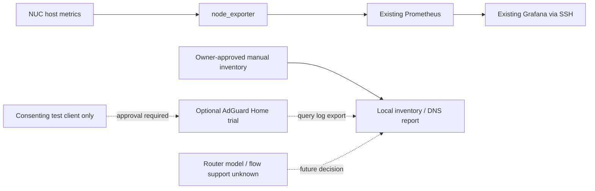

# Home network visibility / 家庭ネットワーク可視化の概要

**2026-10-15 — Phase 1・2を実装中。実機への適用・表示は未検証。**
This is a separate network roadmap; its phase numbers do not refer to the original lab build phases.
既存ラボの構築Phaseとは別の番号です。まず概要をGitHubで共有し、その条件に沿って実装します。

## 目的と見える範囲

「どんな通信があるか」を、ホストの数値、端末の一覧、DNSの問い合わせ先、必要ならルータのフローという順に確認します。
Wiresharkのようなパケット取得は今回行いません。スイッチ接続のNUCは家庭全体の通信を自動的には受信しません。

| Phase | できること / 手段 | 今回の範囲と完了条件 |
|---|---|---|
| 1: 基本の把握 | 既存Prometheus + node_exporter + GrafanaでNUCの負荷・メモリ・インターフェース送受信量。本人が管理する端末の台帳 | 今回。ホスト由来の数値であることを確認し、グラフと許可対象の台帳を表示。台帳は自動発見と区別する |
| 2: 通信先 | 同意した試験端末だけのDNS問い合わせをAdGuard Homeで確認。対応ルータなら後日NetFlow/IPFIX/sFlow等を検討 | 今回。DNSの小規模試験と表示までを目標。現段階は構成雛形・合成ログ試験。実機の端末/DNS設定変更には別途承認が必要。ルータ収集は機種確認待ち |
| 3: 受動検知 | Zeekの通信記録、SuricataのIDS。ミラーポート/TAP等の観測経路が必要 | 将来概要のみ。検知ルール、対象、誤検知、資源を評価してから検討 |
| 4: 限定遮断 | OPNsense等のゲートウェイで、必要なルールだけ適用 | 将来概要のみ。経路変更、停止影響、復旧手順と明示承認が前提 |

DNSにはキャッシュ・直接IP接続・DoH/DoT等で見えない通信があります。DNS問い合わせは接続成功の証拠でも、全通信量でも、HTTPS本文でもありません。
フローは送受信IP・ポート・バイト等のメタデータです。対応機器とexport設定が必要で、本文は含みません。
今回、全家庭の監視・家族端末の記録・本文取得・遮断は開始しません。

## 最小構成と選定理由

- **Prometheus / node_exporter**: 既に導入済みで再利用できる数値監視基盤。パケット解析器としては扱わない。Apache-2.0。
- **Grafana OSS**: 既存のPrometheusデータソースを再利用し、用途を限定したダッシュボードを追加。AGPL-3.0。
- **端末台帳**: まず手動登録。接続状態は未確認と明示。NetAlertX（GPL-3.0）は端末の発見・増減把握に適するが、対象LAN・探索方法の承認がまだないため今回は追加しない。
- **AdGuard Home**: DNSのquery logと画面を持つ単一サービスで、小規模試験に絞りやすい。GPL-3.0。Pi-holeも代替だが今回は同時導入しない。フィルタ・DNS書換・DHCPは試験で無効にする。
- **Zeek / Suricata / OPNsense**: 調査・ルール検知・遮断という役割がそれぞれ異なる。今回インストールしない。

コントリビューター数の順位での選定ではありません。既存構成の再利用、役割適合、導入範囲を小さくできることを優先しました。
既存の固定タグを維持し、新しいDNSイメージは適用前にrelease・ライセンス・digestを再確認します。脆弱性試験対象のOSSは家庭LANや秘密保管と分離し、観測サービスへ追加接続しません。

## 既存状態と確認事項

- 起点は `main` の `887e437`。新規cloneの作業ツリーはclean、確認時点のopen PRは0件。他ブランチを更新しない。
- [既存の稼働記録](playground/prometheus.md)にはPrometheus/node_exporter/Grafanaの稼働と`up`確認あり。[Grafana記録](playground/grafana.md)ではダッシュボードは未試行。
- 現行node_exporterはbridge network。`--path.rootfs=/host`だけでホストのネットワーク名前空間になるわけではない。現在の`node_network_*`を家庭全体やNUC物理NICの通信量と断定しない。
- SSHは既存の設定・鍵・host key検証を使う。新しい鍵作成、known_hosts検証省略、パスワード認証の有効化はしない。
- 未確認: 実機の現在の作業ツリー、NIC数と用途、ルータ/スイッチ機種、ミラー/flow対応、許可する端末、既存DNS/DHCP、利用可能な認証済み接続。

## 保存・運用・戻し方

数値は既存Prometheusの15日保持を継続。端末台帳・DNS生ログ・生成レポートはGit管理外の`data/`に置き、本人のみ読める権限とする。
DNS試験は原則1時間、query logは最長24時間、試験後に停止して生ログ・生成物を削除。端末台帳は必要期間のみ手動保持。DNS名やMACをPrometheusラベルに入れない。
現時点でobservability volumeは暗号化backup対象外。DNS生ログを既存backupに追加しない。

適用前に対象コミット・現行ファイル・volume有無を記録し、既存データを残して変更部分だけ戻せるようにする。
DNS試験終了時は端末側のDNSを元に戻してからDNSサービス停止。DHCP/ルータ設定を変更しない。`down -v`は使わない。

## 実装と承認の境界

今回先行できること: 文書、ダッシュボード定義、ローカル台帳/DNS表示、DNS試験Compose雛形、合成データの試験。
実機でのdeployは既存状態の確認後に判断。DNS/ルータ/DHCP/FW/VLAN変更、host namespace権限追加、LAN探索、家族端末の記録、外部公開、資格情報作成は個別に影響範囲を示して承認を待つ。
Phase 1・2全体の完了にはNUCでの収集・稼働・ブラウザ表示の証拠が必要で、コードや模擬試験だけで完了としない。

## 公式資料（2026-10-15確認）

- [Prometheus node metrics guide](https://prometheus.io/docs/guides/node-exporter/)、[node_exporter Docker / license](https://github.com/prometheus/node_exporter#docker)
- [Grafana dashboard provisioning](https://grafana.com/docs/grafana/latest/administration/provisioning/#dashboards)、[Grafana license](https://github.com/grafana/grafana/blob/main/LICENSE)
- [AdGuard Home Docker](https://github.com/AdguardTeam/AdGuardHome/wiki/Docker)、[Configuration](https://github.com/AdguardTeam/AdGuardHome/wiki/Configuration)、[license](https://github.com/AdguardTeam/AdGuardHome/blob/master/LICENSE.txt)
- [NetAlertX documentation](https://docs.netalertx.com/)、[project and license](https://github.com/netalertx/NetAlertX)
- [Zeek](https://zeek.org/)、[Suricata](https://suricata.io/)、[OPNsense](https://docs.opnsense.org/)
