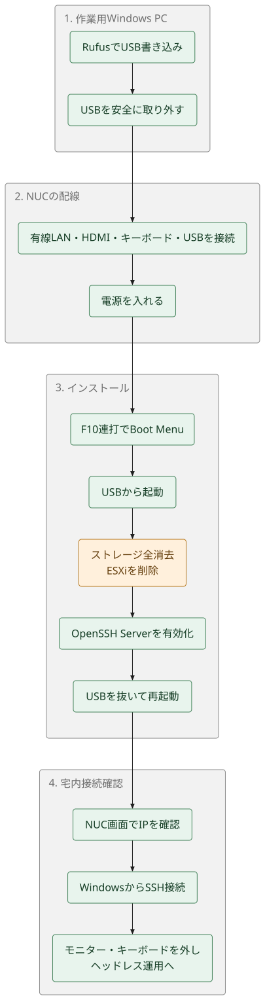

# 物理セットアップ＆Ubuntu Server導入ランブック / Physical Hardware & OS Setup Guide

> **対象機**: Intel NUC 11 Performance (NUC11PAH / Core i5)  
> **目的**: 既存のESXi環境を完全に消去し、Ubuntu Server 24.04 LTSを導入。同一宅内LAN（IPv4）のWindows PCからSSH接続可能な常設ヘッドレスサーバーとして立ち上げる。

---

## 全体フロー




---

## 必要な機器・準備物

| 機器 | 用途・注意点 |
|---|---|
| **作成したUSBメモリ** | KIOXIA 16GB（Ubuntu 24.04.5 LTS 書込済） |
| **Intel NUC 本体 & ACアダプタ** | 今回セットアップするサーバー実機 |
| **有線LANケーブル** | 自宅ルーターまたはハブに直接接続（※初回セットアップはWi-Fi不可・有線必須） |
| **ディスプレイ & HDMIケーブル** | 初期セットアップ画面確認用（セットアップ完了後は撤去可能） |
| **USBキーボード** | インストーラー操作用（セットアップ完了後は撤去可能） |
| **作業用 Windows PC** | 同一宅内Wi-Fi/LANに接続されていること |

---

## Step 1: USBメモリの安全な取り外し（Windows PC）

1. Rufus の進捗バーが `100% (READY / 準備完了)` になっていることを確認し、**閉じる (CLOSE)** をクリックします。
2. Windows タスクトレイの「ハードウェアを安全に取り外してメディアを取り出す」アイコンをクリックし、USBドライブ（`KIOXIA TransMemory`）を取り外します。
3. PCからUSBメモリを引き抜きます。

---

## Step 2: Intel NUC の物理配線

電源を入れる前に、以下の順序でケーブルを接続します：

1. **有線LANケーブル**: NUC背面のLANポート（2.5GbE）と自宅ルーター/スイッチを接続。
2. **HDMIケーブル**: NUC背面とモニターを接続。
3. **USBキーボード**: NUCのUSBポートに接続。
4. **作成したUSBメモリ**: NUCの空いているUSBポートに接続。
5. **ACアダプター（電源）**: 最後に電源ケーブルをNUC背面に差し込み、コンセントに繋ぎます。

---

## Step 3: NUCの起動とブートメニュー呼び出し

1. モニターの電源を入れておきます。
2. NUC前面の**電源ボタン**を押します。
3. 画面が点灯した直後から、キーボードの **`F10` キーをトントントンと連打**します。
   - ※タイミングを逃してESXiが立ち上がってしまった場合は、電源ボタンを長押しして強制終了し、再度電源を入れて `F10` を連打してください。
   - ※BIOS設定画面を開くキーは `F2` ですが、OSブート先を選ぶには `F10` (Boot Menu) が最も確実です。
4. **Boot Menu** が表示されたら、矢印キーで以下のような名称のUSBドライブを選択して **Enter** を押します：
   - 例: `UEFI : KIOXIA TransMemory ...` または `UEFI : USB Device ...`
5. 黒い画面に「`Try or Install Ubuntu Server`」と表示されたら、そのまま **Enter** を押します。

---

## Step 4: Ubuntu Server インストール（対話画面）

操作はすべて **矢印キー（移動）**、**スペースキー（選択/チェック）**、**Enterキー（決定）** で行います。

### 1. 言語選択 (Language)
- **`English`** を選択して Enter（推奨: ターミナルの文字化け防止、エラーログ調査の容易さのため）。

### 2. インストーラー更新 (Installer update)
- 「Update to the new installer」が出た場合は、**`Update to the new installer`** または **`Continue without updating`** のどちらでも構いません（通常はそのまま Enter で続行）。

### 3. キーボード設定 (Keyboard configuration)
- 日本語キーボードをお使いの場合:
  - Layout: `Japanese`
  - Variant: `Japanese`
- 英語キーボードの場合: `English (US)`
- 「Done」に合わせて Enter。

### 4. インストールタイプ (Choose type of install)
- **`Ubuntu Server`**（デフォルト）が選択されていることを確認し、「Done」で Enter。
  - ※「Ubuntu Server (minimized)」は最小構成のため、標準の「Ubuntu Server」を推奨します。

### 5. ネットワーク接続 (Network connections) — 重要
- 有線LANポート（`enp...` など）が表示され、ルーターから自動的にIPv4アドレス（例: `192.168.1.xxx/24`）が割り当てられていることを確認します。
  - **ここで画面に表示されている IPv4 アドレス（例: `192.168.1.50`）をメモしておいてください。** 後でWindows PCから接続する際に使用します。
- 「Done」に合わせて Enter。

### 6. プロキシ設定 (Configure proxy)
- 空欄のまま「Done」で Enter。

### 7. Ubuntuアーカイブミラー設定 (Configure Ubuntu archive mirror)
- 日本国内のミラー（`http://jp.archive.ubuntu.com/ubuntu` など）が自動設定されています。そのまま「Done」で Enter。

### 8. ストレージ設定 (Guided storage configuration) — 最重要（ESXiの完全消去）
- **`[X] Use an entire disk`** にチェックが入っていることを確認します。
- ディスク一覧に NUC の内蔵SSD（例: `NVMe SSD ...` または `SATA SSD ...`）が選択されていることを確認します。
- ※「Set up this disk as an LVM group」はチェックが入ったままで問題ありません。
- 「Done」に合わせて Enter。
- パーティションサマリー（FILE SYSTEM SUMMARY）が表示されるので、確認して「Done」で Enter。
- **「Confirm destructive action (データ破棄の確認)」警告ダイアログ**:
  - 「既存のデータがすべてフォーマットされ失われます」という警告が出ます。
  - 矢印キーで **`Continue`** を選択して Enter を押します。
  - **※ これにより、以前の ESXi 環境およびデータストアが完全に消去され、Ubuntu用に初期化されます。**

### 9. プロファイル設定 (Profile setup)
サーバーの管理者ユーザーを作成します：
- **Your name**: あなたのお名前（例: `Kentaro Mori`）
- **Your server's name**: サーバーのホスト名（例: `nuc-ai-lab`）
- **Pick a username**: ログイン用ユーザー名（例: `kentaro`）※英小文字・数字推奨
- **Choose a password**: ログインパスワード
- **Confirm your password**: パスワード再入力
- 「Done」に合わせて Enter。

### 10. Ubuntu Pro
- 「Skip for now」を選択して「Done」で Enter。

### 11. SSH設定 (SSH Setup) — 最重要（リモート接続用）
- **`[X] Install OpenSSH server`** に必ずチェックを入れます（スペースキーを押して `[X]` にする）。
  - ※これにチェックを入れないと、後からWindows PCからSSH接続できなくなります！
- **GitHubからの公開鍵インポート（任意・推奨）**:
  - `Import SSH identity`: `Import from GitHub` を選択
  - `GitHub username`: `moruku36` と入力
  - ※GitHubに登録されている公開鍵が自動的に `~/.ssh/authorized_keys` に登録され、初回からパスワード不要の公開鍵認証が可能になります（スキップしてパスワード認証のみでも構いません）。
- 「Done」に合わせて Enter。

### 12. サーバー追加パッケージ (Featured Server Snaps)
- 後ほどDockerで必要なサービスを立ち上げるため、ここでは**何も選択せず**「Done」で Enter を押します。

### 13. インストール実行と完了
- インストール処理が開始されます（数分〜十数分かかります）。
- 最下部に `Cancel update and reboot` または `Reboot Now` が表示されるまで待ちます。
- **`Reboot Now`** が表示されたら選択して Enter を押します。

---

## Step 5: USBメモリの抜去と初回起動

1. 再起動処理が進むと、画面に以下のようなメッセージが表示されます：
   ```text
   Please remove the installation medium, then press ENTER:
   ```
2. **USBメモリをNUCから引き抜きます。**
3. キーボードの **Enter** キーを押します。
4. NUCがSSDから再起動します。
5. 起動ログが流れた後、以下のようなログインプロンプトが表示されればOS導入完了です：
   ```text
   nuc-ai-lab login:
   ```

---

## Step 6: 宅内Windows PCからの接続確認（疎通テスト）

ここからは、作業用 Windows PC で操作します。

### 1. NUCのIPアドレス確認
- インストール時のStep 4-5でメモしたIPアドレス（例: `192.168.1.50`）を確認します。
- ※もしメモを忘れた場合は、NUCに接続したキーボードからStep 4-9で作成したユーザー名とパスワードでログインし、以下を実行して確認できます：
  ```bash
  ip -br addr
  ```
  `enp...` の横に表示される `192.168.x.x` がIPv4アドレスです。

### 2. Windows PC（PowerShell）からのPing疎通確認
Windows PCで PowerShell を開き、Pingを実行します：
```powershell
Test-Connection 192.168.x.x -Count 2
```
正常に応答（StatusCode: Success）が返ってくることを確認します。

### 3. SSHリモート接続
PowerShellからNUCへSSH接続します：
```powershell
ssh <username>@192.168.x.x
```
*(例: `ssh kentaro@192.168.1.50`)*

- 初回接続時、`Are you sure you want to continue connecting (yes/no/[fingerprint])?` と尋ねられるので、**`yes`** と入力して Enter。
- パスワードを求められたら、Step 4-9で設定したパスワードを入力して Enter。
- 以下のようなプロンプトが表示されれば、接続成功です！
  ```bash
  kentaro@nuc-ai-lab:~$
  ```

### 4. ハードウェア情報の最終確認（NUC上）
SSH接続したターミナルで以下を実行し、リポジトリに記載のスペック（RAM 32GB、CPU、SSD容量）を確認します：
```bash
# CPU / メモリ / SSD の確認
lscpu | grep "Model name"
free -h
lsblk -o NAME,SIZE,TYPE,FSTYPE,MOUNTPOINTS
```

---

## Step 7: ヘッドレス（常設）化

SSH接続が確認できたら、物理作業はすべて完了です：

1. NUCに接続されている **HDMIケーブル（ディスプレイ）** と **USBキーボード** を抜きます。
2. NUC本体には **「電源ケーブル」** と **「有線LANケーブル」** の2本だけが接続された状態にします。
3. 今後のすべての設定（Docker導入、AIジョブ自動化、Open WebUI等）は、Windows PCからSSH経由またはAIアシスタントを介してリモートで実行できます。

---

## トラブルシューティング

| 現象 | 原因と対策 |
|---|---|
| **F10を押してもBoot Menuが出ずESXiが起動する** | 高速起動が有効になっているかキー連打のタイミングが遅い可能性があります。電源投入前からF10を連打し続けてください。それでも出ない場合は `F2` を連打してBIOS画面に入り、Bootタブから起動順序でUSBを最優先に変更してください。 |
| **画面が真っ暗で何も映らない** | HDMIケーブルがしっかり奥まで刺さっているか確認してください。NUCの別のHDMIポートやモニター側の入力切替（HDMI 1 / HDMI 2）を確認してください。 |
| **インストーラーでIPv4アドレスが取得できない** | 有線LANケーブルがルーターのLANポートにカチッと音がするまで刺さっているか確認してください。ルーターのDHCP機能が有効か確認してください。 |
| **Windows PCから `ssh` すると Connection Refused になる** | インストール時の「Install OpenSSH server」にチェックが入っていなかった可能性があります。一度NUCにモニターとキーボードを繋ぎ直してログインし、`sudo apt update && sudo apt install -y openssh-server && sudo systemctl enable --now ssh` を実行してください。 |
| **Windows PCから `ssh` するとタイムアウト（No route to host）になる** | Windows PCが「ゲストWi-Fi」などに接続されており、LAN内機器間の通信がルーターのプライバシーセパレーター機能で遮断されている可能性があります。同一の宅内プライベートLANに接続されているか確認してください。 |
