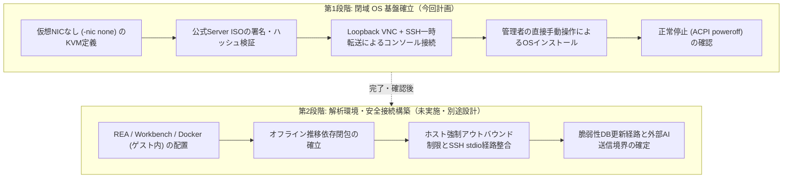

# Security analysis VM / 専用セキュリティ解析VM

**Status: Planning & Pre-check (Unimplemented) / 計画・事前確認中（未実施）**

外部オープンソースソフトウェアやバイナリのセキュリティ解析（リバースエンジニアリング、脆弱性診断等）を検証するため、既存の日常運用環境（n8n, Grafana, 外部APIキー、暗号化バックアップ等）への直接干渉を抑え、QEMUおよびホストLinuxカーネルを信頼境界とする専用の仮想実行環境（Linux KVMゲスト）を整備する計画です（ハイパーバイザエスケープ等の脆弱性リスクは残存するため、完全隔離を保証するものではありません）。

---

## 1. 概要とツール位置づけ

ホスト環境の保護を優先し、解析作業に伴う潜在的リスク（不正な外向き通信、ホストファイルシステムへの干渉、依存の競合）をハイパーバイザおよびホスト側境界によって局所化することを図ります（QEMU実装やカーネルの不具合等による境界突破リスクは残るため、絶対的な防御を保証するものではありません）。

### 利用ツールと関係性
- **REA (Reverse Engineer Anything)**: [morluto/rea](https://github.com/morluto/rea)  
  バイナリ、Electron、ネイティブコード等の解析を行うリバースエンジニアリング支援MCPサーバー。
- **OSS Vulnerability Workbench MCP**: [moruku36/oss-vulnerability-workbench-mcp](https://github.com/moruku36/oss-vulnerability-workbench-mcp)  
  依存パッケージの脆弱性スキャンや静的コード解析を取り扱うセキュリティ診断ワークベンチMCPサーバー。

> [!IMPORTANT]
> **REA と OSS Vulnerability Workbench MCP は独立した別個の MCP サーバーです。**  
> 両者は将来的な連携・統合呼出しを予定していますが、一方が他方を内包・内蔵する関係ではありません。依存関係、実行プロセス、設定は個別に管理されます。

---

## 2. 段階的アプローチと完了条件

リスクを段階的に管理・検証するため、導入を 2 つのフェーズに分離して進めます。

### 第1段階の完了条件（今回のスコープ）
1. **仮想ネットワークの完全排除**:
   - QEMU オプションに `-nic none` を明示指定し、仮想 NIC デバイスを一切生成しない。
2. **公式 ISO の真正性・整合性検証**:
   - Ubuntu 公式配布元より `ubuntu-24.04.5-live-server-amd64.iso` を取得。
   - 公式の `SHA256SUMS` および GPG 署名（`SHA256SUMS.gpg`、Ubuntu CD Image Automatic Signing Key）により検証完了すること。
3. **隔離ストレージと資源枠の確保**:
   - 2vCPU / 4GiB RAM / 20GiB thin（sparse qcow2）を `/var/lib/rea-vm/images/rea-guest.qcow2` に作成。
4. **起動と管理コンソール操作**:
   - OS 起動時の自動起動（autostart）は行わず、必要時のみ手動起動する運用とする。
   - ホスト側の Loopback（`127.0.0.1:5900`）限定 VNC 出力と、管理端末からの SSH 一時ローカルポート転送を経由してコンソールを表示できること。
   - ゲスト内ローカルパスワードは管理者がコンソールへ直接入力し、AI・チャット・ログに一切露出させないこと。
5. **安全停止の確認**:
   - ゲスト内からの正常シャットダウン（`sudo poweroff`）または ACPI 電源断により、QEMU プロセスが正常終了（exit 0）すること。

### 第2段階の完了条件（未実施・将来スコープ）
- ゲスト内への Node.js、REA、Workbench、Docker（ゲスト内完結）の資材搬入と依存閉包の確立。
- ホスト側カーネルでの強制アウトバウンド遮断と、管理端末からの SSH stdio 連携の整合性検証。
- 脆弱性データベース等の更新経路の確立。
- 外部 AI への解析データ送信および動的トレースは必須要件ではなく、必要時に個別承認を得る運用境界が明確に定まること（現時点では未承認・未設定を維持）。

---

## 3. 資源枠とホスト配慮

| 項目 | 割り当て枠 | 設計上の配慮と制限 |
| :--- | :--- | :--- |
| **CPU** | 2 vCPU | 物理コア専有やピニングは行わずホストのスケジューラに委ねる共有割当。負荷集中回避は保証されず、既存サービス（n8n, Grafana等）へのリソース競合・性能影響が生じ得ます。 |
| **メモリ** | 4 GiB | ホストの利用可能メモリから動的に確保（事前の一括固定確保は行わない）。 |
| **ストレージ** | 20 GiB thin (qcow2) | ゲスト内の論理容量上限（sparse形式）。ホストの実消費上限ではなく、qcow2メタデータや将来のスナップショット等で拡大する可能性があり、初期実消費も実機未測定です。 |
| **停止閾値 (提案値)** | ホスト空き 15GiB 未満 | ホストのルート空きが 15GiB 未満となった場合に VM 開始を拒否する未検証の提案値（安全マージン案）。運用上の十分性を保証するものではありません。 |

> [!WARNING]
> ハードウェア資源（CPU・メモリ・I/O）はホストと物理共有するため、既存サービスに対する完全な無影響は保証されません。

---

## 4. セキュリティと運用上の注意事項

- **既存環境の非干渉**:
  - ホスト上の既存 Docker ネットワーク、UFW、稼働中コンテナの設定変更は一切行いません。
  - 一般ユーザーの管理者権限拡張（sudoers 変更等）は行いません。
- **専用非特権ユーザーの利用**:
  - QEMU 実行用として、ログイン権限を持たない専用システムユーザー `rea-vm` を作成し、`/dev/kvm` へのアクセス（`kvm` グループ）のみを最小限付与します。
- **コンソール操作と VNC ビューア**:
  - 管理端末（Windows）側での VNC ビューア導入は、未検出であっても即座に導入を指示するものではなく、利用可能な既存ツールの有無確認および必要に応じた個別承認事項として扱います。
- **安全保留手順（強制 kill・一括削除の禁止）**:
  - 作業中断・停止時は、ゲスト OS 内からの正常シャットダウンまたは ACPI 終了要求を使用します。
  - 停止要求に応答しない場合、強制 kill（`kill -9`）や CPU pause を「安全終了」として扱わず、プロセスを強制停止せずに「停止応答なし」として保留報告を行います。
  - `rm -rf` によるディレクトリ再帰削除や、`apt purge` / `autoremove` によるパッケージ連鎖削除は行いません。撤回が必要な場合も、作成したディスクファイル等を個別に対象確認のうえ保持・整理します。

---

## 5. 現在の実施状況

- **第1段階**: 設計および事前確認中（パッケージ導入・ユーザー作成・ディスク作成・実機起動は未実施）。
- **第2段階**: 未実施（第1段階の完了・検証後に着手）。
