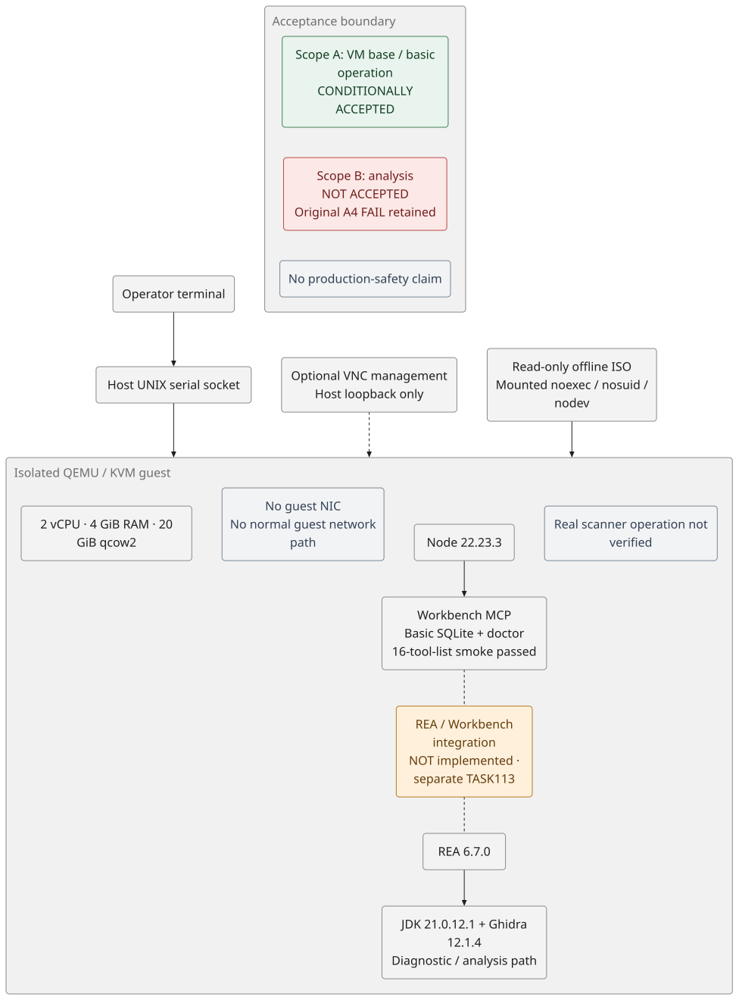

# Security analysis VM / 専用セキュリティ解析VM

**更新日: 2026-10-20（JST）**  
**状態: スコープAは条件付きオーナー受入れ。スコープBは未受入れ。文書の意味・構成・受入れ範囲に限定したMiMoレビューを実施済み。**

専用の QEMU/KVM ゲストに解析用資材をオフラインで配置し、VM基盤・基本操作と一部ツールの限定試験を実施しました。以前の「計画・未実施」から進んでいますが、解析環境全体の完成や本番利用可能を意味しません。

- **スコープA（条件付き受入れ）**: VM基盤、コンソール操作、資材搬入、限定的な基本動作。2026-10-20（JST）のオーナー判断によるものです。
- **スコープB（未受入れ）**: REA → Ghidra の解析能力の受入れ。解析コマンドが結果を返したことと、受入れ試験への合格は分けて扱います。
- **元の評価を保持**: A4 の `FAIL` と評価レポートの `REPORT=UNVERIFIED` は変更しません。後続の補足確認やスコープAの受入れは、この判定を上書きしません。

## 1. 現在の構成

構成図は [Pele](https://pele.run/) で生成しています。[編集用ソースと再生成方法](assets/security-analysis-vm/README.md)。破線のWorkbench ↔ REAは将来の統合であり、現状の接続ではありません。

### VMとアクセス境界

| 項目 | 現在の構成・確認範囲 |
|---|---|
| 仮想化 | QEMU/KVM。ホスト上の既存サービスとは別のゲストで実行 |
| 資源 | 2 vCPU / 4 GiB RAM / 20 GiB 仮想容量の qcow2 |
| ゲストネットワーク | 仮想NICなし。通常のゲスト外向き通信経路を設けない |
| 管理コンソール | ホストのループバックに限定した VNC、UNIXソケットのシリアルコンソール |
| ゲスト操作 | 通常の非rootログインを使用 |
| 資材搬入 | 読み取り専用ISO。ゲスト側は `noexec,nosuid,nodev` でマウント |
| 解析入力 | 自作の無害な小型ELFを試験用に搬入。入力ファイルを実行せず解析 |

ISOの `noexec` は、そのマウント上の直接実行を制限する設定であり、解析ソフトの安全性や、コピーしたファイルの不実行を保証するものではありません。仮想NICを作らない構成も完全隔離の保証ではなく、QEMU・ホストカーネルを信頼境界とし、コンソール・資材搬入経路を別途管理します。

CPU・メモリ・I/Oはホストと共有します。20 GiBはゲストの仮想容量であり、qcow2メタデータ等を含むホスト実消費量の厳密な上限ではありません。既存サービスへの無影響や、ハイパーバイザ境界を越える脆弱性への完全な防御は保証しません。

### 解析ツールの位置づけ

- **[OSS Vulnerability Workbench MCP](https://github.com/moruku36/oss-vulnerability-workbench-mcp)**: 依存関係・静的解析等を扱う独立したMCPサーバー。今回確認したのは基本操作と限定的なMCP通信です。
- **[REA（Reverse Engineer Anything）](https://github.com/morluto/rea)**: バイナリ等の解析支援ツール。今回、Ghidraを利用する限定的なELF解析試験を実施しましたが、受入れには至っていません。
- **Ghidra / Java**: REA側の解析に使用する資材としてオフライン配置。

**Workbench と REA は別個のMCPサーバーです。一方が他方を内包する構成ではなく、相互連携は未実施です。** REA → Ghidra の限定試験も、Workbench ↔ REA の統合試験とは区別します。

## 2. 配置・確認したバージョン

| 資材 | 記録したバージョン・固定点 | 確認の限界 |
|---|---|---|
| Workbench | commit `be62cc164fc5` | 基本動作のみ。実スキャナーの動作保証ではない |
| Node.js | 22.23.3 | 現在の実行バージョンは確認。搬入バンドルとの由来の紐づけは未確定 |
| MCP SDK server/core | 2.3.1 | 当該環境の依存バージョン |
| zod | 4.6.5 | 当該環境の依存バージョン |
| REA | 6.7.0 | オフライン資材・固定マニフェストの確認 |
| Java | Temurin 21.0.12.1 | コンパイラのバージョン確認を含む限定確認 |
| Ghidra | 12.1.4 | オフライン資材・固定マニフェストの確認。解析の受入れは未完了 |

この表は当該検証時の記録であり、最新版の推奨や、すべての依存資材の由来・互換性を保証する一覧ではありません。

## 3. ここまで実施したこと

### Workbenchの基本動作（2026-10-19）

SQLiteとdoctorの基本確認後、時間・呼出し範囲を限定したMCPスモークテストを実施しました。

- initialize
- tools/list（16ツールを列挙）
- ping
- doctor
- 正常終了

上記の基本的な通信・終了は確認できました。16ツールの列挙は16ツールすべての実行成功を意味しません。**実スキャナーの実行、実対象の脆弱性診断、REAとの統合はこの結果に含みません。**

### REA関連の限定確認

`PASS-LIMITED` はその確認項目だけの限定的な通過であり、システム全体の受入れではありません。

| 試験 | 観測結果 | 判定と制限 |
|---|---|---|
| C1: REAバージョン | `rea --version` が約2秒で応答 | `PASS-LIMITED`。解析機能の動作保証ではない |
| C2: Javaコンパイラ | `javac -version` に応答 | `PASS-LIMITED`。Ghidra全体の検証ではない |
| C3: Ghidra doctor | レポートの `healthy=true`、`environment_healthy=false` | `PASS-LIMITED`。両方の値を保持し、全環境正常とは解釈しない |
| C4: node-pty | モジュールのロードのみ | `PASS-LIMITED`。PTY spawnは未実施 |

### A4: 無害なELFのGhidra解析

入力は自作の無害なELF（15,528 bytes）を用い、所有者のみ読み書き可能な権限で搬入し、入力自体は実行していません。

- REAのGhidra指定・JSON出力によるinspectが約15秒で終了。
- 終了コード0、標準エラー出力0 bytes。
- JSONには procedures 13件、strings 60件、segments 29件が記録された。
- **元の評価は `FAIL`、元の評価レポートは `REPORT=UNVERIFIED` のまま。**

ここでSLAは、Ghidraが使用するコンパイル済みのプロセッサ言語定義（SLEIGH）の成果物です。サービス水準合意を意味しません。`REPORT=UNVERIFIED` は元の試験評価器が出したレポートの確認状態であり、後述の文書レビューの判定ではありません。

失敗・未確認として残した理由は次のとおりです。

1. `FAIL` の理由は、GhidraのSLAファイルのmtime変化と、OS一時領域の性能データ用ディレクトリのmtime差分です。作業用一時ディレクトリのメタデータ変化は `REVIEW`、状態ディレクトリ自体のmtime変化は明示的な許容対象であり、これらを一括して失敗理由とはしません。
2. レポートの期待条件との不一致は `REVIEW` として残しています。JSON外側のproviderが `rea-workflow`、上流が `ghidra 12.1.4` と記録され、外側のproviderに直接Ghidraを期待した評価基準と一致しませんでした。結果の意味を補足しても、元の評価記録は変更しません。
3. 後続確認でSLAファイルの現在のハッシュは期待値と一致しましたが、mtime変化の原因は特定できていません。
4. Ghidraの実行プロセスについて独立した由来・実行証跡を確立していません。終了コードとJSONだけで解析能力の受入れ完了とはしません。

### 終了時の補足確認

- G1（ゲスト側の終了時確認）は `PASS`。このチェックの対象内の結果であり、解析能力の受入れではありません。
- N1（ホスト側の隔離・構成確認）は元の `REVIEW` を保持。ディスク情報の判定でネストしたJSONを正規表現で扱った問題がありました。
- 別の読み取り専用補足確認で、トップレベルのディスク情報として qcow2 / 20 GiB を確認しました。元のN1記録の上書きはしていません。

これらは限られた時点・項目の確認です。試験前後のスナップショットが一致する項目があっても、全期間・全領域で副作用がなかった証明にはなりません。

## 4. 成果と、まだ言えないこと

### 今回の成果

- 仮想NICなしのVM基盤と、コンソール・読み取り専用ISOによるオフライン作業経路を用意した。
- Workbenchの基本的なMCP通信と正常終了を確認した。
- REA・Java・Ghidra等を配置し、限定的な応答と無害ELFの解析出力を観測した。
- 技術的な試験結果とオーナーの受入れ範囲を分離し、未確認事項を残したまま記録した。

### 未完了・対象外

- REA → Ghidra の解析能力の受入れ（スコープB）。
- Workbenchの実スキャナー、実対象での脆弱性診断、Workbench ↔ REA の統合。
- PTY spawn、動的トレース、未信頼バイナリの実行。
- Node.jsの由来の紐づけ、mtime変化原因、独立したGhidra実行証跡。
- 脆弱性DB更新、外部AIへの解析データ送信、ネットワークを必要とする更新・連携経路。
- PR全差分・実行コード・依存関係・描画結果のMiMo監査。以下の限定レビューでは対象にしていません。

**この状態を「セキュリティ解析環境完成」「副作用なし」「本番利用可能」とは表現しません。**

## 5. 次の段階と運用境界

今回の文書更新は現在地の記録です。追加の実機試験、構成変更、ネットワーク追加、権限変更やサービス再起動は行いません。

1. この文書と構成図をPRとして公開し、限定した文書レビューを実施した。
2. 指摘を公開文書と照合し、用語と判定範囲を明確化した。元の試験評価は保持する。
3. Workbench ↔ REA の連携は、将来の別スコープ（TASK-113）として扱う。今回の条件付き受入れから自動的に着手・承認済みとはしない。

公開文書には実環境のホスト名、ユーザー名、IPアドレス、ローカルパス、プロセス識別子、秘密情報、生ログを含めません。検証内容は一般化した構成と要約のみを記載しています。

## 6. 文書レビュー記録（2026-10-20 JST）

MiMoはPR #22の初回head `77dbf6550a2a` に対応する公開文書本文とPele編集用ソースを対象に、文書の意味・構成・受入れ範囲をレビューしました。リンク先や生成SVG等を除いた独立資料によるレビューであり、PR全差分、実行コード、依存関係・lockfile、描画結果、リンク先の監査や実機試験の独立検証ではありません。

指摘を受け、G1・N1・SLA・REPORTの意味、A4のFAILとREVIEWの区分を補足しました。リンク欠片の指摘はレビュー資料でリンク先を省略したことに由来し、公開文書の元リンクを確認したうえで不要な変更はしていません。この修正文自体の追加MiMoレビューは行っていません。

文書レビューの実施・修正は、スコープBの受入れや元のA4 `FAIL`、`REPORT=UNVERIFIED`、N1 `REVIEW` の変更を意味しません。
